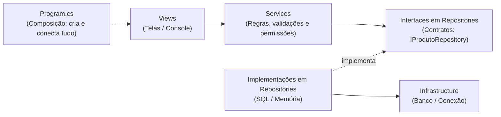

# Aula 04 — Arquitetura em Camadas, Contratos e Injeção de Dependência

**Duração:** 3h30. **Pré-requisito:** [Aula 03](03-Orientacao-a-Objetos.md). **Entrega:** consulta de produtos em memória no console em que o `Program` conecta um Serviço a duas implementações diferentes de uma Interface de Repositório — provando a troca sem alterar o serviço.

| Bloco | Minutos | Atividade |
| --- | ---: | --- |
| Retomada | 15 | Identificar onde estão entrada, regra e dados no console atual |
| Explicação | 30 | Por que separar camadas, `IReadOnlyList` e injeção manual |
| Construção | 60 | Construir contrato, repositório em memória e serviço de consulta |
| Intervalo | 15 | Pausa |
| Prática | 60 | Criar segunda implementação, trocar na composição e testar regra sem UI |
| Entrega | 30 | Demonstrar a troca real de dependência e explicar responsabilidades |

---

## 1. O Problema Real: Por Que Não Escrever Tudo Dentro do Botão da Tela?

Imagine que, quando chegarmos ao Windows Forms, você coloque a validação de preço positivo, a consulta SQL ao banco e os `MessageBox.Show` tudo misturado dentro do clique do botão `btnSalvar_Click`. Veja os **3 problemas imediatos** que isso cria:

1. **Regras duplicadas:** se outra tela (ou uma futura API web) precisar validar preço, você teria de copiar e colar os mesmos `if`s — e esquecer de atualizar um deles quando a regra mudar.
2. **Impossível testar sem banco e sem clicar na tela:** para testar se o sistema recusa preço `0`, você seria obrigado a abrir o programa, fazer login, ter internet e clicar no botão toda vez.
3. **Acoplamento forte:** mudar um detalhe de SQL obriga a mexer no código da janela visual, aumentando o risco de quebrar a interface.

### A Solução do Nosso Projeto: Separação Lógica em 5 Pastas

Usaremos **um único projeto** organizado em 5 pastas por responsabilidade (sem a complexidade prematura de múltiplos projetos, contêineres automáticos ou ORMs):



| Pasta | Responsabilidade Única | O que **NUNCA** pode ficar aqui | Exemplos no MarketFlow |
| --- | --- | --- | --- |
| **Models** | Representar dados e conceitos do domínio | SQL, `MessageBox`, acesso à rede | `Produto`, `Sessao`, `ItemCarrinho` |
| **Services** | Regras de negócio, validações e autorização | SQL direto, controles visuais (`TextBox`, `MessageBox`) | `ProdutoService`, `VendaService` |
| **Repositories** | Contratos (`I...`) e acesso aos dados (SQL ou Memória) | `MessageBox`, decisões de tela | `IProdutoRepository`, `ProdutoRepository` |
| **Infrastructure** | Configuração técnica de ambiente e conexão | Regras de desconto ou cadastro | `Banco` |
| **Views** | Ler controles da tela, chamar o Serviço e exibir resultado/erro | Comandos SQL, regras de negócio duplicadas | `FormLogin`, `FormProdutos`, `FormCaixa` |

> [!NOTE]
> **Importante:** pastas no Visual Studio 2022 ajudam a organizar o código, mas **não impedem** que alguém escreva SQL dentro de uma `View`. Respeitar a direção das setas do diagrama acima é disciplina de arquitetura da equipe!

---

## 2. Entendendo `IReadOnlyList<T>` e a Injeção de Dependência Manual

### Por que o contrato retorna `IReadOnlyList<Produto>` em vez de `List<Produto>`?
- Se um repositório devolvesse `List<Produto>`, qualquer tela que chamasse `Listar()` poderia chamar `.Add(...)` ou `.Clear()` diretamente na lista retornada, burlando validações!
- **`IReadOnlyList<Produto>`** é uma interface do .NET que permite **percorrer com `foreach`**, consultar `.Count` e ler posições `[0]`, mas **não oferece `.Add()`, `.Remove()` nem `.Clear()`**.
- **Limite importante dessa proteção:** `IReadOnlyList` impede alterar a *coleção* (adicionar/remover itens), mas não torna imutáveis os objetos dentro dela se eles tiverem `set` público.

### Por que Injeção de Dependência Manual pelo Construtor?
Observe um modelo genérico de **serviço de busca de livros** recebendo um contrato `ICatalogoLivros`:

```csharp
public class BuscaLivrosService
{
    private readonly ICatalogoLivros catalogo;

    public BuscaLivrosService(ICatalogoLivros catalogo)
    {
        this.catalogo = catalogo;
    }

    public IReadOnlyList<Livro> BuscarTodos() => catalogo.ObterTodos();
}
```

- O serviço **não** escreve `new CatalogoEmMemoria()` nem `new CatalogoPostgres()` dentro dele.
- Ele apenas declara no construtor: *"me entregue qualquer objeto que cumpra o contrato `ICatalogoLivros`"*.
- Quem decide qual implementação concreta usar é o **`Program.cs`** (ponto de composição). Isso é **Injeção de Dependência Manual** — você entende o mecanismo inteiro sem precisar de nenhuma biblioteca mágica!

---

## 3. Limites Honestos da Nossa Arquitetura (Importante!)

Antes de construir, compreenda duas realidades do mercado de software:
1. **Trocar de banco de dados não é "mágico":** usar interfaces de repositório isola o SQL e reduz o impacto de uma mudança, mas migrar PostgreSQL para MySQL ainda exige adaptar tipos SQL, transações, bloqueios e comandos específicos (como mostra o [guia XAMPP](INTEGRACAO-MYSQL-XAMPP.md)).
2. **Fronteira de segurança em aplicativos desktop:** neste curso didático, o aplicativo Windows Forms conectará diretamente ao banco de dados para que possamos focar em C#, POO e SQL sem construir um servidor web ao mesmo tempo. Em um sistema comercial distribuído a clientes, **as credenciais do banco e as regras de autorização devem ficar em uma API no servidor**, pois alguém com acesso à máquina local poderia extrair uma credencial guardada no computador.

---

## 4. Roteiro de Construção Guiada (Sua Vez no Visual Studio 2022!)

No projeto console `TreinoSupermercado` (mantendo a classe `Produto.cs` com `Nome` e `Preco`), construa passo a passo os arquivos abaixo usando **Adicionar → Classe / Interface** (`Shift+Alt+C`) no **Visual Studio 2022**:

### Passo 1 — Construir o Contrato `IConsultaProdutos.cs` (`A04.02`)
1. Crie o arquivo **`IConsultaProdutos.cs`**.
2. Declare `public interface IConsultaProdutos` contendo um único método:
   - Nome: `Listar`
   - Parâmetros: nenhum `()`
   - Retorno: `IReadOnlyList<Produto>`

### Passo 2 — Construir o Primeiro Repositório em Memória: `ProdutosEmMemoria.cs`
1. Crie o arquivo **`ProdutosEmMemoria.cs`** declarando `public class ProdutosEmMemoria : IConsultaProdutos`.
2. Implemente o método `public IReadOnlyList<Produto> Listar()` retornando uma `new List<Produto>` com dois produtos fictícios: `"Arroz"` (`25.90m`) e `"Feijão"` (`8.50m`).
3. *(Opcional)* Lembre-se que esse repositório funciona 100% offline, sem internet e sem banco de dados!

### Passo 3 — Construir o Serviço: `ConsultaProdutosService.cs` (`A04.03` e `A04.04`)
1. Crie o arquivo **`ConsultaProdutosService.cs`** declarando `public class ConsultaProdutosService`.
2. Declare um campo privado somente leitura: `private readonly IConsultaProdutos produtos;`.
3. Crie o construtor público `ConsultaProdutosService(IConsultaProdutos produtos)` guardando o parâmetro no campo com `this.produtos = produtos;`.
4. Crie o método `public IReadOnlyList<Produto> Executar()` que chama `produtos.Listar()` e devolve o resultado.
5. Crie o método `public void ValidarPreco(decimal preco)`:
   - Se `preco <= 0`, lance `ArgumentException` com a mensagem `"Preço deve ser positivo."`.
   - *(Por que `ValidarPreco` está separado de `Executar` hoje? Para você exercitar uma regra de negócio isolada no serviço sem nenhuma tela gráfica. A partir da Aula 11, a validação ficará integrada dentro de `SalvarAsync`.)*

### Passo 4 — Construir a Segunda Implementação: `ProdutosPromocionais.cs` (`A04.03`)
1. Crie o arquivo **`ProdutosPromocionais.cs`** também assinando o mesmo contrato (`: IConsultaProdutos`).
2. Implemente `Listar()` retornando uma lista diferente — por exemplo, apenas `"Café"` por `12.90m`.

### Passo 5 — Conectar Tudo no `Program.cs` e Comprovar os 4 Critérios
No `Program.cs` (mantendo apenas instruções de execução):
1. Instancie `IConsultaProdutos repositorio = new ProdutosEmMemoria();`.
2. Crie `var servico = new ConsultaProdutosService(repositorio);` (injeção manual!).
3. Percorra `servico.Executar()` com `foreach` e exiba cada produto e preço formatado com `:C`.
4. **Teste de proteção do contrato (`A04.02`):** tente chamar temporariamente `servico.Executar().Add(new Produto());`, observe o erro do compilador (`CS1061`, pois `IReadOnlyList` não possui `Add`) e apague a linha.
5. **Teste de regra independente de tela (`A04.04`):** chame `servico.ValidarPreco` com `25.90m`, `0m` e `-1m` usando `try / catch (ArgumentException erro)` para exibir a recusa sem travar o console.
6. **Prova real da troca de dependência (`A04.03`):** no `Program.cs`, troque **apenas** `new ProdutosEmMemoria()` por `new ProdutosPromocionais()` e execute com `Ctrl+F5`.
   - **Observe:** a saída muda para `"Café"` sem que você tenha tocado em **uma única linha** de `ConsultaProdutosService.cs`! (Simplesmente alterar o preço dentro da mesma lista **não** demonstra troca de implementação.)

---

## 5. Verificação e Reflexão Antes de Encerrar

Registre no seu caderno:
- Por que um repositório (`Repositories`) **jamais** deve chamar `MessageBox.Show` ou `Console.WriteLine`?
- Quais arquivos continuarão iguais e quais precisarão mudar quando conectarmos o PostgreSQL (Neon) ou MySQL (XAMPP) nas próximas aulas?
- O que precisaria mudar para levar credenciais e autorização para uma API comercial (`A04.05`)?

[Anterior: Aula 03](03-Orientacao-a-Objetos.md) · [Próxima: Aula 05 — Ambiente e solução no VS 2022](05-Configuracao-Ambiente.md) · [Índice](README.md)

## Atividades por conceito

Realize as atividades da [aula 04 no caderno complementar](ATIVIDADES-POR-CONCEITO.md#aula-04). Cada conceito tem enunciado e critério de aceite. Reúna as evidências em uma entrega por aula, usando os IDs no [caderno de evidências](CADERNO-DE-EVIDENCIAS.md). Essas tarefas integram a prática e a verificação já previstas no encontro.
