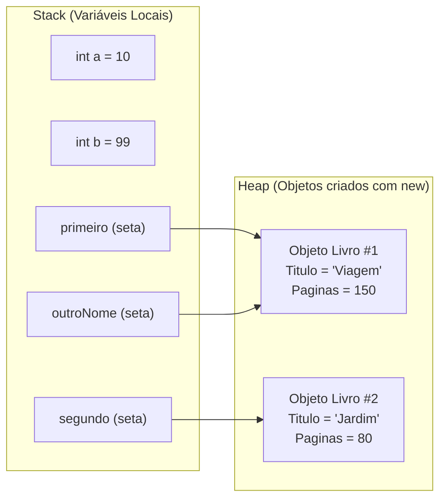

# Aula 04 — Classes, Objetos, Propriedades, Métodos e Referências na Memória

**Duração:** 3h30. **Pré-requisito:** [Aula 03](03-Metodos-Parametros-e-Escopo.md). **Entrega:** domínio completo da criação e uso de classes em C# no Visual Studio 2022 — criando arquivos `.cs` separados, propriedades, métodos de instância, objetos independentes, passagem de objetos por parâmetro, tratamento de `null` e demonstração prática/desenho de referência compartilhada na memória RAM (`A04.01`–`A04.04`).

| Bloco | Minutos | Atividade |
| --- | ---: | --- |
| Retomada | 15 | Comparar o caos das variáveis soltas com a organização em Classes |
| Explicação | 30 | Abstração, Classe vs Objeto, Propriedades, Métodos, Stack vs Heap e `null` |
| Construção | 60 | Digitar, compilar e depurar os Exemplos Completos #1, #2 e #3 no VS 2022 |
| Intervalo | 15 | Pausa |
| Prática | 60 | Executar o Exemplo #4 e construir os exercícios guiados `Produto.cs` e `Livro.cs` |
| Entrega | 30 | Demonstrar execução, mapa de memória (variáveis vs objetos) e registrar evidências |

---

## 1. O Problema Real: Por Que Classes Existem?

Até a [Aula 03](03-Metodos-Parametros-e-Escopo.md), você só usou tipos prontos do C# (`string`, `int`, `decimal`, `bool`). Imagine agora que você precisa guardar os dados de **3 produtos** de um supermercado usando apenas variáveis soltas:

```csharp
// ❌ JEITO QUE NÃO ESCALA (variáveis soltas):
string nome1 = "Arroz 5kg";
decimal preco1 = 25.90m;
int estoque1 = 10;

string nome2 = "Feijão 1kg";
decimal preco2 = 8.50m;
int estoque2 = 25;

string nome3 = "Café 500g";
decimal preco3 = 18.90m;
int estoque3 = 15;
```

Perceba os **3 problemas graves** desse código:
1. Se o mercado tiver **500 produtos**, você teria que criar `nome500`, `preco500`, `estoque500` — impossível manter!
2. Nada impede um erro bobo como multiplicar `preco1` por `estoque2` (misturando dados de produtos diferentes!).
3. Se você quiser passar um produto para um método, teria que passar 3, 5 ou 10 parâmetros soltos toda vez: `Exibir(nome1, preco1, estoque1, codigo1, ativo1)`.

### A Solução da Programação Orientada a Objetos (POO): Criar Seus Próprios Tipos!

Em C#, uma **Classe** permite que você **invente um novo tipo de dado** (como `Produto`, `Cliente`, `Livro`, `Filme`, `Aluno`) que agrupa **em um único bloco**:
- **Dados (Propriedades):** o que o objeto **tem** (`Nome`, `Preco`, `Estoque`);
- **Comportamentos (Métodos):** o que o objeto **faz** (`CalcularValorEmEstoque()`, `AplicarDesconto()`, `Descrever()`).

### Vocabulário Fundamental de POO (Sem Mistério)

Pense na analogia de uma **planta baixa de casa** (ou uma **forma de bolo**):

| Conceito | Analogia do Mundo Real | O que é no C#? |
| --- | --- | --- |
| **Abstração** | Na planta da casa, desenhamos paredes e portas, mas **não** desenhamos a cor das almofadas do sofá. | Escolher **somente os dados e ações relevantes** para o sistema. Para um supermercado, `Produto` precisa de `Codigo`, `Nome`, `Preco` e `Estoque`; não precisa de `CorDaEmbalagem` nem `NomeDoMotoristaDoCaminhao`. |
| **Classe** | A **planta baixa** no papel. Você não mora na planta; ela descreve *como* construir casas. | O código `public class Produto { ... }` escrito no arquivo `Produto.cs`. Define a estrutura do novo tipo. |
| **Objeto (Instância)** | Cada **casa construída** a partir daquela planta. Você pode construir 1, 10 ou 10.000 casas com a mesma planta! | Cada exemplar real criado na memória RAM usando o operador **`new`**: `new Produto()`. |
| **Propriedade** | Uma característica de cada casa (número de quartos, cor da parede). | Membro da classe com `{ get; set; }` que guarda e expõe um dado de cada objeto (`produto.Preco`). |
| **Estado** | Os valores atuais daquela casa específica (*"Casa 1: cor azul, 3 quartos"*). | O conjunto de valores atuais nas propriedades de um objeto em um dado instante (`Nome = "Arroz"`, `Preco = 25.90m`). |
| **Método de Instância** | Uma ação que aquela casa/objeto realiza usando seus próprios dados. | Função declarada dentro da classe (`arroz.ExibirEtiqueta()`). |

---

## 2. Como Criar Arquivos de Classe no Visual Studio 2022

Antes de rodar os exemplos abaixo, aprenda a organização correta no Visual Studio 2022:

1. Crie um novo **Aplicativo de Console** (C#, .NET moderno — **sem** `.NET Framework`) chamado **`Aula04Classes`**.
2. Para cada classe que você for criar (ex.: `Filme`, `Produto`, `Livro`, `Aluno`), **crie um arquivo `.cs` separado**:
   - No **Gerenciador de Soluções** (`Ctrl+Alt+L`), clique com o botão direito no projeto **`Aula04Classes`** → **Adicionar → Classe...** (atalho: **`Shift+Alt+C`**).
   - Digite o nome exato da classe com `.cs` (ex.: `Filme.cs`) e clique em **Adicionar**.
   - **Por que um arquivo por classe?** Facilita encontrar qualquer classe pelo nome do arquivo e evita o erro `CS8803` (que acontece quando você mistura código solto no `Program.cs` depois de declarar uma `class`).
3. *(Nota didática para as Aulas 04 a 06: se o Visual Studio gerar um bloco `namespace Aula04Classes { ... }` dentro do arquivo novo, você pode removê-lo por enquanto para manter os arquivos mais curtos — estudaremos `namespace` e `using` em profundidade na Aula 07.)*

---

## 3. Exemplo Prático Completo #1 — Anatomia Completa de uma Classe (`Filme.cs`)

Vamos começar com um exemplo **100% compilável** que você pode digitar e rodar agora mesmo no Visual Studio 2022. Ele mostra **propriedades de vários tipos**, **valores padrão**, **duas formas de preencher um objeto** e **quatro tipos diferentes de métodos dentro de uma classe**.

### Arquivo 1: `Filme.cs`

```csharp
public class Filme
{
    // PROPRIEDADES (os dados que CADA objeto Filme vai guardar):
    public string Titulo { get; set; } = "";
    public string Genero { get; set; } = "";
    public int DuracaoMinutos { get; set; }
    public decimal PrecoIngresso { get; set; }
    public bool JaAssistido { get; set; }

    // MÉTODO 1 — Sem parâmetros, devolve um texto usando as próprias propriedades:
    public string Descrever()
    {
        string status = JaAssistido ? "Assistido" : "Na lista";
        return $"{Titulo} ({Genero}) - {DuracaoMinutos} min | Ingresso: {PrecoIngresso:C} | [{status}]";
    }

    // MÉTODO 2 — Devolve um bool (uma pergunta sobre o próprio objeto):
    public bool EhFilmeLongo()
    {
        return DuracaoMinutos >= 120;
    }

    // MÉTODO 3 — Método void que ALTERA o estado do próprio objeto:
    public void MarcarComoAssistido()
    {
        JaAssistido = true;
    }

    // MÉTODO 4 — Recebe um parâmetro externo e calcula/atualiza o preço do objeto:
    public void AplicarDesconto(decimal percentual)
    {
        if (percentual > 0 && percentual <= 50)
        {
            decimal desconto = PrecoIngresso * (percentual / 100m);
            PrecoIngresso = PrecoIngresso - desconto;
        }
    }
}
```

### Arquivo 2: `Program.cs`

```csharp
using System.Globalization;

CultureInfo.CurrentCulture = CultureInfo.GetCultureInfo("pt-BR");

// FORMA 1 — Instanciar com 'new' e preencher propriedade por propriedade:
Filme filme1 = new Filme();
filme1.Titulo = "Aventura Espacial";
filme1.Genero = "Ficção";
filme1.DuracaoMinutos = 142;
filme1.PrecoIngresso = 30.00m;
// Repare: não atribuímos JaAssistido. Todo bool nasce 'false' automaticamente!

// FORMA 2 — Inicializador de Objeto (mesmo efeito, escrita mais limpa e moderna):
Filme filme2 = new Filme
{
    Titulo = "Comédia no Escritório",
    Genero = "Comédia",
    DuracaoMinutos = 95,
    PrecoIngresso = 24.00m,
    JaAssistido = false
};

Console.WriteLine("=== ANTES DAS AÇÕES ===");
Console.WriteLine(filme1.Descrever());
Console.WriteLine(filme2.Descrever());

// Chamando métodos em CADA objeto separadamente:
filme1.MarcarComoAssistido();
filme1.AplicarDesconto(20); // 20% de desconto APENAS no filme1!

Console.WriteLine("\n=== DEPOIS DAS AÇÕES ===");
Console.WriteLine(filme1.Descrever());
Console.WriteLine(filme2.Descrever()); // filme2 continua intacto!

Console.WriteLine($"\n'{filme1.Titulo}' é longo? {filme1.EhFilmeLongo()}");
Console.WriteLine($"'{filme2.Titulo}' é longo? {filme2.EhFilmeLongo()}");
```

### Saída Esperada no Console (`Ctrl+F5`)

```text
=== ANTES DAS AÇÕES ===
Aventura Espacial (Ficção) - 142 min | Ingresso: R$ 30,00 | [Na lista]
Comédia no Escritório (Comédia) - 95 min | Ingresso: R$ 24,00 | [Na lista]

=== DEPOIS DAS AÇÕES ===
Aventura Espacial (Ficção) - 142 min | Ingresso: R$ 24,00 | [Assistido]
Comédia no Escritório (Comédia) - 95 min | Ingresso: R$ 24,00 | [Na lista]

'Aventura Espacial' é longo? True
'Comédia no Escritório' é longo? False
```

### Dissecando Cada Detalhe do Código Acima (O Quê e Por Quê)

| Trecho do Código | O que significa? | Por que funciona assim? |
| --- | --- | --- |
| `public class Filme` | Declara a classe visível no projeto inteiro. | Sem `public`, outros arquivos podem receber o erro `CS0122` (inacessível). |
| `{ get; set; }` | **Propriedade automática.** `get` = permite **ler** (`filme1.Titulo`); `set` = permite **gravar** (`filme1.Titulo = "..."`). | Na Aula 05 você aprenderá a travar o `set` (`private set`) para impedir valores inválidos. |
| `= "";` em `string` | Inicializa o texto com vazio em vez de `null`. | Projetos .NET modernos têm `<Nullable>enable</Nullable>`. Deixar `string` sem `= ""` gera o aviso amarelo `CS8618`. |
| Valores padrão automáticos | Quando você faz `new Filme()` sem preencher tudo: `int` nasce `0`, `decimal` nasce `0m`, `bool` nasce `false`, `string` sem `= ""` nasce `null`. | Saber os valores iniciais evita surpresas ao esquecer de preencher um campo! |
| `new Filme()` vs `new Filme { ... }` | Ambas criam o objeto na RAM; a segunda já preenche as propriedades entre `{ }` na mesma instrução. | O inicializador de objeto é muito usado em C# profissional e no Windows Forms (`new Button { Text = "Salvar" }`). |
| `filme1.AplicarDesconto(20);` | Chama o método **sobre o objeto `filme1`**. | Dentro de `AplicarDesconto`, `PrecoIngresso` refere-se automaticamente ao `PrecoIngresso` do **`filme1`**, nunca ao do `filme2`! |

---

## 4. Exemplo Prático Completo #2 — Objetos Independentes + Passar e Retornar Objetos em Métodos (`Produto.cs`)

Agora vamos aplicar classes ao domínio do **supermercado**. Além de criar vários objetos `Produto`, observe como **métodos podem receber um objeto `Produto` como parâmetro** e **retornar um objeto `Produto` pronto**!

### Arquivo 1: `Produto.cs`

```csharp
public class Produto
{
    public string Codigo { get; set; } = "";
    public string Nome { get; set; } = "";
    public decimal Preco { get; set; }
    public int Estoque { get; set; }
    public bool Ativo { get; set; } = true; // Todo produto nasce ativo por padrão

    // Calcula quanto dinheiro está parado no estoque deste produto:
    public decimal CalcularValorEmEstoque()
    {
        return Preco * Estoque;
    }

    // Reajusta o preço por porcentagem (ex.: 10 aumenta 10%; -5 reduz 5%):
    public void ReajustarPreco(decimal percentual)
    {
        Preco = Preco * (1 + percentual / 100m);
    }

    // Devolve uma etiqueta formatada pronta para exibição:
    public string Resumo()
    {
        string situacao = Ativo ? "Ativo" : "Inativo";
        return $"[{Codigo}] {Nome} | Preço: {Preco:C} | Estoque: {Estoque} un. | Total estoque: {CalcularValorEmEstoque():C} ({situacao})";
    }
}
```

### Arquivo 2: `Program.cs`

```csharp
using System.Globalization;

CultureInfo.CurrentCulture = CultureInfo.GetCultureInfo("pt-BR");

// 1. Criando dois objetos COMPLETAMENTE INDEPENDENTES (duas chamadas a 'new'):
Produto arroz = new Produto
{
    Codigo = "000123",
    Nome = "Arroz Branco 5kg",
    Preco = 25.90m,
    Estoque = 10
};

Produto feijao = CriarProduto("000456", "Feijão Carioca 1kg", 8.50m, 20);

Console.WriteLine("=== CATÁLOGO INICIAL ===");
ImprimirEtiqueta(arroz);
ImprimirEtiqueta(feijao);

// 2. Alterando APENAS o feijão e provando que o arroz NÃO muda:
feijao.Preco = 9.00m;
arroz.ReajustarPreco(10); // +10% apenas no arroz (25,90 -> 28,49)

Console.WriteLine("\n=== APÓS ALTERAÇÕES INDEPENDENTES ===");
ImprimirEtiqueta(arroz);
ImprimirEtiqueta(feijao);

// --- FUNÇÕES AUXILIARES QUE RECEBEM E RETORNAM OBJETOS ---

// Função que RETORNAM um novo objeto Produto pronto:
Produto CriarProduto(string codigo, string nome, decimal preco, int estoque)
{
    return new Produto
    {
        Codigo = codigo,
        Nome = nome,
        Preco = preco,
        Estoque = estoque
    };
}

// Função que RECEBE um objeto inteiro (1 único parâmetro em vez de 5 variáveis soltas!):
void ImprimirEtiqueta(Produto item)
{
    Console.WriteLine(item.Resumo());
}
```

### Saída Esperada no Console (`Ctrl+F5`)

```text
=== CATÁLOGO INICIAL ===
[000123] Arroz Branco 5kg | Preço: R$ 25,90 | Estoque: 10 un. | Total estoque: R$ 259,00 (Ativo)
[000456] Feijão Carioca 1kg | Preço: R$ 8,50 | Estoque: 20 un. | Total estoque: R$ 170,00 (Ativo)

=== APÓS ALTERAÇÕES INDEPENDENTES ===
[000123] Arroz Branco 5kg | Preço: R$ 28,49 | Estoque: 10 un. | Total estoque: R$ 284,90 (Ativo)
[000456] Feijão Carioca 1kg | Preço: R$ 9,00 | Estoque: 20 un. | Total estoque: R$ 180,00 (Ativo)
```

> [!TIP]
> **Veja o ganho imediato de clareza:** em vez de chamar `ImprimirEtiqueta(codigo1, nome1, preco1, estoque1, ativo1)`, chamamos simplesmente `ImprimirEtiqueta(arroz)`. A classe empacotou os 5 dados e os 3 cálculos em um único conceito!

---

## 5. O Conceito Que Mais Derruba Iniciantes: Stack vs Heap, Valor vs Referência e `null`

Na [Aula 03](03-Metodos-Parametros-e-Escopo.md), você viu que copiar um `int` gera uma cópia independente. **Com classes, NÃO funciona assim!** Entender o que acontece na memória RAM vai livrar você de 90% dos bugs misteriosos de POO.

### Como o .NET Organiza a Memória RAM

Existem duas regiões principais na memória enquanto seu programa roda:
1. **Stack (Pilha):** rápida e pequena. Guarda variáveis locais de **Tipos de Valor** (`int`, `decimal`, `bool`, `char`) com o **próprio número dentro**, e guarda apenas o **endereço (uma seta)** para objetos de classes.
2. **Heap (Monte):** região maior onde vivem os **objetos reais** criados com **`new`**.



### Exemplo Prático Completo #3 — Testando Valor, Referência Compartilhada, Método e `null`

Crie `Livro.cs` e execute este `Program.cs` completo para **ver com os próprios olhos** os 4 experimentos fundamentais de memória:

#### Arquivo 1: `Livro.cs`

```csharp
public class Livro
{
    public string Titulo { get; set; } = "";
    public int Paginas { get; set; }

    public string Descrever() => $"{Titulo} ({Paginas} páginas)";
}
```

#### Arquivo 2: `Program.cs`

```csharp
// EXPERIMENTO A — TIPO DE VALOR (int): copia o VALOR!
Console.WriteLine("=== A. TIPO DE VALOR (int) ===");
int numeroA = 10;
int numeroB = numeroA; // Cria uma CÓPIA independente do número 10
numeroB = 99;          // Altera SOMENTE numeroB
Console.WriteLine($"numeroA = {numeroA} | numeroB = {numeroB}");

// EXPERIMENTO B — TIPO DE REFERÊNCIA (class): copia a SETA (endereço)!
Console.WriteLine("\n=== B. REFERÊNCIA COMPARTILHADA (class) ===");
Livro primeiro = new Livro { Titulo = "Viagem", Paginas = 120 }; // Cria Objeto #1 no Heap
Livro segundo = new Livro { Titulo = "Jardim", Paginas = 80 };   // Cria Objeto #2 no Heap

Livro outroNome = primeiro; // NÃO TEM 'new'! outroNome aponta para o MESMO Objeto #1!
outroNome.Paginas = 150;    // Muda o Objeto #1 no Heap

Console.WriteLine($"primeiro : {primeiro.Descrever()}");   // 150!
Console.WriteLine($"outroNome: {outroNome.Descrever()}");  // 150!
Console.WriteLine($"segundo  : {segundo.Descrever()}");    // 80 (Objeto #2 não foi tocado)

// EXPERIMENTO C — PASSANDO UM OBJETO PARA UM MÉTODO:
Console.WriteLine("\n=== C. MÉTODO ALTERANDO UM OBJETO ===");
AdicionarCapituloExtra(segundo, 30); // Passa a SETA do Objeto #2!
Console.WriteLine($"segundo após método: {segundo.Descrever()}"); // Virou 110!

// EXPERIMENTO D — O QUE É 'null' (seta que aponta para LUGAR NENHUM)?
Console.WriteLine("\n=== D. REFERÊNCIA NULA (null) ===");
Livro? livroEmBusca = null; // '?' indica que esta variável PODE estar vazia (sem objeto no Heap)

// ❌ Se fizéssemos livroEmBusca.Descrever() aqui, o programa quebraria com NullReferenceException!
// ✅ Sempre verifique antes de usar uma referência anulável:
if (livroEmBusca is null)
{
    Console.WriteLine("Nenhum livro encontrado (referência é null).");
}
else
{
    Console.WriteLine(livroEmBusca.Descrever());
}

void AdicionarCapituloExtra(Livro alvo, int paginasExtras)
{
    // 'alvo' recebeu uma cópia da SETA para o mesmo objeto no Heap!
    alvo.Paginas += paginasExtras;
}
```

#### Saída Esperada no Console (`Ctrl+F5`)

```text
=== A. TIPO DE VALOR (int) ===
numeroA = 10 | numeroB = 99

=== B. REFERÊNCIA COMPARTILHADA (class) ===
primeiro : Viagem (150 páginas)
outroNome: Viagem (150 páginas)
segundo  : Jardim (80 páginas)

=== C. MÉTODO ALTERANDO UM OBJETO ===
segundo após método: Jardim (110 páginas)

=== D. REFERÊNCIA NULA (null) ===
Nenhum livro encontrado (referência é null).
```

> [!IMPORTANT]
> **Guarde esta regra para o resto da sua carreira em C#:**
> - **Quantas vezes apareceu `new Livro` no Experimento B?** Apenas **2 vezes** → existem **2 objetos** na memória RAM.
> - **Quantas variáveis do tipo `Livro` foram declaradas?** **3 variáveis** (`primeiro`, `segundo`, `outroNome`).
> - Logo, `primeiro` e `outroNome` são apenas **dois apelidos apontando para o mesmo objeto**! E se você quiser uma cópia *independente* de um objeto? Precisa dar `new Livro { Titulo = primeiro.Titulo, Paginas = primeiro.Paginas }`.

---

## 6. Exemplo Prático Completo #4 — Juntando Tudo (Entrada do Teclado + Classe + Métodos)

Para fechar o entendimento antes dos seus exercícios, veja um **mini-sistema real de boletim escolar** combinando leitura validada da [Aula 02](02-Entrada-Decisoes-Lacos-e-Depuracao.md), funções da [Aula 03](03-Metodos-Parametros-e-Escopo.md) e uma **Classe completa** (`Aluno.cs`). Digite e teste com valores diferentes!

### Arquivo 1: `Aluno.cs`

```csharp
public class Aluno
{
    public string Nome { get; set; } = "";
    public decimal Nota1 { get; set; }
    public decimal Nota2 { get; set; }

    public decimal CalcularMedia()
    {
        return (Nota1 + Nota2) / 2m;
    }

    public string ObterSituacao()
    {
        decimal media = CalcularMedia();
        if (media >= 7.0m) return "Aprovado";
        if (media >= 5.0m) return "Recuperação";
        return "Reprovado";
    }

    public void ExibirBoletim()
    {
        Console.WriteLine($"Aluno: {Nome} | N1: {Nota1:F1} | N2: {Nota2:F1} | Média: {CalcularMedia():F1} | Situação: {ObterSituacao()}");
    }
}
```

### Arquivo 2: `Program.cs`

```csharp
using System.Globalization;

CultureInfo.CurrentCulture = CultureInfo.GetCultureInfo("pt-BR");

Aluno aluno1 = LerAluno(1);
Aluno aluno2 = LerAluno(2);

Console.WriteLine("\n=== BOLETIM FINAL ===");
aluno1.ExibirBoletim();
aluno2.ExibirBoletim();

Aluno LerAluno(int numero)
{
    Console.WriteLine($"\n--- Dados do Aluno {numero} ---");
    Console.Write("Nome: ");
    string nome = Console.ReadLine() ?? "";

    decimal n1 = LerNota("Nota 1 (0 a 10): ");
    decimal n2 = LerNota("Nota 2 (0 a 10): ");

    return new Aluno
    {
        Nome = nome,
        Nota1 = n1,
        Nota2 = n2
    };
}

decimal LerNota(string mensagem)
{
    decimal nota;
    string? entrada;
    do
    {
        Console.Write(mensagem);
        entrada = Console.ReadLine();
        if (entrada is null) return 0m;
    } while (!decimal.TryParse(entrada, out nota) || nota < 0m || nota > 10m);
    return nota;
}
```

**Olhe para o `Program.cs` acima:** ele não sabe *como* se calcula média nem qual é a nota de corte de aprovação! Toda essa responsabilidade ficou encapsulada dentro da classe `Aluno`. Se amanhã a escola mudar a nota de aprovação de `7,0` para `6,0`, você altera **um único lugar** (`Aluno.cs`) e o programa inteiro se atualiza!

---

## 7. Roteiro de Construção e Exercícios no Visual Studio 2022 (`A04.01`–`A04.04`)

Agora que você digitou, compilou e entendeu os 4 exemplos completos acima, organize sua entrega da aula no projeto **`Aula04Classes`** cumprindo cada item abaixo:

1. **Abstração no caderno (`A04.01`):**
   - Escolha **4 propriedades úteis** para representar um produto no supermercado (ex.: `Codigo`, `Nome`, `Preco`, `Estoque`) e **2 características reais descartadas** (ex.: `CorDoRotulo`, `AlturaDaPrateleira`), justificando por que cada uma entrou ou ficou de fora.
2. **Classe `Produto.cs` e independência de instâncias (`A04.02`):**
   - Com sua classe `Produto.cs` (propriedades `Nome = ""`, `Preco`, e método `Resumo()`), instancie `arroz` (`"Arroz"`, `25.90m`) e `feijao` (`"Feijão"`, `8.50m`) no `Program.cs`.
   - Altere **apenas** `feijao.Preco = 9.00m` e comprove no console que `arroz.Preco` permaneceu `R$ 25,90`, com **zero avisos** `CS8618` na Lista de Erros.
3. **Experimento de referência compartilhada com `Livro.cs` (`A04.03` e `A04.04`):**
   - Com sua classe `Livro.cs` (`Titulo = ""`, `Paginas`, `Descrever()`), crie `primeiro` (`"Viagem"`, `120`), `segundo` (`"Jardim"`, `80`) e `Livro outroNome = primeiro;` (sem `new`).
   - Altere `outroNome.Paginas = 150;` e comprove a saída **`150`**, **`150`** e **`80`**.
   - Coloque um **Breakpoint (`F9`)** na linha `outroNome.Paginas = 150;`, execute com **`F5`**, abra a janela **Locais** e pressione **`F10`** observando que **`primeiro.Paginas` muda no exato instante em que `outroNome.Paginas` é alterado!**
   - Desenhe no caderno o mapa de memória identificando **3 variáveis de referência** e **2 objetos no Heap**, apontando no seu código: uma classe, uma propriedade, uma instanciação (`new`), um método e o estado de um objeto.
4. **Desafio extra de fixação (prática autônoma):**
   - Crie uma classe **`Cliente.cs`** em arquivo separado com `Nome`, `Cpf`, `PontosFidelidade` (`int`), método `AdicionarPontos(int pontos)` e método `Resumo()`. Instancie dois clientes no `Program.cs`, adicione pontos em apenas um deles e exiba os dois resumos.

---

## 8. Erros Comuns de Iniciantes com Classes (❌ Errado vs ✅ Certo)

| Erro / Sintoma | ❌ Código que quebra | ✅ Como corrigir |
| --- | --- | --- |
| **`CS8618`** (aviso de nulabilidade) | `public string Nome { get; set; }` | `public string Nome { get; set; } = "";` (ou inicializar no construtor na Aula 05). |
| **`CS8803`** (ordem no `Program.cs`) | Declarar `class Produto { }` no meio do `Program.cs` acima de `Console.WriteLine(...)`. | Crie um arquivo separado **`Produto.cs`** (`Shift+Alt+C`). |
| **`CS0122`** (inacessível) | `class Produto { string Nome { get; set; } = ""; }` (sem `public`, o padrão de membros é `private`!). | Coloque **`public`** na classe, nas propriedades e nos métodos que serão usados fora dela. |
| **`CS0120`** (faltou instanciar objeto) | `Produto.Nome = "Arroz";` (tentou usar o nome da *classe* como se fosse um objeto!). | Crie o objeto com `new`: `var p = new Produto(); p.Nome = "Arroz";`. |
| **`NullReferenceException`** | `Livro? x = null; Console.WriteLine(x.Titulo);` | Crie o objeto com `new Livro()` ou verifique `if (x is not null)` antes de usar `.`. |
| **Achar que `b = a` cria cópia** | `Produto copia = arroz; copia.Preco = 1m;` (alterou o `arroz` original sem querer!). | Crie uma nova instância com `new Produto { Nome = arroz.Nome, Preco = 1m }`. |

> [!NOTE]
> **O que ainda falta proteger nas nossas classes?** Repare que hoje nada impede alguém de escrever `arroz.Preco = -50m;` ou `new Produto()` sem nome! Na próxima aula (**Aula 05**), aprenderemos **Construtores, Encapsulamento (`private set`) e Exceções (`throw` / `try-catch`)** para blindar seus objetos contra dados inválidos.

[Anterior: Aula 03](03-Metodos-Parametros-e-Escopo.md) · [Próxima: Aula 05 — Construtores, encapsulamento e exceções](05-Construtores-Encapsulamento-e-Excecoes.md) · [Índice](README.md)

## Atividades por conceito

Realize as atividades da [aula 04 no caderno complementar](ATIVIDADES-POR-CONCEITO.md#aula-04). Cada conceito tem enunciado e critério de aceite. Reúna as evidências em uma entrega por aula, usando os IDs no [caderno de evidências](CADERNO-DE-EVIDENCIAS.md). Essas tarefas integram a prática e a verificação já previstas no encontro.
