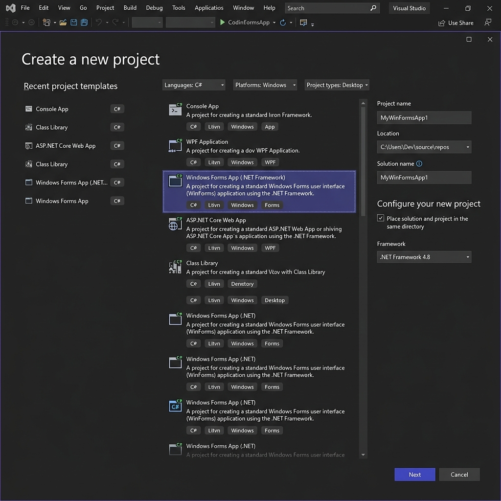
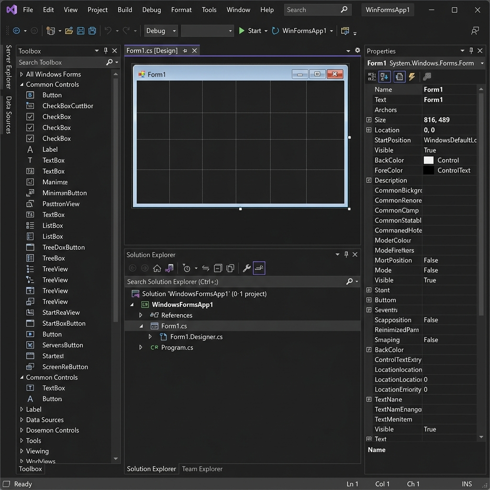

# Aula 05 — Ambiente e solução no Visual Studio 2026

**Duração:** 3h30. **Pré-requisito:** aula 04 e laboratório preparado pelo professor para as práticas de console anteriores. **Entrega:** solução Windows Forms compilando, com pastas e janela inicial.

| Bloco | Minutos | Atividade |
| --- | ---: | --- |
| Retomada | 15 | Conferir console e diferenças de uma aplicação desktop |
| Explicação | 30 | IDE, SDK, runtime, solução e projeto |
| Construção | 60 | Conferir instalação e criar o projeto |
| Intervalo | 15 | Pausa |
| Prática | 60 | Organizar pastas, propriedades e depuração |
| Entrega | 30 | Compilar, executar e registrar ambiente |

## 1. Confira o ambiente

1. Abra **Visual Studio Installer** pelo menu Iniciar do Windows. Localize **Visual Studio 2026 Community** e selecione **Modificar**. Para uma instalação nova, use o instalador específico do VS 2026; o botão principal do site pode oferecer outra edição. O professor deve preparar o instalador antes da aula.
2. Marque **Desenvolvimento para desktop com .NET**. Na lista de componentes individuais, confira o SDK e as ferramentas de direcionamento do .NET 10.
3. Conclua a instalação e abra o VS 2026. Em **Ajuda → Sobre**, confira a versão. Prefira VS 2026 18.11 atualizado com SDK 10.0.4xx.
4. No terminal do Visual Studio, execute `dotnet --list-sdks`. Deve aparecer uma versão `10.0.xxx`.

**Por quê?** A IDE edita e depura, o SDK compila, e o runtime executa. Instalar apenas o runtime não permite criar o projeto. A versão do SDK também precisa ser compatível com a IDE; veja as [referências](REFERENCIAS.md).

Esta edição usa .NET 10 LTS com SDK 10.0.404 e VS 2026 18.11, combinação indicada na [página oficial de download](https://dotnet.microsoft.com/en-us/download/dotnet/10.0). O .NET 8 da edição anterior encerrou suporte em 10/11/2026. O professor deve preparar o novo ambiente antes da turma e manter seus patches atualizados.

## 2. Crie a solução

1. Clique em **Criar um novo projeto**.
2. Pesquise **Windows Forms** e filtre por **C#**.
3. Escolha **Aplicativo do Windows Forms**, sem o sufixo **.NET Framework**.
4. Use o nome de projeto `SupermercadoApp` e de solução `Supermercado`.
5. Selecione **.NET 10.0** e clique em **Criar**.
6. Pressione **Ctrl+Shift+B**. Na janela **Saída**, confirme que a compilação foi concluída.
7. Pressione **F5**, confira a janela e feche-a para voltar ao editor.

As imagens são ilustrativas: a posição dos itens pode mudar. Use o nome do modelo e a versão do framework como critérios.

## 3. Conheça o projeto

- **Gerenciador de Soluções:** arquivos e dependências. Se estiver oculto, use **Exibir → Gerenciador de Soluções**.
- **Caixa de Ferramentas:** controles para arrastar ao Designer.
- **Propriedades (F4):** aparência, nome e eventos do controle selecionado.
- `Program.cs`: ponto de entrada; `ApplicationConfiguration.Initialize()` prepara padrões da interface e `Application.Run(...)` inicia o formulário.
- `Form1.cs`: comportamento da tela.
- `Form1.Designer.cs`: código gerado pelo Designer. Modifique a aparência pela ferramenta visual.
- `.csproj`: configuração do projeto, incluindo `net10.0-windows` e `UseWindowsForms`.

## 4. Organize e depure

1. Pelo botão direito do projeto, use **Adicionar → Nova Pasta** para criar `Models`, `Services`, `Repositories`, `Infrastructure` e `Views`.
2. Mova `Form1.cs` para `Views` e renomeie para `FormLogin.cs`. Aceite a atualização de referências oferecida pelo VS.
3. Confira o namespace de **ambas** as partes do formulário (`.cs` e `.Designer.cs`): use `SupermercadoApp.Views`. Mover o arquivo nem sempre atualiza o namespace.
4. Em `Program.cs`, adicione `using SupermercadoApp.Views;` e confira `Application.Run(new FormLogin());`.
5. Compile novamente. Coloque um breakpoint no construtor, execute F5 e depois F10 para avançar uma instrução.
6. Com o aplicativo fechado, copie o projeto para uma pasta de entrega, excluindo `bin`, `obj` e `.vs`. Se usar Git, adote o `.gitignore` da raiz deste repositório.

**Por quê?** Organizar cedo evita renomear dezenas de arquivos depois. Compilar após cada pequena mudança ajuda a identificar qual alteração causou o erro.

## Verifique antes de encerrar

- F5 abre `FormLogin` e fechar a janela encerra o aplicativo.
- O projeto usa .NET 10, não .NET Framework.
- Você sabe explicar a diferença entre `FormLogin.cs` e `FormLogin.Designer.cs`.
- O caderno registra IDE, SDK e uma compilação bem-sucedida.

[Anterior: aula 04](04-Arquitetura-e-Padroes.md) · [Próxima: aula 06](06-Criando-Interface-Login.md)

## Atividades por conceito

Realize as atividades da [aula 05 no caderno complementar](ATIVIDADES-POR-CONCEITO.md#aula-05). Cada conceito tem enunciado e critério de aceite. Reúna as evidências em uma entrega por aula, usando os IDs no [caderno de evidências](CADERNO-DE-EVIDENCIAS.md). Essas tarefas integram a prática e a verificação já previstas no encontro.
