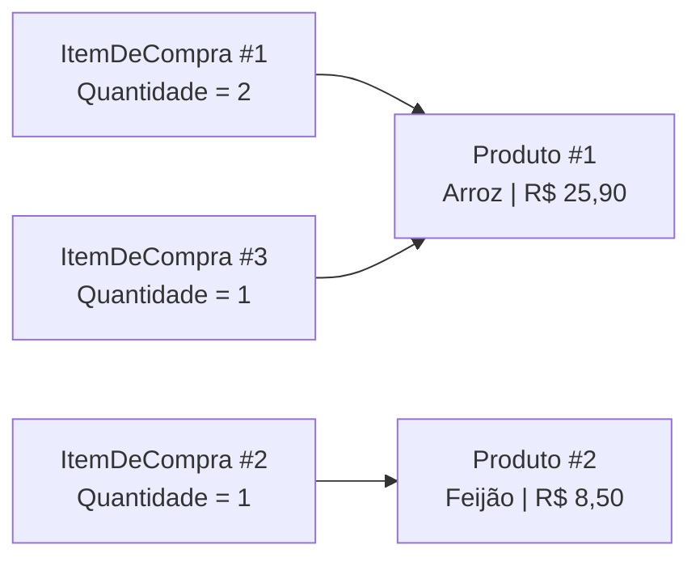

# Aula 06 — Composição ("Tem Um"), Coleções (`List<T>`) e Propriedades Calculadas (`=>`)

**Duração:** 3h30. **Pré-requisito:** [Aula 05](05-Construtores-Encapsulamento-e-Excecoes.md). **Entrega:** objetos encapsulados colaborando via composição (`ItemDeCompra` + `Produto`) dentro de coleções dinâmicas `List<T>`, cálculo automático de subtotais via propriedade calculada `=>` e totalização em função separada (`A06.01`–`A06.04`).

| Bloco | Minutos | Atividade |
| --- | ---: | --- |
| Retomada | 15 | Revisar encapsulamento da Aula 05 e como guardar vários objetos juntos |
| Explicação | 30 | `List<T>`, Generics, `foreach`, Composição ("tem um"), `=>` e objeto compartilhado |
| Construção | 60 | Executar os Exemplos Completos #1 e #2 (`List<T>` e composição `ItemTreino` + `Exercicio`) |
| Intervalo | 15 | Pausa |
| Prática | 60 | Executar o Exemplo #3 (`Produto` + `ItemDeCompra` + `SomarItens`) e testes de fronteira |
| Entrega | 30 | Demonstrar lista vazia/preenchida, total `R$ 60,30` / `R$ 86,20` e explicar composição |

---

## 1. Coleções Dinâmicas com `List<T>` (`A06.01`)

Na Aula 02, usamos um array fixo `string[] catalogo = { "Arroz", "Feijão" };`. O problema de um array é que o **tamanho dele nunca muda depois de criado**! Em um caixa de supermercado, um cliente pode comprar 0, 2 ou 80 produtos.

Para listas que crescem e diminuem dinamicamente, o C# oferece **`List<T>`** (onde `<T>` é o **tipo genérico** dos elementos que a lista aceita).

### Exemplo Prático Completo #1 — Dominando `List<T>` (Preenchida, Remoção e Lista Vazia)

Crie um novo **Aplicativo de Console** chamado **`Aula06Composicao`** no Visual Studio 2022 e execute:

```csharp
// Criando uma lista dinâmica que SÓ aceita strings:
List<string> carrinhoNomes = new List<string>();

// 1. Testando lista VAZIA (Count == 0; foreach simplesmente não roda nenhuma vez, sem erro!):
Console.WriteLine($"Inicialmente -> Quantidade: {carrinhoNomes.Count}");
foreach (string nome in carrinhoNomes)
{
    Console.WriteLine($"  Item: {nome}"); // Não executa enquanto estiver vazia
}

// 2. Adicionando itens dinamicamente com .Add(...):
carrinhoNomes.Add("Arroz 5kg");
carrinhoNomes.Add("Feijão 1kg");
carrinhoNomes.Add("Café 500g");

Console.WriteLine($"\nApós adicionar 3 itens -> Quantidade: {carrinhoNomes.Count}");
Console.WriteLine($"Primeiro item [0]: {carrinhoNomes[0]}"); // Índices começam em 0!

foreach (string nome in carrinhoNomes)
{
    Console.WriteLine($"  - {nome}");
}

// 3. Removendo um item e limpando a lista:
carrinhoNomes.Remove("Feijão 1kg");
Console.WriteLine($"\nApós remover Feijão -> Quantidade: {carrinhoNomes.Count}");

carrinhoNomes.Clear();
Console.WriteLine($"Após Clear()        -> Quantidade: {carrinhoNomes.Count}");
```

### Saída Esperada no Console (`Ctrl+F5`)

```text
Inicialmente -> Quantidade: 0

Após adicionar 3 itens -> Quantidade: 3
Primeiro item [0]: Arroz 5kg
  - Arroz 5kg
  - Feijão 1kg
  - Café 500g

Após remover Feijão -> Quantidade: 2
Após Clear()        -> Quantidade: 0
```

- **Segurança de tipos (`<T>`):** tentar fazer `carrinhoNomes.Add(123);` gera erro de compilação imediato, porque `List<string>` só aceita `string`!

---

## 2. Composição ("Tem Um") e Propriedade Calculada com `=>` (`A06.02`)

No mundo real, objetos raramente vivem isolados — um objeto **contém** (ou referencia) outro objeto. Isso se chama **Composição ("tem um")**:

- Um `ItemTreino` **tem um** `Exercicio` e uma duração em `Minutos`.
- Um `ItemDeCompra` **tem um** `Produto` e uma `Quantidade`.
  - *(Atenção: um `ItemDeCompra` **NÃO É** um `Produto` — portanto **não** usa herança! Ele **contém** uma referência para um `Produto`.)*

### Exemplo Prático Completo #2 — Composição Completa (`Exercicio.cs` + `ItemTreino.cs` + `Program.cs`)

Adicione os dois arquivos abaixo (`Shift+Alt+C`) e execute no `Program.cs` para ver **como um objeto navega até outro objeto usando o ponto (`.`)** e como funciona o atalho **`=>`**:

#### Arquivo 1: `Exercicio.cs`

```csharp
public class Exercicio
{
    public string Nome { get; }
    public int CaloriasPorMinuto { get; }

    public Exercicio(string nome, int caloriasPorMinuto)
    {
        if (string.IsNullOrWhiteSpace(nome))
            throw new ArgumentException("Informe o nome do exercício.");
        if (caloriasPorMinuto <= 0)
            throw new ArgumentException("Calorias por minuto devem ser positivas.");

        Nome = nome.Trim();
        CaloriasPorMinuto = caloriasPorMinuto;
    }
}
```

#### Arquivo 2: `ItemTreino.cs`

```csharp
public class ItemTreino
{
    // COMPOSIÇÃO: ItemTreino "tem um" Exercicio!
    public Exercicio Exercicio { get; }
    public int Minutos { get; }

    // PROPRIEDADE CALCULADA (atalho '=>'):
    // Equivale a: public int TotalCalorias { get { return Exercicio.CaloriasPorMinuto * Minutos; } }
    public int TotalCalorias => Exercicio.CaloriasPorMinuto * Minutos;

    public ItemTreino(Exercicio exercicio, int minutos)
    {
        // Proteção contra NullReferenceException futura!
        if (exercicio is null)
            throw new ArgumentException("Informe o exercício.");
        if (minutos <= 0)
            throw new ArgumentException("Informe minutos positivos.");

        Exercicio = exercicio;
        Minutos = minutos;
    }
}
```

#### Arquivo 3: `Program.cs`

```csharp
Exercicio corrida = new Exercicio("Corrida", 10);
Exercicio natacao = new Exercicio("Natação", 8);

List<ItemTreino> treinoDeHoje = new List<ItemTreino>
{
    new ItemTreino(corrida, 30), // 300 kcal
    new ItemTreino(natacao, 20)  // 160 kcal
};

int totalCalorias = 0;
foreach (ItemTreino item in treinoDeHoje)
{
    // Navegação por referências: item -> Exercicio -> Nome!
    Console.WriteLine($"{item.Exercicio.Nome}: {item.Minutos} min = {item.TotalCalorias} kcal");
    totalCalorias += item.TotalCalorias;
}
Console.WriteLine($"Total gasto no treino: {totalCalorias} kcal");
```

### Saída Esperada no Console

```text
Corrida: 30 min = 300 kcal
Natação: 20 min = 160 kcal
Total gasto no treino: 460 kcal
```

**Por que `TotalCalorias => ...` (calculado) é melhor do que guardar um campo `public int TotalCalorias { get; set; }`?**
Porque ninguém consegue gravar um valor incoerente (ex.: 30 minutos de corrida valendo 9999 kcal). O valor é sempre recalculado com exatidão a partir de `Exercicio.CaloriasPorMinuto * Minutos`!

---

## 3. Exemplo Prático Completo #3 — Composição no Supermercado, Totalização e Objeto Compartilhado

Agora veja o modelo completo do nosso supermercado com **`Produto.cs`**, **`ItemDeCompra.cs`** e **`Program.cs`** (`A06.02`–`A06.04`), incluindo a prova visual de **2 objetos `Produto` compartilhados por 3 objetos `ItemDeCompra`** na memória RAM!

### Arquivo 1: `Produto.cs`

```csharp
public class Produto
{
    public string Nome { get; }
    public decimal Preco { get; }

    public Produto(string nome, decimal preco)
    {
        if (string.IsNullOrWhiteSpace(nome))
            throw new ArgumentException("O nome do produto é obrigatório.", nameof(nome));
        if (preco <= 0m)
            throw new ArgumentException("O preço deve ser positivo.", nameof(preco));

        Nome = nome.Trim();
        Preco = preco;
    }
}
```

### Arquivo 2: `ItemDeCompra.cs`

```csharp
public class ItemDeCompra
{
    public Produto Produto { get; }
    public int Quantidade { get; }

    // Subtotal sempre consistente (calculado sob demanda via '=>'):
    public decimal Subtotal => Produto.Preco * Quantidade;

    public ItemDeCompra(Produto produto, int quantidade)
    {
        if (produto is null)
            throw new ArgumentException("O produto é obrigatório.", nameof(produto));
        if (quantidade <= 0)
            throw new ArgumentException("A quantidade deve ser maior que zero.", nameof(quantidade));

        Produto = produto;
        Quantidade = quantidade;
    }
}
```

### Arquivo 3: `Program.cs`

```csharp
using System.Globalization;

CultureInfo.CurrentCulture = CultureInfo.GetCultureInfo("pt-BR");

// 1. Apenas DOIS objetos Produto criados no Heap:
Produto arroz = new Produto("Arroz", 25.90m);
Produto feijao = new Produto("Feijão", 8.50m);

// 2. Lista de itens da compra:
List<ItemDeCompra> itens = new List<ItemDeCompra>();
itens.Add(new ItemDeCompra(arroz, 2));  // 2 x 25,90 = 51,80
itens.Add(new ItemDeCompra(feijao, 1)); // 1 x  8,50 =  8,50

Console.WriteLine("=== COMPRA COM 2 ITENS ===");
foreach (ItemDeCompra item in itens)
{
    Console.WriteLine($"{item.Produto.Nome,-10} | {item.Quantidade} x {item.Produto.Preco:C} = {item.Subtotal:C}");
}
Console.WriteLine($"TOTAL: {SomarItens(itens):C}"); // Esperado: R$ 60,30

// 3. OBJETO COMPARTILHADO: 3º ItemDeCompra apontando para o MESMO objeto 'arroz'!
itens.Add(new ItemDeCompra(arroz, 1)); // + 25,90 -> 86,20
Console.WriteLine($"\nApós 3º item (mesmo objeto arroz) -> TOTAL: {SomarItens(itens):C}");

// 4. FRONTEIRA: lista vazia retorna 0 sem erro!
List<ItemDeCompra> listaVazia = new List<ItemDeCompra>();
Console.WriteLine($"Total de lista vazia              -> TOTAL: {SomarItens(listaVazia):C}");

// 5. FRONTEIRA: quantidade zero recusada antes de entrar na lista!
try
{
    itens.Add(new ItemDeCompra(arroz, 0));
}
catch (ArgumentException erro)
{
    Console.WriteLine($"Item inválido recusado            -> {erro.Message}");
}

// Função pura de totalização (ZERO Console.WriteLine aqui dentro!):
decimal SomarItens(List<ItemDeCompra> lista)
{
    decimal total = 0m;
    foreach (ItemDeCompra item in lista)
    {
        total += item.Subtotal;
    }
    return total;
}
```

### Saída Esperada no Console (`Ctrl+F5`)

```text
=== COMPRA COM 2 ITENS ===
Arroz      | 2 x R$ 25,90 = R$ 51,80
Feijão     | 1 x R$ 8,50 = R$ 8,50
TOTAL: R$ 60,30

Após 3º item (mesmo objeto arroz) -> TOTAL: R$ 86,20
Total de lista vazia              -> TOTAL: R$ 0,00
Item inválido recusado            -> A quantidade deve ser maior que zero. (Parameter 'quantidade')
```

### Mapa da Memória RAM (2 Objetos `Produto` para 3 Objetos `ItemDeCompra`)



> [!WARNING]
> **Por que `List<ItemDeCompra>` na memória RAM não substitui um banco de dados?**
> A memória RAM é **volátil**: assim que a janela do programa fecha (ou acaba a energia), todos os objetos `Produto` e `ItemDeCompra` desaparecem! A partir da Aula 12, gravaremos esses dados de forma permanente em **PostgreSQL (Neon)** ou **MySQL (XAMPP)**.

---

## 4. Roteiro de Prática e Entregas no Visual Studio 2022 (`A06.01`–`A06.04`)

No projeto **`Aula06Composicao`**, demonstre e entregue:

1. **`A06.01`:** execute o teste de `List<string>` preenchida e vazia comprovando `Count == 0` sem exceção no `foreach`.
2. **`A06.02`:** construa `Produto.cs` e `ItemDeCompra.cs` validando `produto is null` e usando `Subtotal => Produto.Preco * Quantidade;` (explique por que composição é usada aqui em vez de herança).
3. **`A06.03`:** implemente `SomarItens(List<ItemDeCompra>)` sem imprimir no console, comprovando `R$ 60,30` para `2` arrozes + `1` feijão e `R$ 0,00` para lista vazia.
4. **`A06.04`:** adicione o terceiro item com o mesmo `arroz` (`R$ 86,20`), teste `quantidade = 0` em `try/catch`, desenhe os **2 `Produto` vs 3 `ItemDeCompra`** e explique a volatilidade da RAM.

---

## 5. Erros Comuns de Iniciantes (❌ Errado vs ✅ Certo)

| Erro / Sintoma | ❌ Código que quebra | ✅ Como corrigir |
| --- | --- | --- |
| **Usar `=` em vez de `=>`** | `public decimal Subtotal = Produto.Preco * Quantidade;` *(calcula só na criação ou não compila!)* | Use expressão calculada: `public decimal Subtotal => Produto.Preco * Quantidade;`. |
| **Esquecer `new List<T>()`** | `List<Produto> lista; lista.Add(p);` | Inicialize: `List<Produto> lista = new List<Produto>();` (ou `[]` em C# 12+). |
| **Esquecer de validar `null`** | `public ItemDeCompra(Produto p, int q) { Produto = p; }` *(se passarem `null`, explode depois!)* | Valide no construtor: `if (p is null) throw new ArgumentException(...);`. |
| **Misturar cálculo e tela** | Colocar `Console.WriteLine(total)` dentro de `SomarItens`. | Devolva `return total;` e imprima somente no `Program.cs`. |

[Anterior: Aula 05](05-Construtores-Encapsulamento-e-Excecoes.md) · [Próxima: Aula 07 — Namespaces, interfaces, herança e polimorfismo](07-Namespaces-Interfaces-Heranca-e-Polimorfismo.md) · [Índice](README.md)

## Atividades por conceito

Realize as atividades da [aula 06 no caderno complementar](ATIVIDADES-POR-CONCEITO.md#aula-06). Cada conceito tem enunciado e critério de aceite. Reúna as evidências em uma entrega por aula, usando os IDs no [caderno de evidências](CADERNO-DE-EVIDENCIAS.md). Essas tarefas integram a prática e a verificação já previstas no encontro.
