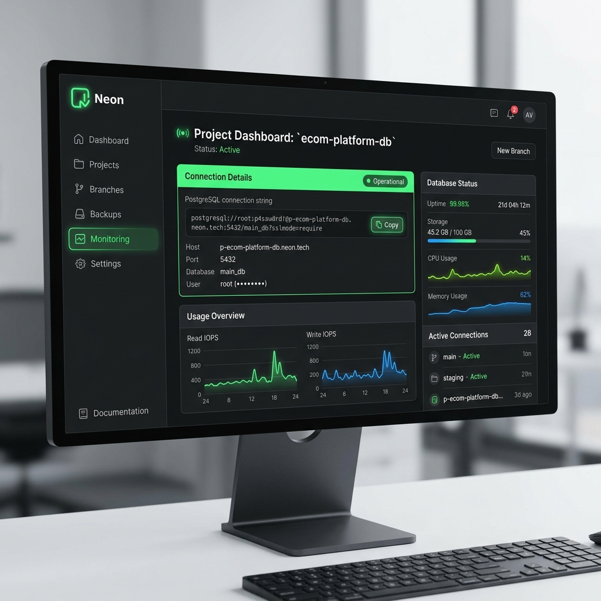

# Aula 07 — Banco Neon e usuários

**Duração:** 3h30. **Pré-requisito:** aula 06, internet e conta de laboratório. **Entrega:** banco com a tabela `usuario` criada, sem contas com senha aberta.

| Bloco | Minutos | Atividade |
| --- | ---: | --- |
| Retomada | 15 | Diferenciar campos de tela e persistência |
| Explicação | 30 | Tabela, chave, restrições e credenciais |
| Construção | 60 | Criar projeto/branch e executar script 001 |
| Intervalo | 15 | Pausa |
| Prática | 60 | Consultar estrutura e conferir conexão |
| Entrega | 30 | Explicar o esquema e identificar a branch correta |

## 1. Prepare um ambiente só da turma

1. Entre no [console do Neon](https://console.neon.tech/). Os nomes dos botões podem mudar; procure a criação de projeto.
2. Crie um projeto `SupermercadoDB`, escolha uma região disponível adequada ao laboratório e anote o nome do banco e da branch.
3. Cada estudante/dupla deve usar um ambiente separado. Se o professor usar um projeto compartilhado, distribua branches/bancos diferentes; executar os mesmos scripts e testes no mesmo esquema provoca conflitos.
4. Confira os limites e as condições do plano usado antes da turma. Não presuma gratuidade ou cotas ilimitadas.
5. Abra o **SQL Editor** e confira banco e branch antes de executar qualquer comando.



**Por quê?** Uma branch de laboratório permite errar sem atingir outro grupo. Uma branch derivada de um banco existente pode copiar o esquema; para esta sequência, escolha um banco vazio. Quem fez o material antigo deve ler a [transição](TRANSICAO.md).

## 2. Execute o primeiro script

Abra [database/001-usuarios.sql](database/001-usuarios.sql), copie seu conteúdo inteiro para o SQL Editor e execute **uma vez**. Ele contém:

```sql
CREATE TABLE usuario (
    id integer GENERATED ALWAYS AS IDENTITY PRIMARY KEY,
    username varchar(50) NOT NULL UNIQUE CHECK (username = lower(username)),
    senha_hash text NOT NULL,
    perfil varchar(20) NOT NULL CHECK (perfil IN ('Administrador', 'Caixa'))
);
```

O arquivo também envolve a criação em `BEGIN` e `COMMIT`. Se houver erro e a sessão ficar em transação abortada, execute `ROLLBACK` antes de corrigir e tentar novamente.

- `id` identifica o registro, independentemente do nome de login.
- `IDENTITY` faz o banco gerar o número; não suponha que o próximo será sempre o anterior mais um.
- `UNIQUE` impede dois logins iguais, inclusive se duas pessoas tentarem cadastrar ao mesmo tempo.
- `NOT NULL` impede ausência de dado; não equivale a validar texto vazio.
- `CHECK` restringe os perfis e exige nome em minúsculas.
- `senha_hash` guarda a representação produzida por uma biblioteca. Não execute um `INSERT` com senha aberta nessa coluna.

Usamos um conjunto pequeno de perfis em vez de uma tabela separada de cargos. Isso evita dependência em IDs mágicos como “gerente = 1” e combina com o `enum Perfil` do C#.

Execute:

```sql
SELECT id, username, perfil FROM usuario;
SELECT column_name, data_type, is_nullable
FROM information_schema.columns
WHERE table_schema = 'public' AND table_name = 'usuario';
```

A primeira consulta retorna **zero usuários**, o que é correto. O administrador será criado pelo aplicativo na aula 09. O script não deve ser reaplicado como se fosse uma consulta: se a tabela já existe, confira o ambiente e o histórico em vez de apagá-la.

## 3. Prepare os dados de conexão

No painel **Connect**, selecione **.NET/C#**, branch, banco e role. Copie os campos adequados ao Npgsql. Uma URI `postgresql://...` não deve ser colada diretamente no construtor que espera os pares abaixo:

```text
Host=SEU_HOST;Database=SEU_BANCO;Username=SEU_ROLE;Password=SUA_SENHA;SSL Mode=VerifyFull;
```

O hostname deve ser exatamente o fornecido pelo Neon. `VerifyFull` solicita criptografia e validação da identidade do servidor. Não use `Trust Server Certificate=true` para contornar erros. Confirme rede, data do Windows, hostname e cadeia de certificados.

Guarde a conexão apenas no ambiente local conforme a aula 08. A senha do **role do PostgreSQL** é diferente da senha de um **usuário do supermercado**. Não inclua credenciais em Git, capturas ou entregas.

## Verifique antes de encerrar

- `usuario` existe e contém `senha_hash`, sem coluna de senha aberta.
- A consulta retorna zero contas; não inventamos uma senha padrão.
- Você explica chave primária, unicidade e a diferença entre role e perfil do aplicativo.
- Registrou nome da branch e resultado das consultas, sem credenciais.

Fontes: [conexão Neon/.NET](https://neon.com/docs/guides/dotnet-npgsql) e [TLS no Npgsql](https://www.npgsql.org/doc/security.html).

[Anterior: aula 06](06-Criando-Interface-Login.md) · [Próxima: aula 08](08-Conectando-Banco-Dados.md)
