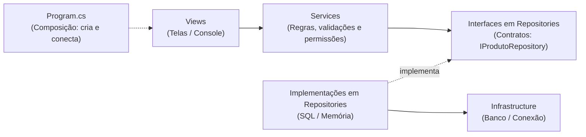

# Aula 08 — Arquitetura em Camadas, Contratos (`IReadOnlyList`) e Injeção Manual

**Duração:** 3h30. **Pré-requisito:** [Aula 07](07-Namespaces-Interfaces-Heranca-e-Polimorfismo.md). **Entrega:** projeto completo em camadas no console em que o `Program` conecta um `Service` a duas implementações diferentes de um contrato `I...Repository` — provando a troca real de dependência sem alterar uma única linha do serviço (`A08.01`–`A08.05`).

| Bloco | Minutos | Atividade |
| --- | ---: | --- |
| Retomada | 15 | Identificar onde moram entrada, regra e dados em um programa monolítico |
| Explicação | 30 | As 5 responsabilidades do MarketFlow, `IReadOnlyList<T>`, injeção manual e limites |
| Construção | 60 | Construir e executar o Exemplo Completo das 5 camadas em `Aula08Arquitetura` |
| Intervalo | 15 | Pausa |
| Prática | 60 | Criar `ProdutosPromocionais`, testar `CS1061` em `IReadOnlyList` e `ValidarPreco` |
| Entrega | 30 | Demonstrar troca real na composição e explicar responsabilidades e fronteira de API |

---

## 1. O Problema Real: Por Que Não Escrever Tudo Dentro do Clique do Botão?

Imagine um iniciante montando uma tela Windows Forms onde **tudo** fica misturado dentro do clique do botão `btnSalvar_Click`:

```csharp
// ❌ CÓDIGO ESPAGUETE (tudo misturado dentro da tela — NUNCA faça assim!):
private void btnSalvar_Click(object sender, EventArgs e)
{
    if (preco <= 0) { MessageBox.Show("Preço inválido"); return; } // Regra presa na tela!
    var conexao = new NpgsqlConnection("Host=...;Password=123");    // Senha no código!
    var cmd = new NpgsqlCommand("INSERT INTO produto...", conexao); // SQL na tela!
    cmd.ExecuteNonQuery();
}
```

Veja os **3 desastres** que esse estilo cria em qualquer projeto real:
1. **Regras duplicadas:** se outra tela (ou uma API web futura) precisar validar preço, você copia e cola os `if`s — e quando a regra muda, esquece de atualizar uma tela.
2. **Impossível testar sem banco e sem clicar na tela:** para provar que preço `0` é recusado, você teria que abrir o programa, fazer login, ter internet e clicar no botão toda vez.
3. **Acoplamento forte:** mudar uma coluna no SQL obriga a abrir e editar o código das janelas visuais.

### A Solução do MarketFlow: Separação em 5 Pastas (Um Único Projeto Limpo)



| Pasta | Responsabilidade Única | O que **NUNCA** pode ficar aqui | Exemplos no MarketFlow |
| --- | --- | --- | --- |
| **`Models`** | Estruturas de dados do domínio | SQL, `MessageBox`, acesso à rede | `Produto`, `Sessao`, `ItemCarrinho` |
| **`Services`** | Regras de negócio, validações e permissões | SQL direto, controles visuais (`TextBox`, `MessageBox`) | `ProdutoService`, `VendaService` |
| **`Repositories`** | Contratos (`I...`) e acesso a dados (SQL ou Memória) | `MessageBox`, decisões de tela | `IProdutoRepository`, `ProdutoRepository` |
| **`Infrastructure`** | Configuração técnica de ambiente e pool de conexão | Regras de desconto ou cadastro | `Banco` |
| **`Views`** | Ler controles da tela, chamar o Serviço e exibir resultado/erro | Comandos SQL, regras de negócio duplicadas | `FormLogin`, `FormProdutos`, `FormCaixa` |

> [!NOTE]
> Pastas no Visual Studio 2022 organizam arquivos, mas **não impedem** alguém de escrever SQL numa `View`. Respeitar a direção das setas do diagrama acima é disciplina de arquitetura!

---

## 2. Por Que Retornar `IReadOnlyList<T>` em Vez de `List<T>`? (`A08.02`)

Se o repositório devolver `List<Produto>`, qualquer tela que chamasse `Listar()` poderia chamar `.Add(...)` ou `.Clear()` direto na lista devolvida, burlando validações!
- **`IReadOnlyList<Produto>`** permite ler `.Count`, ler posição `[0]` e percorrer com `foreach`, mas **não possui `.Add()`, `.Remove()` nem `.Clear()`** (o compilador barra com **`CS1061`**!).
- **Limite importante dessa proteção:** `IReadOnlyList<Produto>` protege a **coleção** (impede adicionar/remover itens da lista), mas **não torna imutáveis** os objetos dentro dela se as propriedades de `Produto` tiverem `set` público!

---

## 3. Exemplo Prático Completo — Arquitetura em Camadas 100% Compilável (`Aula08Arquitetura`)

Crie um **Aplicativo de Console** chamado **`Aula08Arquitetura`** no Visual Studio 2022 e adicione os **5 arquivos de classe/interface** abaixo (`Shift+Alt+C`), mais o `Program.cs`. Compile e execute para ver a troca real de dependência funcionando!

### Arquivo 1: `Produto.cs` (Camada `Models`)

```csharp
namespace Aula08Arquitetura;

public class Produto
{
    public string Nome { get; set; } = "";
    public decimal Preco { get; set; }
}
```

### Arquivo 2: `IConsultaProdutos.cs` (Contrato da Camada `Repositories`)

```csharp
namespace Aula08Arquitetura;

public interface IConsultaProdutos
{
    // Retorna IReadOnlyList para impedir a View de fazer .Add() ou .Clear()!
    IReadOnlyList<Produto> Listar();
}
```

### Arquivo 3: `ProdutosEmMemoria.cs` (Implementação 1 do Repositório)

```csharp
namespace Aula08Arquitetura;

public class ProdutosEmMemoria : IConsultaProdutos
{
    public IReadOnlyList<Produto> Listar()
    {
        return new List<Produto>
        {
            new Produto { Nome = "Arroz", Preco = 25.90m },
            new Produto { Nome = "Feijão", Preco = 8.50m }
        };
    }
}
```

### Arquivo 4: `ProdutosPromocionais.cs` (Implementação 2 do Mesmo Contrato!)

```csharp
namespace Aula08Arquitetura;

public class ProdutosPromocionais : IConsultaProdutos
{
    public IReadOnlyList<Produto> Listar()
    {
        return new List<Produto>
        {
            new Produto { Nome = "Café Especial", Preco = 12.90m },
            new Produto { Nome = "Leite Integral", Preco = 4.99m }
        };
    }
}
```

### Arquivo 5: `ConsultaProdutosService.cs` (Camada `Services` — ZERO SQL e ZERO Tela!)

```csharp
namespace Aula08Arquitetura;

public class ConsultaProdutosService
{
    private readonly IConsultaProdutos produtos;

    // INJEÇÃO DE DEPENDÊNCIA MANUAL PELO CONSTRUTOR:
    // O serviço NÃO dá 'new ProdutosEmMemoria()' aqui dentro!
    public ConsultaProdutosService(IConsultaProdutos produtos)
    {
        if (produtos is null)
            throw new ArgumentException("Informe um repositório de produtos.", nameof(produtos));
        this.produtos = produtos;
    }

    public IReadOnlyList<Produto> Executar()
    {
        return produtos.Listar();
    }

    // Regra de negócio 100% independente de Console ou Windows Forms!
    // (A partir da Aula 16, essa validação ficará integrada dentro de SalvarAsync.)
    public void ValidarPreco(decimal preco)
    {
        if (preco <= 0m)
            throw new ArgumentException("Preço deve ser positivo.");
    }
}
```

### Arquivo 6: `Program.cs` (Ponto de Composição + Testes)

```csharp
using System.Globalization;
using Aula08Arquitetura;

CultureInfo.CurrentCulture = CultureInfo.GetCultureInfo("pt-BR");

// === 1. COMPOSIÇÃO COM REPOSITÓRIO PADRÃO ===
IConsultaProdutos repositorioPadrao = new ProdutosEmMemoria();
var servico = new ConsultaProdutosService(repositorioPadrao);

Console.WriteLine("=== CATÁLOGO 1 (ProdutosEmMemoria) ===");
foreach (Produto p in servico.Executar())
{
    Console.WriteLine($"- {p.Nome}: {p.Preco:C}");
}

// ❌ TESTE DE PROTEÇÃO DO CONTRATO (descomente para ver o erro CS1061 e depois apague):
// servico.Executar().Add(new Produto { Nome = "Invasor", Preco = 1m });

// === 2. TESTE DE REGRA DE NEGÓCIO SEM TELA GRÁFICA (A08.04) ===
Console.WriteLine("\n=== VALIDAÇÃO DE PREÇO NO SERVIÇO ===");
decimal[] precosTeste = { 25.90m, 0m, -1m };
foreach (decimal preco in precosTeste)
{
    try
    {
        servico.ValidarPreco(preco);
        Console.WriteLine($"Preço {preco:C} -> ACEITO");
    }
    catch (ArgumentException erro)
    {
        Console.WriteLine($"Preço {preco:C} -> RECUSADO ({erro.Message})");
    }
}

// === 3. PROVA REAL DE TROCA DE DEPENDÊNCIA (A08.03) ===
// Trocamos APENAS o objeto criado aqui no Program.cs — ZERO linhas alteradas em ConsultaProdutosService!
IConsultaProdutos repositorioPromo = new ProdutosPromocionais();
var servicoPromocional = new ConsultaProdutosService(repositorioPromo);

Console.WriteLine("\n=== CATÁLOGO 2 (ProdutosPromocionais — MESMO SERVIÇO!) ===");
foreach (Produto p in servicoPromocional.Executar())
{
    Console.WriteLine($"- {p.Nome}: {p.Preco:C}");
}
```

### Saída Esperada no Console (`Ctrl+F5`)

```text
=== CATÁLOGO 1 (ProdutosEmMemoria) ===
- Arroz: R$ 25,90
- Feijão: R$ 8,50

=== VALIDAÇÃO DE PREÇO NO SERVIÇO ===
Preço R$ 25,90 -> ACEITO
Preço R$ 0,00 -> RECUSADO (Preço deve ser positivo.)
Preço -R$ 1,00 -> RECUSADO (Preço deve ser positivo.)

=== CATÁLOGO 2 (ProdutosPromocionais — MESMO SERVIÇO!) ===
- Café Especial: R$ 12,90
- Leite Integral: R$ 4,99
```

---

## 4. Limites Honestos da Nossa Arquitetura (`A08.05`)

Engenharia madura também conhece **os limites** das próprias decisões:

1. **Trocar PostgreSQL por MySQL NÃO é "automático":** interfaces isolam o SQL dentro de `Repositories/`, reduzindo muito o impacto, mas cada banco tem sintaxe própria (`ILIKE` vs `LIKE`, `RETURNING id` vs `LastInsertedId`, `pg_advisory_xact_lock` vs `GET_LOCK`), como mostra o [guia XAMPP](INTEGRACAO-MYSQL-XAMPP.md).
2. **Fronteira de segurança em aplicativos desktop:** neste curso didático, o Windows Forms conecta diretamente ao banco de dados para focarmos em C#, POO, WFA e SQL sem construir um servidor web ao mesmo tempo. Em sistemas comerciais distribuídos a clientes externos, **credenciais do banco e autorização devem morar em uma API no servidor**, porque qualquer credencial presente na máquina do usuário pode ser extraída localmente.

---

## 5. Roteiro de Prática e Entregas no Visual Studio 2022 (`A08.01`–`A08.05`)

1. **`A08.01`:** desenhe no caderno o fluxo `Program → View → Service → IRepository ← Repository → Infrastructure` distribuindo entrada, validação, consulta, SQL e composição.
2. **`A08.02`:** execute o projeto `Aula08Arquitetura`, provoque e registre o erro **`CS1061`** ao tentar chamar `.Add(...)` em `IReadOnlyList<Produto>`, remova a linha e explique o limite dessa proteção.
3. **`A08.03`:** comprove a substituição de `ProdutosEmMemoria` por `ProdutosPromocionais` trocando apenas a criação no `Program.cs`, sem editar `ConsultaProdutosService.cs`.
4. **`A08.04`:** execute `ValidarPreco` com `25,90`, `0` e `-1` no console demonstrando tratamento em `try/catch` sem nenhuma janela gráfica.
5. **`A08.05`:** registre no caderno o que precisaria mudar para mover credenciais e autorização para uma API comercial e cite uma diferença concreta entre PostgreSQL e MySQL.

[Anterior: Aula 07](07-Namespaces-Interfaces-Heranca-e-Polimorfismo.md) · [Próxima: Aula 09 — Ambiente e solução no VS 2022](09-Configuracao-Ambiente.md) · [Índice](README.md)

## Atividades por conceito

Realize as atividades da [aula 08 no caderno complementar](ATIVIDADES-POR-CONCEITO.md#aula-08). Cada conceito tem enunciado e critério de aceite. Reúna as evidências em uma entrega por aula, usando os IDs no [caderno de evidências](CADERNO-DE-EVIDENCIAS.md). Essas tarefas integram a prática e a verificação já previstas no encontro.
