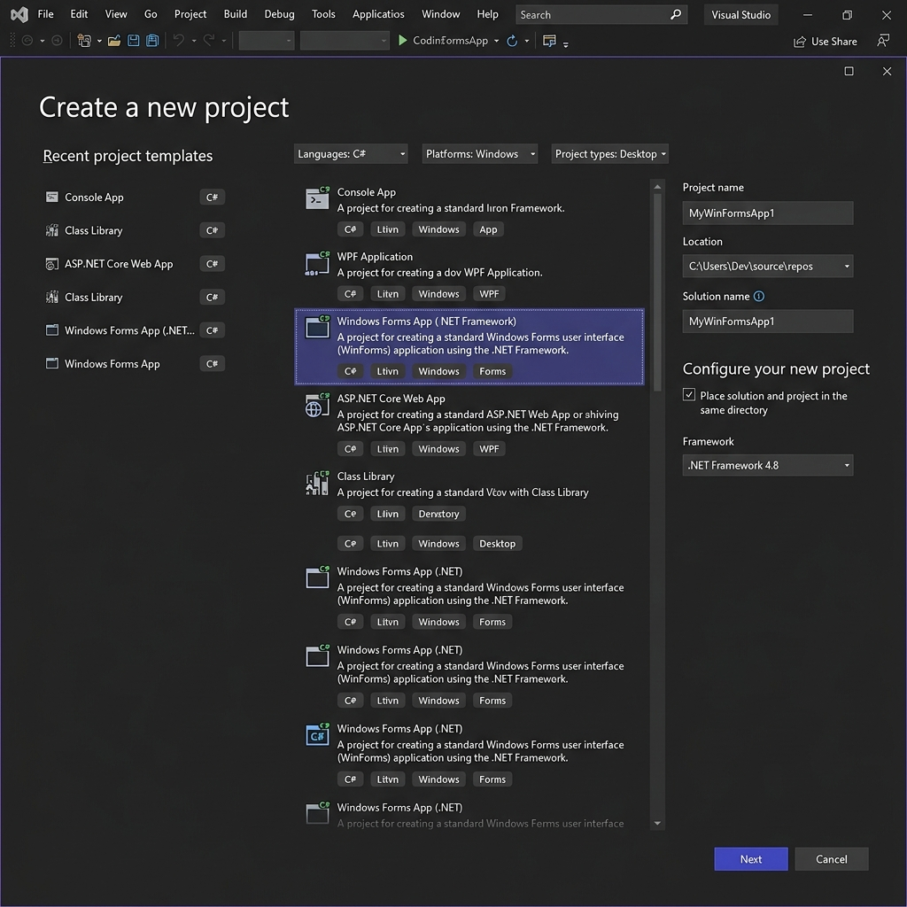
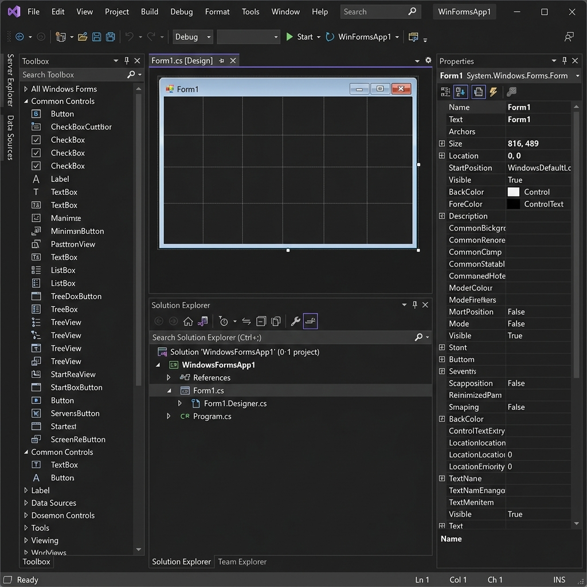

# Aula 09 — Ambiente, Solução e Primeiro Windows Forms no Visual Studio 2022

**Duração:** 3h30. **Pré-requisito:** [Aula 08](08-Arquitetura-e-Padroes.md). **Entrega:** solução `Supermercado` e projeto Windows Forms `SupermercadoApp` organizados em 5 pastas, com `FormLogin` abrindo, fechando e compilando sem erros no Visual Studio 2022 (`A09.01`–`A09.05`).

| Bloco | Minutos | Atividade |
| --- | ---: | --- |
| Retomada | 15 | Comparar aplicativo de console e aplicativo visual Windows Forms (WFA) |
| Explicação | 30 | IDE, SDK, Runtime, `.sln`, `.csproj`, `partial class`, `InitializeComponent` e `Program.cs` |
| Construção | 60 | Conferir Visual Studio 2022, criar `Supermercado` / `SupermercadoApp` e ler os 4 arquivos gerados |
| Intervalo | 15 | Pausa |
| Prática | 60 | Criar as 5 pastas, renomear/mover `FormLogin`, alinhar namespaces e depurar o construtor |
| Entrega | 30 | Compilar (`Ctrl+Shift+B`), executar (`F5`), gerar cópia limpa e registrar ambiente |

---

## 1. Entendendo as Peças do Ambiente (IDE vs SDK vs Runtime) (`A09.01`)

Antes de criar o projeto visual, entenda exatamente o que cada componente instalado no Windows faz:

| Componente | O que faz? | Por que precisa estar instalado? |
| --- | --- | --- |
| **Visual Studio 2022 (IDE)** | Editor, Designer visual de telas, Gerenciador de Soluções e Depurador. | É onde você projeta formulários, escreve C# e investiga erros. |
| **.NET SDK** | Compilador e ferramentas CLI (`dotnet build`, `dotnet run`). | Instalar apenas o Runtime permite *executar* programas prontos, mas **não** permite criar nem compilar projetos novos. |
| **.NET Runtime** | Motor que executa o aplicativo compilado no Windows. | Já vem incluído dentro do SDK na máquina de desenvolvimento. |
| **Workload Desktop .NET** | Pacote de ferramentas no Visual Studio Installer para Windows Forms e WPF. | Sem essa carga marcada, o modelo *Aplicativo do Windows Forms* nem aparece na tela de Novo Projeto! |

### Conferindo o Ambiente no Laboratório
1. Abra o **Visual Studio Installer** → localize **Visual Studio Community 2022** → **Modificar** → confirme que **Desenvolvimento para desktop com .NET** está marcada.
2. Abra o **Visual Studio 2022**, clique em **Ajuda → Sobre o Microsoft Visual Studio** e anote a versão instalada.
3. No menu superior do VS 2022, abra **Exibir → Terminal** (`Ctrl+'`) e execute:
   ```powershell
   dotnet --list-sdks
   ```
   Confirme que existe um SDK moderno do .NET instalado (ex.: `8.0.xxx` ou `10.0.xxx`, conforme a turma) e registre a saída no caderno.

> [!NOTE]
> **Escolha do banco de dados:** combine com o professor antes da Aula 12 se a turma seguirá pela trilha principal (**Neon/PostgreSQL**) ou pela trilha local ([**MySQL/MariaDB pelo XAMPP**](INTEGRACAO-MYSQL-XAMPP.md)). Hoje e na próxima aula (catálogo prático de componentes Windows Forms) ainda não precisamos de banco configurado.

---

## 2. Criando a Solução `Supermercado` e o Projeto `SupermercadoApp` (`A09.02`)

1. No **Visual Studio 2022**, clique em **Criar um novo projeto**.
2. Pesquise `Windows Forms`, filtre por **C#** e escolha **Aplicativo do Windows Forms** (**NÃO** escolha a opção com sufixo **`(.NET Framework)`**!).
3. Clique em **Próximo** e preencha exatamente:
   - **Nome do projeto:** `SupermercadoApp`
   - **Nome da solução:** `Supermercado`
   - **Por que nomes diferentes?** A Solução (`Supermercado.sln`) agrupa o sistema inteiro (incluindo o projeto de testes na Aula 25), enquanto `SupermercadoApp` é o projeto do aplicativo Windows Forms.
4. Clique em **Próximo**, selecione a versão moderna do **.NET** da turma e clique em **Criar**.



5. Pressione **`Ctrl+Shift+B`** (Compilar) e **`F5`** (Executar): uma janela vazia chamada `Form1` abrirá no Windows. Feche-a pelo `X`.

---

## 3. Dissecando os 4 Arquivos Reais de um Projeto Windows Forms



### As 3 janelas essenciais do VS 2022 para WFA
- **Gerenciador de Soluções (`Ctrl+Alt+L`):** pastas, arquivos `.cs` e **Dependências**.
- **Caixa de Ferramentas (`Ctrl+Alt+X`):** controles visuais (`Label`, `TextBox`, `Button`, `DataGridView`, etc.) que você arrasta para o Designer.
- **Janela de Propriedades (`F4`):** aparência, `(Name)`, `Text` e aba de Eventos (ícone de raio ⚡) do controle selecionado.

### Veja por dentro cada um dos 4 arquivos (após organizar nas 5 pastas!)

#### Arquivo 1: `SupermercadoApp.csproj` (clique duplo no nome do projeto para abrir)

```xml
<Project Sdk="Microsoft.NET.Sdk">
  <PropertyGroup>
    <!-- WinExe: abre apenas a janela gráfica, sem abrir tela preta de console atrás -->
    <OutputType>WinExe</OutputType>
    <!-- -windows: habilita APIs nativas do Windows para formulários -->
    <TargetFramework>net8.0-windows</TargetFramework>
    <!-- Ativa a biblioteca System.Windows.Forms -->
    <UseWindowsForms>true</UseWindowsForms>
    <ImplicitUsings>enable</ImplicitUsings>
    <Nullable>enable</Nullable>
  </PropertyGroup>
</Project>
```

#### Arquivo 2: `Program.cs` (Ponto de Entrada da Aplicação)

```csharp
using SupermercadoApp.Views; // Enxerga FormLogin que mora na pasta Views!

namespace SupermercadoApp;

internal static class Program
{
    // [STAThread] é obrigatório pelo Windows para gerenciar janelas, mouse e área de transferência:
    [STAThread]
    static void Main()
    {
        // Ajusta fontes modernas e escala de tela (DPI) do Windows:
        ApplicationConfiguration.Initialize();

        // Abre a janela inicial e mantém o aplicativo vivo ouvindo eventos até ela fechar:
        Application.Run(new FormLogin());
    }
}
```

#### Arquivos 3 e 4: Como `partial class` Une `Views/FormLogin.cs` e `Views/FormLogin.Designer.cs`!

Por que um único formulário tem **dois arquivos**? Porque a palavra-chave **`partial`** permite dividir **uma mesma classe** em dois arquivos que o compilador junta automaticamente na hora de compilar:

```csharp
// Arquivo 3: Views/FormLogin.cs (código escrito POR VOCÊ!)
namespace SupermercadoApp.Views;

public partial class FormLogin : Form // Herda de System.Windows.Forms.Form!
{
    public FormLogin()
    {
        // Chama o método gerado automaticamente no arquivo .Designer.cs:
        InitializeComponent();
    }
}
```

```csharp
// Arquivo 4: Views/FormLogin.Designer.cs (gerenciado automaticamente pelo Designer visual!)
namespace SupermercadoApp.Views; // <-- TEM QUE SER IDÊNTICO ao namespace de FormLogin.cs!

partial class FormLogin
{
    private System.ComponentModel.IContainer? components = null;

    protected override void Dispose(bool disposing)
    {
        if (disposing && (components != null)) components.Dispose();
        base.Dispose(disposing);
    }

    private void InitializeComponent()
    {
        AutoScaleMode = AutoScaleMode.Font;
        ClientSize = new Size(420, 300);
        Text = "FormLogin";
    }
}
```

> [!WARNING]
> **Armadilha clássica no Visual Studio 2022 (`CS0103`):** se você arrastar `FormLogin.cs` para a pasta `Views` e mudar o `namespace` para `SupermercadoApp.Views` apenas em `FormLogin.cs` (esquecendo `FormLogin.Designer.cs`), o compilador achará que são **duas classes diferentes** e `InitializeComponent()` ficará sublinhado de vermelho!

---

## 4. Roteiro de Construção Guiada no VS 2022 (`A09.03`–`A09.05`)

1. **Criar as 5 pastas arquiteturais:** clique direito em `SupermercadoApp` → **Adicionar → Nova Pasta** criando exatamente:
   `Models`, `Services`, `Repositories`, `Infrastructure` e `Views`.
2. **Renomear e mover `Form1.cs`:**
   - Clique direito em `Form1.cs` → **Renomear (`F2`)** → digite **`FormLogin.cs`** → confirme **Sim** para renomear todas as referências.
   - Arraste `FormLogin.cs` para dentro da pasta **`Views`** (`FormLogin.Designer.cs` vai junto automaticamente).
3. **Conferir os dois namespaces + `Program.cs`:**
   - Abra `Views/FormLogin.cs` (`F7`) e confirme `namespace SupermercadoApp.Views;`.
   - Expanda a setinha de `FormLogin.cs` no Gerenciador de Soluções, abra **`FormLogin.Designer.cs`** e confirme o **mesmo** `namespace SupermercadoApp.Views;`.
   - Abra `Program.cs`, adicione `using SupermercadoApp.Views;` no topo e confirme `Application.Run(new FormLogin());`.
4. **Compilar e depurar o construtor (`A09.04`):**
   - Pressione **`Ctrl+Shift+B`** (zero erros).
   - Em `Views/FormLogin.cs`, coloque um **Breakpoint (`F9`)** na linha `InitializeComponent();`, execute com **`F5`**, avance com **`F10`** e depois **`F5`** para abrir a janela; feche-a pelo `X` comprovando encerramento limpo.
5. **Cópia limpa de entrega (`A09.05`):**
   - Com o Visual Studio 2022 fechado, ao fazer backup ou entregar código-fonte, **nunca** envie as pastas `bin`, `obj` e `.vs` (arquivos temporários de compilação).

---

## 5. Erros Comuns no Visual Studio 2022 (❌ Errado vs ✅ Certo)

| Erro / Sintoma | Causa provável | Como resolver |
| --- | --- | --- |
| **`CS0103`: `InitializeComponent` não existe** | `FormLogin.cs` e `FormLogin.Designer.cs` ficaram com `namespace` diferentes! | Deixe exatamente `namespace SupermercadoApp.Views` em **ambos** os arquivos. |
| **`CS0246`: `FormLogin` não encontrado** | Faltou `using SupermercadoApp.Views;` em `Program.cs`. | Adicione `using SupermercadoApp.Views;` no topo de `Program.cs`. |
| **O arquivo abre em código em vez do desenho** | Abriu com `F7` ou clicou direto no `.Designer.cs`. | Clique direito em `FormLogin.cs` → **Exibir Designer (`Shift+F7`)**. |

[Anterior: Aula 08](08-Arquitetura-e-Padroes.md) · [Próxima: Aula 10 — Componentes do Windows Forms na prática](10-Componentes-Windows-Forms.md) · [Índice](README.md)

## Atividades por conceito

Realize as atividades da [aula 09 no caderno complementar](ATIVIDADES-POR-CONCEITO.md#aula-09). Cada conceito tem enunciado e critério de aceite. Reúna as evidências em uma entrega por aula, usando os IDs no [caderno de evidências](CADERNO-DE-EVIDENCIAS.md). Essas tarefas integram a prática e a verificação já previstas no encontro.
