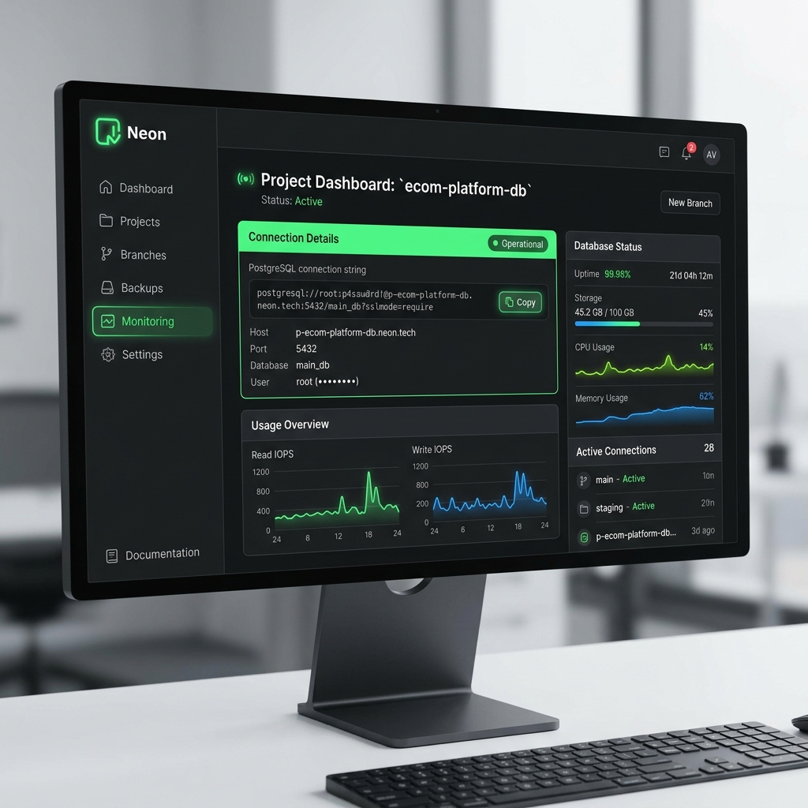

# Aula 11 — Banco de Dados Relacional, Integridade e Tabela de Usuários

> [!NOTE]
> **Escolha do banco de dados:** esta aula apresenta a trilha principal com **Neon / PostgreSQL**. Se a sua turma escolheu banco local com **MySQL/MariaDB pelo XAMPP**, siga as Etapas 1 e 2 da [trilha alternativa XAMPP](INTEGRACAO-MYSQL-XAMPP.md) no lugar da criação de conta Neon e dos scripts PostgreSQL abaixo. Todos os conceitos de integridade e critérios de entrega permanecem os mesmos.

**Duração:** 3h30. **Pré-requisito:** [Aula 10](10-Criando-Interface-Login.md), internet e conta de laboratório. **Entrega:** ambiente de banco isolado com a tabela `usuario` criada, restrições testadas em tabela temporária e nenhuma conta com senha em texto puro.

| Bloco | Minutos | Atividade |
| --- | ---: | --- |
| Retomada | 15 | Diferenciar memória RAM volátil da persistência em banco de dados |
| Explicação | 30 | Tabelas, chave primária, `IDENTITY`, `NOT NULL`, `UNIQUE`, `CHECK` e TLS |
| Construção | 60 | Preparar projeto/branch isolada no Neon e aplicar o script `001-usuarios.sql` |
| Intervalo | 15 | Pausa |
| Prática | 60 | Montar dicionário de dados e testar violações em tabela temporária |
| Entrega | 30 | Explicar esquema, restrições e diferença entre Role do banco e Perfil do app |

---

## 1. Por Que Precisamos de um Banco de Dados Relacional com Restrições?

Na memória RAM (como nas listas das Aulas 06 e 08), ao fechar o programa tudo desaparece. Um **Banco de Dados Relacional (PostgreSQL)** grava as informações em disco de forma estruturada em **tabelas** (linhas e colunas) e permite que vários caixas acessem os mesmos dados simultaneamente com regras rígidas de integridade.

**Por que colocar restrições (`NOT NULL`, `UNIQUE`, `CHECK`) no banco se também vamos validar no C#?**
Isso se chama **Defesa em Profundidade**:
- A validação em **C#** serve para dar mensagens amigáveis e rápidas para quem usa a tela.
- As restrições no **Banco de Dados** são a garantia definitiva: mesmo que outro sistema, um script ou dois usuários no mesmo milissegundo tentem gravar dados inválidos ou duplicados, o banco recusa fisicamente a gravação!

---

## 2. Preparando Seu Ambiente Isolado no Neon (`A11.01`)

1. Acesse o [console do Neon](https://console.neon.tech/) e faça login com sua conta de laboratório.
2. Crie um projeto chamado `SupermercadoDB` escolhendo a região mais próxima disponível.
3. **Regra de isolamento:** cada estudante ou dupla deve trabalhar em seu **próprio banco ou branch vazia**. **Por quê?** Se duas duplas compartilharem o mesmo banco, os scripts e testes de uma apagarão ou conflitarão com os dados da outra!
4. Abra o **SQL Editor** no painel e **sempre confira o nome da branch e do banco selecionados** no topo antes de rodar qualquer comando.



---

## 3. Dissecando Cada Linha do Script `001-usuarios.sql` (`A11.02`)

Abra o arquivo [database/001-usuarios.sql](database/001-usuarios.sql) no repositório e leia cada cláusula **antes** de executá-lo. Entenda o motivo técnico de cada palavra:

| Cláusula SQL | O que faz exatamente? | Por que usamos dessa forma? |
| --- | --- | --- |
| `BEGIN;` ... `COMMIT;` | Envolve o script em uma **transação**. | Garante que o bloco seja aplicado por inteiro ou revertido se falhar. (Se um erro abortar uma transação no editor, execute `ROLLBACK;` antes de tentar de novo.) |
| `id integer GENERATED ALWAYS AS IDENTITY PRIMARY KEY` | Cria a **Chave Primária (`PK`)** gerada automaticamente pelo PostgreSQL. | `id` identifica cada usuário de forma imutável, mesmo que o nome mude no futuro. `GENERATED ALWAYS` impede que alguém force IDs manuais; **nunca** suponha que IDs não terão lacunas após um rollback. |
| `username varchar(50) NOT NULL UNIQUE` | Texto até 50 caracteres, obrigatório e **sem repetição**. | `UNIQUE` impede dois cadastros com o mesmo login mesmo em acessos simultâneos. **Atenção:** `NOT NULL` impede ausência de dado (`NULL`), mas sozinho **não** impede texto vazio `''` — são conceitos diferentes! |
| `CHECK (username = lower(username))` | Regra de verificação que só aceita o login totalmente em minúsculas. | Evita que existam dois usuários diferentes `"Admin"` e `"admin"` no mesmo supermercado. |
| `senha_hash text NOT NULL` | Guarda o **hash criptográfico** gerado pela biblioteca no C#. | **Nunca** criamos coluna de senha aberta nem fazemos `INSERT` com `"123456"` aqui! Se o banco vazar um dia, hashes fortes protegem as senhas reais. |
| `perfil varchar(20) NOT NULL CHECK (perfil IN ('Administrador', 'Caixa'))` | Restringe a coluna a exatamente dois valores permitidos. | Dispensa criar uma tabela extra de cargos com IDs mágicos (`1 = gerente`) e casa perfeitamente com o `enum Perfil` que construiremos no C# na Aula 13. |

---

## 4. Entendendo a String de Conexão, TLS e Role vs Perfil (`A11.05`)

No painel do Neon, localize o botão **Connect**, escolha o formato **.NET / C#** e observe os 5 componentes da string de conexão Npgsql:

```text
Host=SEU_HOST;Database=SEU_BANCO;Username=SEU_ROLE;Password=SUA_SENHA;SSL Mode=VerifyFull;
```

- **Por que não colar a URI `postgresql://...`?** O construtor `NpgsqlConnectionStringBuilder` que construiremos na Aula 12 espera pares `Chave=Valor;` separados por ponto e vírgula.
- **O que faz `SSL Mode=VerifyFull`?** Ativa criptografia **TLS** na rede **e** confere se o certificado digital pertence ao hostname oficial do servidor (proteção contra interceptação *Man-in-the-Middle*). **Nunca** use `Trust Server Certificate=true` para "sumir" com um erro de certificado — corrija a rede, o relógio do Windows ou o hostname.
- **Diferença crítica — Role do Banco vs Perfil do Aplicativo:**
  - **Role (`Username` na string de conexão):** é a credencial técnica que o *aplicativo* usa para entrar no servidor PostgreSQL.
  - **Perfil (`Administrador` / `Caixa` na tabela `usuario`):** é a conta humana do *funcionário do supermercado* dentro da aplicação. São senhas e conceitos totalmente separados!

> [!CAUTION]
> **Segurança absoluta:** jamais salve sua string de conexão em código C#, no GitHub, em capturas de tela ou no Caderno de Evidências! Na Aula 12 ela será guardada em uma variável de ambiente local do Windows.

---

## 5. Roteiro de Construção e Experimentação Guiada (`A11.01`–`A11.05`)

Execute as etapas abaixo no **SQL Editor** do Neon (ou phpMyAdmin, se escolheu XAMPP):

1. **Aplicar o script inicial uma única vez:**
   - Copie o conteúdo de [database/001-usuarios.sql](database/001-usuarios.sql), cole no SQL Editor (após conferir branch e banco) e execute **uma vez**.
   - **Não** fique reexecutando scripts de `CREATE TABLE` como se fossem consultas; se a tabela já existe, inspecione-a antes de tomar qualquer ação.
2. **Inspecionar a estrutura criada (`A11.02`):**
   - Escreva e execute duas consultas `SELECT` no SQL Editor:
     - Uma listando `id, username, perfil` da tabela `usuario` — **resultado esperado: zero linhas!** Isso está correto: o primeiro administrador será criado de forma segura com hash pelo nosso aplicativo na Aula 13.
     - Outra consultando `column_name, data_type, is_nullable` na visão de metadados `information_schema.columns` filtrando `table_schema = 'public'` e `table_name = 'usuario'`.
   - **Construa seu Dicionário de Dados no caderno:** liste cada coluna de `usuario`, seu tipo SQL, todas as restrições (`PK`, `NOT NULL`, `UNIQUE`, `CHECK`), significado e um exemplo fictício (sem colocar senha nem hash real).
3. **Laboratório de Violação de Restrições e Transações (`A11.03` e `A11.04`):**
   - Abra [database/laboratorio/07-restricoes.sql](database/laboratorio/07-restricoes.sql) e estude o que ele faz: ele cria **tabelas temporárias** na sessão (sem tocar na tabela real `usuario`) para testar violações controladas.
   - Execute os testes **um caso por vez** (ou o roteiro em conexão direta mantendo a mesma sessão) observando qual restrição o PostgreSQL acusa ao tentar:
     1. Inserir `username` duplicado → violação de `UNIQUE`;
     2. Inserir `NULL` em campo obrigatório → violação de `NOT NULL` (compare inserindo texto vazio `''` para comprovar que `NOT NULL` sozinho aceita `''`!);
     3. Inserir `username` com letra maiúscula (`'Admin'`) → violação de `CHECK`;
     4. Inserir `perfil` fora da lista (`'Gerente'`) → violação de `CHECK`;
     5. Abrir transação (`BEGIN`), inserir uma linha e desfazer (`ROLLBACK`), depois repetir confirmando (`COMMIT`) → observe que a linha revertida some, mas o contador `IDENTITY` pode pular o ID!
4. **Registrar modelo de conexão sem segredos (`A11.05`):**
   - Anote no caderno apenas o modelo genérico (`Host=...;Database=...`) explicando cada campo e diferenciando Role de Perfil.

Fontes oficiais: [Neon com .NET/Npgsql](https://neon.com/docs/guides/dotnet-npgsql) e [Segurança TLS no Npgsql](https://www.npgsql.org/doc/security.html).

[Anterior: Aula 10](10-Criando-Interface-Login.md) · [Próxima: Aula 12 — Conexão assíncrona](12-Conectando-Banco-Dados.md) · [Índice](README.md)

## Atividades por conceito

Realize as atividades da [aula 11 no caderno complementar](ATIVIDADES-POR-CONCEITO.md#aula-11). Cada conceito tem enunciado e critério de aceite. Reúna as evidências em uma entrega por aula, usando os IDs no [caderno de evidências](CADERNO-DE-EVIDENCIAS.md). Essas tarefas integram a prática e a verificação já previstas no encontro.
