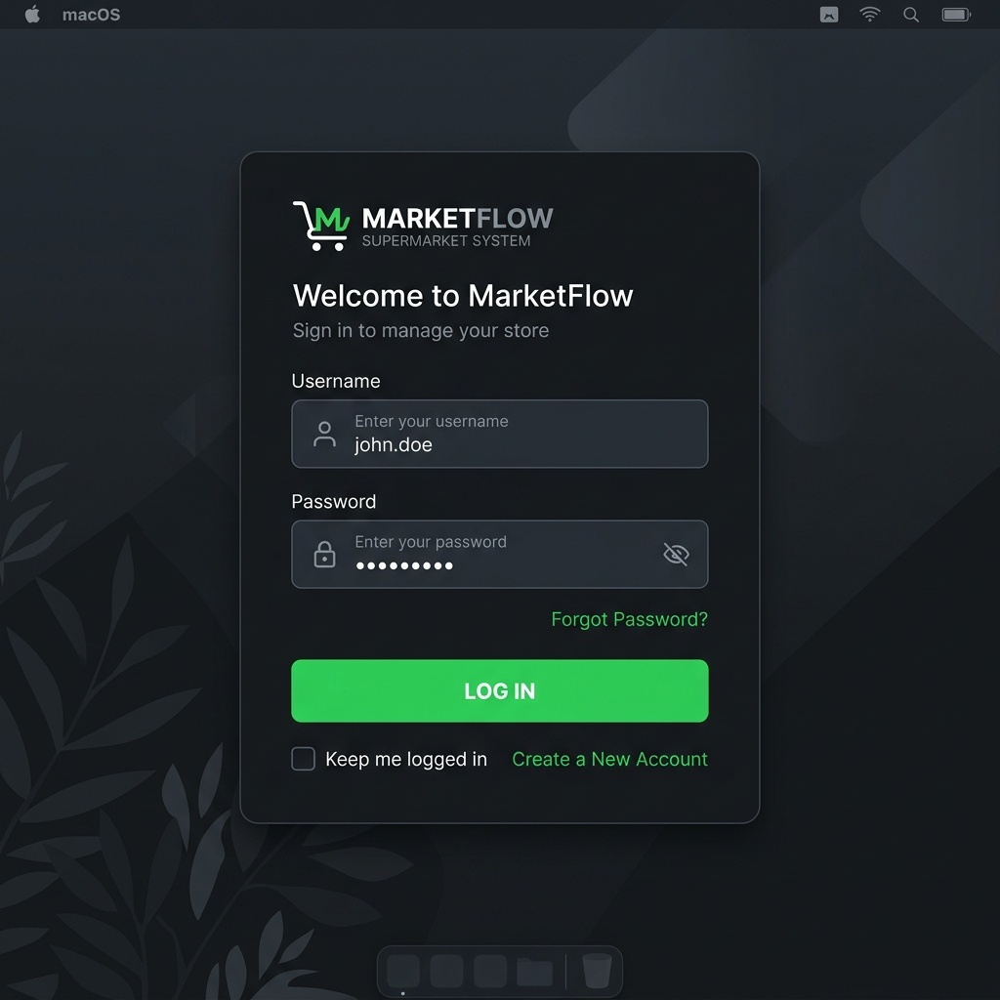

# Aula 11 — Construindo a Interface de Login do MarketFlow pelo Designer

**Duração:** 3h30. **Pré-requisito:** [Aula 09](09-Configuracao-Ambiente.md) e [Aula 10](10-Componentes-Windows-Forms.md). **Entrega:** tela `FormLogin` do projeto **MarketFlow** desenhada no Designer do Visual Studio 2022, navegável apenas pelo teclado (`Tab`, `Shift+Tab`, `Enter`), com senha oculta e validação visual de campos vazios (a autenticação real com banco e hash entra na Aula 14) (`A11.01`–`A11.04`).

| Bloco | Minutos | Atividade |
| --- | ---: | --- |
| Retomada | 15 | Revisar os controles da Aula 10 e abrir o `FormLogin` da Aula 09 no Designer |
| Explicação | 30 | `Name` vs `Text`, propriedades de usabilidade, acessibilidade e Eventos no Designer |
| Construção | 60 | Configurar `FormLogin` e arrastar/nomear todos os 6 controles no Visual Studio 2022 |
| Intervalo | 15 | Pausa |
| Prática | 60 | Configurar `TabIndex`/`AcceptButton` e implementar `btnLogin_Click` com validação |
| Entrega | 30 | Demonstrar todos os testes (`A11.01`–`A11.04`) e registrar evidências |



---

## 1. Conceitos Essenciais no Designer: `Name` vs `Text` e Eventos

Aplicando na prática os componentes estudados na [Aula 10](10-Componentes-Windows-Forms.md), relembre os dois pilares do Designer:

| Propriedade | Para quem serve? | Exemplo no Botão | Por que nunca confundir? |
| --- | --- | --- | --- |
| **`(Name)`** | Para o **programador no código C#** (nome da variável). | `btnLogin` | Sem espaços nem acentos. Usamos prefixos (`lbl`, `txt`, `btn`) para o IntelliSense agrupar os controles. |
| **`Text`** | Para o **usuário final na tela** (texto exibido). | `Entrar` | Pode ter espaços e acentos. Mudar `Text` nunca quebra o código C#; mudar `(Name)` renomeia a variável! |

### O que o Visual Studio escreve quando você dá duplo clique no botão?
1. Em **`Views/FormLogin.Designer.cs`**, o Designer inscreve o evento automaticamente:
   ```csharp
   btnLogin.Click += btnLogin_Click;
   ```
2. Em **`Views/FormLogin.cs`**, o Visual Studio cria o método manipulador pronto para você preencher:
   ```csharp
   private void btnLogin_Click(object sender, EventArgs e)
   {
       // Executa toda vez que o usuário clicar em Entrar ou apertar Enter!
   }
   ```

> [!WARNING]
> **Cuidado com inscrições duplicadas (`A11.04`):** se você apagar o método no `.cs` e der duplo clique de novo no Designer, pode acabar deixando duas inscrições `+=` no `.Designer.cs` — fazendo um único clique disparar duas `MessageBox`! Confira sempre a aba de raio **⚡ (Eventos)** em Propriedades (`F4`).

---

## 2. Roteiro Passo a Passo no Designer do Visual Studio 2022

### Passo 1 — Configurar o Formulário `Views/FormLogin.cs`
Abra `Views/FormLogin.cs` no Designer (`Shift+F7`), clique na área cinza vazia do formulário, pressione **`F4`** e configure:

| Propriedade | Valor | Por que configuramos assim? |
| --- | --- | --- |
| `Text` | `MarketFlow — Login` | Título claro na barra da janela. |
| `StartPosition` | `CenterScreen` | Abre sempre centralizada no monitor. |
| `FormBorderStyle` | `FixedSingle` | Impede esticar a borda e deformar um layout fixo. |
| `MaximizeBox` | `False` | Desativa maximização de tela cheia para uma janela pequena de login. |
| `ClientSize` | `420; 300` | Espaço interno confortável para os 6 controles. |
| `Font` | `Segoe UI, 10` | Fonte moderna e legível no Windows. |

### Passo 2 — Arrastar e Configurar os 6 Controles (`A11.01` e `A11.03`)
Na **Caixa de Ferramentas (`Ctrl+Alt+X`)**, arraste os controles abaixo e configure via **`F4`**:

| Controle | `(Name)` | Propriedades a configurar | Motivo técnico |
| --- | --- | --- | --- |
| `Label` | `lblTitulo` | `Text` = `MarketFlow — Supermercado` | Identificação visual no topo. |
| `Label` | `lblUsuario` | `Text` = `Usuário` | Permanece visível mesmo com o campo digitado (acessibilidade). |
| `TextBox` | `txtUsuario` | `Text` vazio; `TabIndex` = `0`; `MaxLength` = `50` | `TabIndex = 0` recebe o cursor primeiro; `MaxLength = 50` casa com `varchar(50)` do banco! |
| `Label` | `lblSenha` | `Text` = `Senha` | Rótulo claro do campo de senha. |
| `TextBox` | `txtSenha` | `Text` vazio; `UseSystemPasswordChar` = `True`; `TabIndex` = `1`; `MaxLength` = `128` | Mascara caracteres na tela contra olhares externos (**atenção:** protege apenas a *tela*, não o banco — o hash entra na Aula 14!). |
| `Button` | `btnLogin` | `Text` = `Entrar`; `TabIndex` = `2` | Permite chegar ao botão usando apenas `Tab`. |

### Passo 3 — Configurar a Tecla `Enter` (`AcceptButton`)
1. Clique na área vazia do `FormLogin`, pressione **`F4`**, localize **`AcceptButton`** e selecione **`btnLogin`**.
2. Agora pressionar **`Enter`** em qualquer campo aciona `btnLogin` automaticamente!

---

## 3. Código Completo e Compilável de `Views/FormLogin.cs` (Esta Etapa)

Dê **duplo clique** no botão `btnLogin` no Designer e implemente o evento completo abaixo (`A11.02`):

```csharp
namespace SupermercadoApp.Views;

public partial class FormLogin : Form
{
    public FormLogin()
    {
        InitializeComponent();
    }

    private void btnLogin_Click(object sender, EventArgs e)
    {
        // 1. Validação visual:
        //    - Usuário: IsNullOrWhiteSpace barra vazio "" e também só espaços "   ".
        //    - Senha  : Length == 0 verifica se está vazia SEM dar Trim(), pois espaços podem fazer parte da senha!
        if (string.IsNullOrWhiteSpace(txtUsuario.Text) || txtSenha.Text.Length == 0)
        {
            MessageBox.Show(
                "Preencha usuário e senha antes de continuar.",
                "Campos obrigatórios",
                MessageBoxButtons.OK,
                MessageBoxIcon.Warning);

            if (string.IsNullOrWhiteSpace(txtUsuario.Text))
                txtUsuario.Focus();
            else
                txtSenha.Focus();

            return; // Interrompe SOMENTE este evento; a janela continua aberta!
        }

        // 2. Mensagem honesta (NÃO criamos senha fixa "admin"/"123456" nem fingimos autenticação!):
        MessageBox.Show(
            $"Campos validados visualmente para '{txtUsuario.Text.Trim()}'.\nA autenticação real com banco e hash será construída na Aula 14.",
            "Validação visual concluída",
            MessageBoxButtons.OK,
            MessageBoxIcon.Information);
    }
}
```

### Para Entender Por Baixo dos Panos: O Trecho Equivalente no `FormLogin.Designer.cs`
Se você abrir `Views/FormLogin.Designer.cs` apenas para leitura (não precisa editar à mão!), verá o código C# equivalente que o Designer gerou para você:

```csharp
// Trecho ilustrativo do que o Designer gera dentro de InitializeComponent():
txtUsuario.Name = "txtUsuario";
txtUsuario.MaxLength = 50;
txtUsuario.TabIndex = 0;

txtSenha.Name = "txtSenha";
txtSenha.MaxLength = 128;
txtSenha.TabIndex = 1;
txtSenha.UseSystemPasswordChar = true;

btnLogin.Name = "btnLogin";
btnLogin.Text = "Entrar";
btnLogin.TabIndex = 2;
btnLogin.Click += btnLogin_Click; // <-- Inscrição única do evento!

AcceptButton = btnLogin;
```

---

## 4. Roteiro de Testes Obrigatórios no Visual Studio 2022 (`A11.01`–`A11.04`)

Execute com **`F5`** e registre no [Caderno de Evidências](CADERNO-DE-EVIDENCIAS.md):

1. **Ambos vazios:** clique em **Entrar** → exibe aviso de preenchimento e devolve o foco a `txtUsuario`.
2. **Apenas usuário preenchido:** digite usuário, deixe senha vazia e pressione **`Enter`** → `AcceptButton` dispara o clique e ainda recusa pedindo a senha.
3. **Ambos preenchidos:** digite usuário e senha e pressione `Enter` → confirma validação visual avisando que a autenticação entra na Aula 14.
4. **Navegação 100% pelo teclado (`A11.03`):** teste `Tab` (`txtUsuario` → `txtSenha` → `btnLogin`) e `Shift+Tab` (ordem inversa) sem usar o mouse.
5. **Senha oculta e limpeza inicial (`A11.04`):** confirme as bolinhas/asteriscos, feche e reabra a tela confirmando campos limpos.
6. **Auditoria de evento único (`A11.04`):** selecione `btnLogin` → `F4` → ícone de raio **⚡** → confirme que `Click` aponta **uma única vez** para `btnLogin_Click`.

> [!TIP]
> **Conectando ao catálogo WFA da [Aula 10](10-Componentes-Windows-Forms.md):** nesta primeira tela do projeto **MarketFlow**, aplicamos quatro componentes fundamentais: **`Form`** (`StartPosition`, `AcceptButton`), **`Label`**, **`TextBox`** (`MaxLength`, `UseSystemPasswordChar`, `TabIndex`) e **`Button`** (`Click` + `MessageBox.Show`).

---

## 5. Erros Comuns no Visual Studio 2022 (❌ Errado vs ✅ Certo)

| Erro / Sintoma | Causa provável | Como corrigir |
| --- | --- | --- |
| **`CS0103`: `txtUsuario` não existe** | Editou `Text` em vez de `(Name)`. | Selecione o `TextBox` → `F4` → ajuste **`(Name)`** no topo da janela. |
| **Um clique abre duas `MessageBox`** | `btnLogin.Click +=` foi inscrito duas vezes. | Confira a aba ⚡ (Eventos) ou `.Designer.cs` e mantenha apenas uma inscrição. |
| **Designer quebra com tela vermelha ao apagar um evento** | Apagou `btnLogin_Click` no `.cs`, mas deixou `btnLogin.Click += btnLogin_Click;` órfão no `.Designer.cs`. | Remova a linha órfã no `.Designer.cs` (ou desfaça com `Ctrl+Z`) e compile (`Ctrl+Shift+B`). |

[Anterior: Aula 10 — Componentes WFA](10-Componentes-Windows-Forms.md) · [Próxima: Aula 12 — Banco de dados e usuários](12-Criando-Banco-Dados-Neon.md) · [Índice](README.md)

## Atividades por conceito

Realize as atividades da [aula 11 no caderno complementar](ATIVIDADES-POR-CONCEITO.md#aula-11). Cada conceito tem enunciado e critério de aceite. Reúna as evidências em uma entrega por aula, usando os IDs no [caderno de evidências](CADERNO-DE-EVIDENCIAS.md). Essas tarefas integram a prática e a verificação já previstas no encontro.
