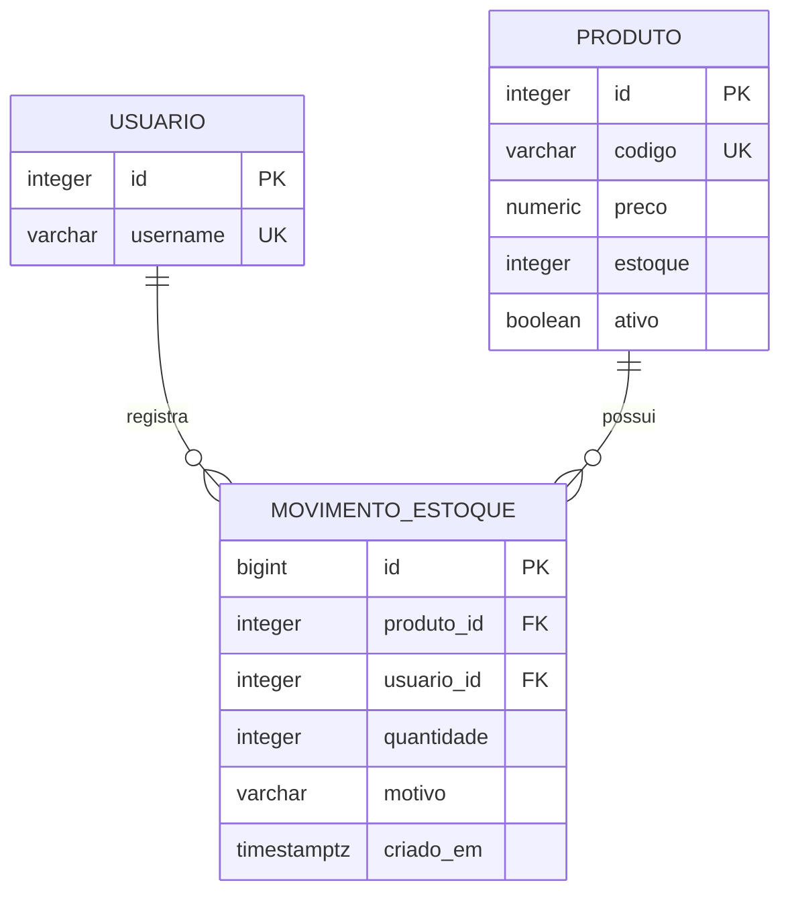

# Aula 11 — Modelo e regras dos produtos

**Duração:** 3h30. **Pré-requisito:** aula 10. **Entrega:** estrutura de produtos e movimentos no banco; regras de cadastro verificadas em memória, sem CRUD visual ainda.

| Bloco | Minutos | Atividade |
| --- | ---: | --- |
| Retomada | 15 | Rever responsabilidade de administrador |
| Explicação | 30 | Identificador, preço, saldo e restrições |
| Construção | 60 | Executar script 002 e criar Produto |
| Intervalo | 15 | Pausa |
| Prática | 60 | Criar contrato e validação com repositório em memória |
| Entrega | 30 | Verificar limites e explicar o modelo |

## 1. Modele antes de desenhar

O produto tem `Id`, `Codigo`, `Nome`, `Preco`, `Estoque` e `Ativo`. O código é texto: “000123” precisa manter os zeros. Usaremos quantidades inteiras; produtos pesáveis exigiriam outro modelo e uma política de precisão.

Acesse o SQL Editor, confira a branch e execute [002-produtos.sql](database/002-produtos.sql) **uma vez**, depois do script 001. Ele cria:

- `produto`: código único, preço positivo, estoque não negativo e estado ativo.
- `movimento_estoque`: produto, usuário responsável, quantidade com sinal e motivo.

**Por quê duas tabelas?** O saldo responde “quanto temos agora”; o movimento responde “por que mudou e quem fez”. Reposição e venda precisam atualizar os dois juntos. Os movimentos serão utilizados nas aulas 14 e 16.

O produto nasce com estoque **zero**. Não aceite saldo digitado na tela de cadastro: a entrada será feita por reposição, com histórico. Evitamos excluir fisicamente produtos porque vendas futuras precisarão preservar sua referência.



As linhas indicam “um para muitos”: cada movimento referencia exatamente um usuário e um produto. As FKs garantem referências existentes; elas não calculam o saldo automaticamente. Use os comandos de reposição e venda para manter saldo e movimentos coerentes.

## 2. Crie o modelo e o contrato mínimo

Em `Models`, crie [Produto.cs](src/SupermercadoApp/Models/Produto.cs). Em `Repositories`, crie `IProdutoRepository.cs` inicialmente com:

```csharp
using SupermercadoApp.Models;
namespace SupermercadoApp.Repositories;
public interface IProdutoRepository
{
    Task SalvarAsync(int id, string codigo, string nome, decimal preco);
}
```

As consultas, a inativação e a reposição serão acrescentadas nas próximas aulas; a referência mostra o contrato final.

Em `Services`, crie `ProdutoService.cs` com o construtor e **somente `SalvarAsync`** da [referência](src/SupermercadoApp/Services/ProdutoService.cs). Ele recebe `IProdutoRepository`, exige administrador e valida:

- Código entre 1 e 30 caracteres após `Trim`.
- Nome entre 2 e 120 caracteres.
- Preço maior que zero, com no máximo duas casas decimais e até 99.999.999,99.
- ID zero indica novo produto; ID negativo é recusado.

Não arredondamos silenciosamente `1,999` para `2,00`: o cadastro deve pedir correção. No PostgreSQL, `numeric(10,2)` representa dez dígitos totais, dos quais dois são decimais. O tipo pode arredondar na conversão; a validação em C# recusa a entrada antes disso.

## 3. Teste sem a interface de cadastro

Desenhe antes as relações: um Produto tem muitos Movimentos; um Usuário é responsável por muitos Movimentos; cada Movimento aponta para um Produto e um Usuário por chaves estrangeiras. No dicionário de dados, registre tipos, PK, FK e restrições das duas tabelas.

No fake, acrescente `public int Chamadas { get; private set; }` e incremente apenas dentro de `SalvarAsync`. Após um caso válido, execute os inválidos abaixo e comprove que o contador não aumentou. Uma primeira asserção executável pode ser `if (fake.Chamadas != 1) throw new Exception("Validação chegou indevidamente ao repositório");`. Essa verificação será reaproveitada na aula 20.

| Entrada | Resultado esperado |
| --- | --- |
| Preço 0 / 0,01 / 1,999 | Recusa / aceita / recusa |
| Preço 99.999.999,99 / 100.000.000 | Aceita / recusa |
| Nome com 1 / 2 / 120 / 121 caracteres | Recusa / aceita / aceita / recusa |
| Código com 0 / 1 / 30 / 31 caracteres após Trim | Recusa / aceita / aceita / recusa |
| ID -1 / 0 | Recusa / inclusão |

Crie um `ProdutoEmMemoriaRepository` temporário implementando `IProdutoRepository`, com `SalvarAsync` que apenas anota os argumentos em uma propriedade e devolve `Task.CompletedTask`. Use um botão temporário na janela de administração para chamar o serviço com código “000123”, nome “Arroz” e preço 25,90. Remova o botão após a verificação; o fake pode ser guardado como exercício.

Repita com nome vazio, preço zero e `1.999m`. A propriedade do fake não deve mudar quando a validação falha. Passe também uma `Sessao` de caixa: o serviço deve negar antes de chamar o repositório.

**Por quê o banco também tem restrições?** Outro programa ou dois usuários simultâneos podem gravar dados. Validação amigável no serviço e integridade no banco cumprem funções diferentes.

## Verifique antes de encerrar

Execute `SELECT codigo, nome, preco, estoque, ativo FROM produto;`: ainda pode estar vazio. Confirme os casos de validação e explique a diferença entre saldo e movimento. Não crie produtos diretamente no SQL para substituir o exercício de validação do serviço.

[Anterior: aula 10](10-Sessao-e-Perfis.md) · [Próxima: aula 12](12-Consulta-de-Produtos.md)

## Atividades por conceito

Realize as atividades da [aula 11 no caderno complementar](ATIVIDADES-POR-CONCEITO.md#aula-11). Cada conceito tem enunciado e critério de aceite. Reúna as evidências em uma entrega por aula, usando os IDs no [caderno de evidências](CADERNO-DE-EVIDENCIAS.md). Essas tarefas integram a prática e a verificação já previstas no encontro.
