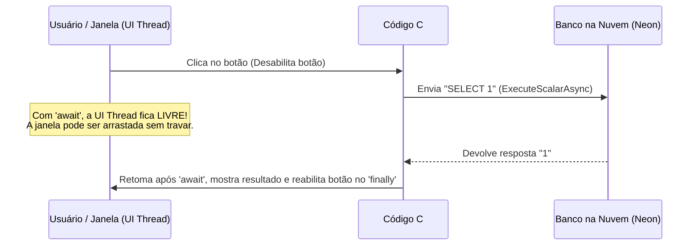

# Aula 12 — Conexão Assíncrona, Pool de Conexões e Descarte Seguro

> [!NOTE]
> **Opção MySQL/MariaDB (XAMPP):** se você escolheu banco local, utilize as Etapas 3 a 5 da [trilha alternativa XAMPP](INTEGRACAO-MYSQL-XAMPP.md) no lugar de `Npgsql` e `NpgsqlDataSource`. Todos os conceitos de assincronia (`async`/`await`), descarte (`await using`), `try/catch/finally` e segurança permanecem idênticos.

**Duração:** 3h30. **Pré-requisito:** [Aula 11](11-Criando-Banco-Dados-Neon.md) e `FormLogin` da Aula 10. **Entrega:** infraestrutura `Banco.cs` construída por você usando variável de ambiente, mais botão temporário de diagnóstico que executa `SELECT 1` sem travar a janela e trata falhas de rede com segurança.

| Bloco | Minutos | Atividade |
| --- | ---: | --- |
| Retomada | 15 | Conferir branch/tabela da Aula 11 e projeto `SupermercadoApp` no VS 2022 |
| Explicação | 30 | NuGet, variáveis de ambiente, Pool (`NpgsqlDataSource`), `async/await` e `finally` |
| Construção | 60 | Instalar Npgsql, configurar `SUPERMERCADO_DB` e construir `Infrastructure/Banco.cs` |
| Intervalo | 15 | Pausa |
| Prática | 60 | Injetar a fonte de dados e construir o evento assíncrono `SELECT 1` |
| Entrega | 30 | Demonstrar sucesso, espera responsiva, configuração ausente e falha de rede |

---

## 1. Conceitos Fundamentais Desta Aula (O Quê e Por Quê)

### 1.1 O que é NuGet no Visual Studio 2022?
O .NET não vem com drivers para todos os bancos do mundo embutidos. O **NuGet** é o gerenciador oficial de pacotes/bibliotecas para projetos .NET. Instalar o pacote **`Npgsql`** adiciona ao seu `.csproj` a biblioteca que sabe falar o protocolo binário do PostgreSQL. **Atenção:** um pacote NuGet pertence ao *projeto* (fica registrado em `SupermercadoApp.csproj`), não é uma extensão da IDE!

### 1.2 Por que guardar a conexão em Variável de Ambiente (`SUPERMERCADO_DB`)?
Se você colar `Password=minhasenha` dentro de um arquivo `.cs`, basta subir o projeto no GitHub ou enviar um ZIP para o professor e sua senha vazou!
Lendo `Environment.GetEnvironmentVariable("SUPERMERCADO_DB")`, o código-fonte fica 100% livre de segredos: cada máquina lê sua própria variável do sistema operacional.
- **Por que fechar e reabrir o Visual Studio 2022 após criar a variável no Windows?** Cada processo do Windows tira uma "foto" das variáveis de ambiente **no instante em que é aberto**. Um Visual Studio que já estava aberto não enxerga variáveis recém-criadas até ser reiniciado.

### 1.3 O que é Pool de Conexões (`NpgsqlDataSource`) e `using` / `await using`?
Abrir uma conexão TCP + criptografia TLS até a nuvem do zero leva centenas de milissegundos.
- **`NpgsqlDataSource`** gerencia um **Pool (piscina) de Conexões**: criamos o `NpgsqlDataSource` **uma única vez** no `Program.cs` e injetamos onde precisar.
- A cada consulta, criamos um comando com `await using var cmd = banco.CreateCommand(...)`. Quando o bloco termina (mesmo que dê exceção!), o **`await using`** devolve automaticamente a conexão ao Pool sem vazar recursos do servidor!
- **O que NUNCA fazer:** guardar uma conexão aberta global para sempre nem chamar `Banco.Criar()` a cada clique de botão (isso recriaria pools e esgotaria o limite do Neon).

### 1.4 Programação Assíncrona (`async`, `await`, `Task` e `async void`)
No Windows Forms, existe uma única **Thread de Interface (UI Thread)** responsável por desenhar a janela, mover o mouse e responder a cliques.

- **Sem `await` (ou usando `.Result` / `.Wait()`):** a UI Thread fica bloqueada esperando a internet; a janela congela e o Windows mostra `(Não está respondendo)` — podendo até causar *deadlock* na interface!
- **`async` e `Task`:** métodos assíncronos normais retornam `Task` (ou `Task<T>`) para que quem os chamou possa aguardar com `await` e capturar exceções.
- **Exceção única — `async void`:** no Windows Forms, manipuladores de evento (`private async void btnTestarConexao_Click(object sender, EventArgs e)`) **precisam** retornar `void` por exigência do evento `Click`. **Nunca** use `async void` nos seus serviços ou repositórios!

### 1.5 Por que usar `try / catch / finally` ao redor de chamadas de rede?
- Antes do `try`: desabilitamos o botão (`botao.Enabled = false;`) para impedir que o usuário clique 5 vezes seguidas enquanto a internet responde.
- No `try`: executamos a consulta ao banco com `await`.
- No `catch (Exception)`: exibimos uma mensagem amigável **sem jamais mostrar `erro.ToString()`** na tela (detalhes técnicos podem expor servidor, porta ou estrutura interna!).
- No **`finally`**: reabilitamos o botão (`botao.Enabled = true;`). **Por que no `finally` e não depois do `try`?** Porque o bloco `finally` executa **sempre** — tanto se a consulta deu certo quanto se deu erro de internet! Sem `finally`, uma falha de rede deixaria o botão travado desabilitado para sempre.

---

## 2. Passo a Passo no Visual Studio 2022: NuGet e Variável de Ambiente

### Passo 1 — Instalar o pacote `Npgsql` (`A12.01`)
1. No **Gerenciador de Soluções** do Visual Studio 2022, clique com o botão direito no projeto **`SupermercadoApp`** → **Gerenciar Pacotes do NuGet...**.
2. Clique na aba **Procurar**, verifique se a **Origem do pacote** no canto superior direito é `nuget.org` e pesquise por **`Npgsql`**.
3. Selecione o pacote oficial **Npgsql** (do autor *Npgsql*), escolha a versão compatível com o SDK da turma (conforme definido pelo professor; consulte [REFERENCIAS.md](REFERENCIAS.md)) e clique em **Instalar**.
4. Expanda **Dependências → Pacotes** no Gerenciador de Soluções e confirme que `Npgsql` aparece listado. Pressione `Ctrl+Shift+B` para validar a compilação.

### Passo 2 — Configurar a variável `SUPERMERCADO_DB` no Windows (`A12.02`)
1. Abra o menu Iniciar do Windows e digite **Editar as variáveis de ambiente da sua conta**.
2. Na seção superior (**Variáveis de usuário**), clique em **Novo...**.
3. Nome da variável: **`SUPERMERCADO_DB`**.
4. Valor da variável: cole a sua string de conexão Npgsql da Aula 11 (com `SSL Mode=VerifyFull;`).
5. Clique em **OK** em todas as janelas e **feche e reabra o Visual Studio 2022**.

*(Prefira sempre a janela gráfica do Windows em vez de digitar a senha no terminal, para que a senha não fique salva no histórico de comandos.)*

---

## 3. Roteiro de Construção Guiada (Sua Vez no Visual Studio 2022!)

Construa cada peça abaixo **sem copiar código pronto de `src/`**:

### Construção 1 — Classe `Infrastructure/Banco.cs` (`A12.03`)
1. No **Gerenciador de Soluções**, clique com o botão direito na pasta **`Infrastructure`** → **Adicionar → Classe...** (`Shift+Alt+C`) → nomeie como **`Banco.cs`**.
2. Adicione `using Npgsql;` no topo e confirme `namespace SupermercadoApp.Infrastructure;`.
3. Declare uma classe pública estática **`public static class Banco`** (estática porque atua apenas como fábrica de configuração, sem estado de instância).
4. Crie o método público estático **`public static NpgsqlDataSource Criar()`** seguindo esta sequência lógica:
   - Leia a variável de ambiente: `string? texto = Environment.GetEnvironmentVariable("SUPERMERCADO_DB");`.
   - Verifique com `if (string.IsNullOrWhiteSpace(texto))`: se estiver ausente/vazia, lance `InvalidOperationException` com uma mensagem clara instruindo a configurar `SUPERMERCADO_DB` e reabrir o Visual Studio 2022.
   - Passe `texto` para `var builder = new NpgsqlConnectionStringBuilder(texto);`.
   - Force programaticamente as proteções de segurança e tempo limite no `builder`:
     - `builder.SslMode = SslMode.VerifyFull;` (impede conexões sem verificação TLS);
     - `builder.Timeout = 15;` (máximo 15 segundos para conectar);
     - `builder.CommandTimeout = 30;` (máximo 30 segundos por consulta).
   - Retorne `NpgsqlDataSource.Create(builder.ConnectionString);`.

### Construção 2 — Injetar a Fonte de Dados no `FormLogin` e no `Program.cs`
1. Abra **`Views/FormLogin.cs`** no modo código (`F7`).
2. Adicione `using Npgsql;` no topo.
3. Declare um campo privado somente leitura: `private readonly NpgsqlDataSource banco;`.
4. Altere o construtor existente de `FormLogin` para receber `NpgsqlDataSource banco` como parâmetro — **mantendo `InitializeComponent();`** na primeira linha do construtor e salvando `this.banco = banco;` logo abaixo!
5. Abra **`Program.cs`** e proteja a inicialização após `ApplicationConfiguration.Initialize();`:
   - Envolva em um `try / catch (InvalidOperationException erro)`:
     - No `try`: crie a fonte de dados com **`using var banco = SupermercadoApp.Infrastructure.Banco.Criar();`** (o `using` garante que o pool seja fechado ao sair do aplicativo) e passe-a ao login: `Application.Run(new SupermercadoApp.Views.FormLogin(banco));`.
     - No `catch`: mostre `MessageBox.Show(erro.Message, "Configuração");` para orientar o usuário caso a variável de ambiente falte.

### Construção 3 — Botão Temporário de Diagnóstico `SELECT 1` (`A12.04` e `A12.05`)
*(Este botão será removido na Aula 13, quando a tela deixar de falar direto com o banco e passar a falar com o `AutenticacaoService`.)*

1. Abra **`Views/FormLogin.cs`** no Designer (`Shift+F7`), arraste um `Button`, configure `(Name)` como **`btnTestarConexao`** e `Text` como **`Testar conexão`**.
2. Dê duplo clique no botão para gerar o manipulador no `FormLogin.cs` e adicione a palavra-chave **`async`** à assinatura (`private async void btnTestarConexao_Click(object sender, EventArgs e)`).
3. Construa o corpo do evento seguindo exatamente estes passos:
   - Desabilite o botão (`btnTestarConexao.Enabled = false;`).
   - Abra um bloco **`try / catch (Exception) / finally`**:
     - **No `try`:**
       - Crie o comando com descarte assíncrono: `await using var comando = banco.CreateCommand("SELECT 1");`.
       - Aguarde o resultado escalar: `var resultado = await comando.ExecuteScalarAsync();` (por que `ExecuteScalarAsync`? Porque `SELECT 1` devolve um único valor na primeira linha e primeira coluna!).
       - Exiba com `MessageBox.Show` confirmando a conexão e mostrando `resultado`.
     - **No `catch (Exception)`:** exiba uma mensagem amigável orientando conferir rede e configuração (sem mostrar `erro.ToString()` nem credenciais!).
     - **No `finally`:** reabilite o botão (`btnTestarConexao.Enabled = true;`).

---

## 4. Roteiro de Testes, Rastreamento e Evidências (`A12.01`–`A12.05`)

1. **Rastreamento no papel antes de rodar:** trace os 3 caminhos possíveis: (a) sucesso (`try` → `finally`), (b) erro de rede (`try` → `catch` → `finally`) e (c) variável ausente (falha em `Banco.Criar()` antes mesmo da tela abrir). Desenhe quais objetos são descartados em cada caminho.
2. **Teste de responsividade da janela (`A12.04`):** adicione temporariamente `await Task.Delay(2000);` logo antes do `CreateCommand`, rode com `F5`, clique no botão e **arraste a janela pela tela durante os 2 segundos de espera** — confirme que ela não congela e que o botão fica desabilitado impedindo clique duplo. **Remova o `Task.Delay` ao concluir!**
3. **Teste real de `SELECT 1`:** clique em **Testar conexão** com a internet ligada → deve exibir `1` e reabilitar o botão.
4. **Teste sem configuração (`A12.02`):** remova/renomeie temporariamente `SUPERMERCADO_DB`, reabra o VS 2022, rode e confirme a mensagem amigável de configuração ausente. Restaure a variável e reabra o VS 2022.
5. **Teste de rede indisponível (`A12.05`):** com orientação do professor, teste sem rede e confirme que nenhuma senha/host vaza na mensagem e que o botão volta a habilitar após o timeout.

---

## 5. Erros Comuns no Visual Studio 2022

| Erro / Sintoma | Causa provável | Como corrigir |
| --- | --- | --- |
| `CS4033: O operador 'await' só pode ser usado em um método assíncrono` | Esqueceu de colocar `async` na declaração do evento `private async void btnTestarConexao_Click`. | Adicione `async` antes de `void`. |
| "Configure a variável SUPERMERCADO_DB..." mesmo depois de criar no Windows | Você criou a variável com o Visual Studio 2022 já aberto. | Feche todas as janelas do VS 2022 e abra novamente. |
| Designer do `FormLogin` não abre mais | Alguns cenários do Designer visual procuram um construtor sem parâmetros ou falham se houver código extra antes de `InitializeComponent()`. | Mantenha `InitializeComponent()` na primeira linha do construtor e evite código que acesse rede dentro do construtor. |

[Anterior: Aula 11](11-Criando-Banco-Dados-Neon.md) · [Próxima: Aula 13 — Autenticação segura](13-Autenticacao-Segura.md) · [Índice](README.md)

## Atividades por conceito

Realize as atividades da [aula 12 no caderno complementar](ATIVIDADES-POR-CONCEITO.md#aula-12). Cada conceito tem enunciado e critério de aceite. Reúna as evidências em uma entrega por aula, usando os IDs no [caderno de evidências](CADERNO-DE-EVIDENCIAS.md). Essas tarefas integram a prática e a verificação já previstas no encontro.
