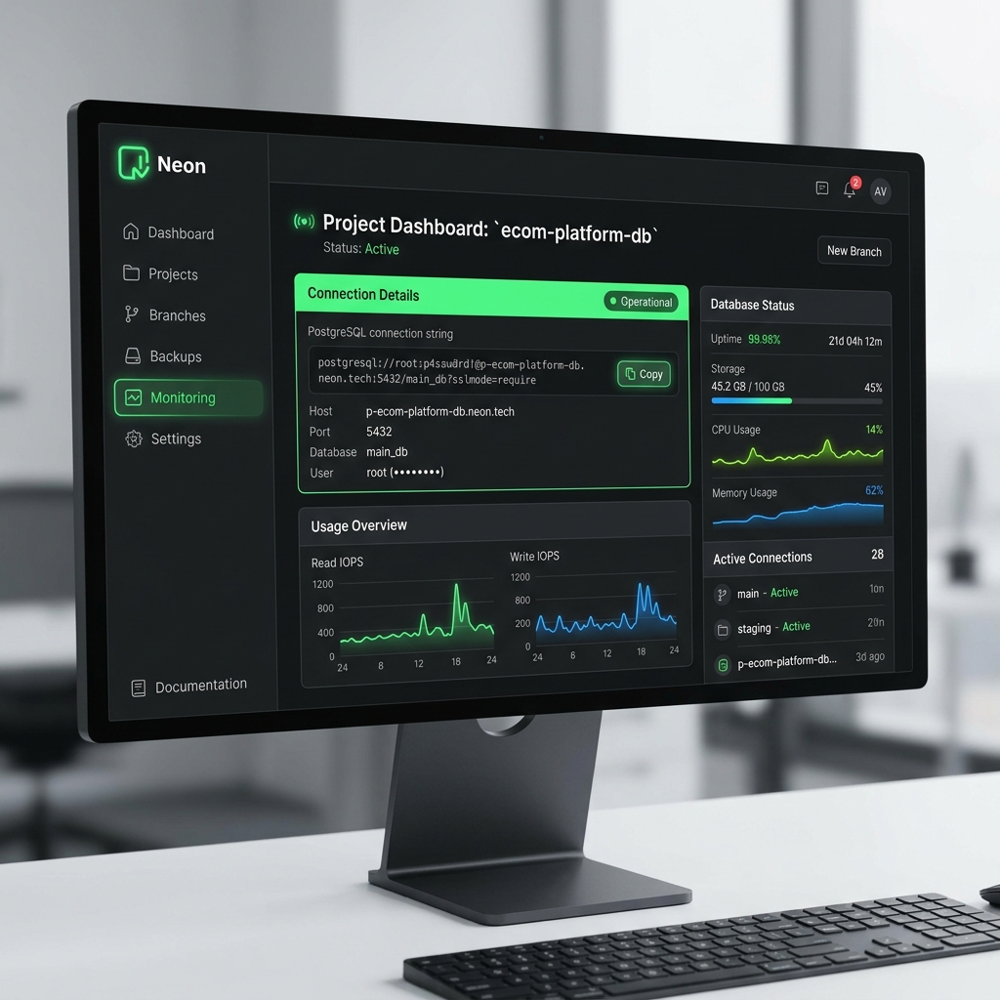

# Aula 12 — Banco de Dados Relacional, Integridade e Tabela de Usuários

> [!NOTE]
> **Escolha do banco de dados:** esta aula apresenta a trilha principal com **Neon / PostgreSQL**. Se a sua turma escolheu banco local com **MySQL/MariaDB pelo XAMPP**, siga as Etapas 1 e 2 da [trilha alternativa XAMPP](INTEGRACAO-MYSQL-XAMPP.md) no lugar da criação de conta Neon e dos scripts PostgreSQL abaixo. Todos os conceitos de integridade e critérios de entrega permanecem os mesmos.

**Duração:** 3h30. **Pré-requisito:** [Aula 11](11-Criando-Interface-Login.md), internet e conta de laboratório. **Entrega:** ambiente de banco isolado com a tabela `usuario` criada, restrições (`PK`, `UNIQUE`, `NOT NULL`, `CHECK`) e transações (`BEGIN`/`ROLLBACK`/`COMMIT`) comprovadas em tabela temporária, e nenhuma senha em texto puro (`A12.01`–`A12.05`).

| Bloco | Minutos | Atividade |
| --- | ---: | --- |
| Retomada | 15 | Diferenciar memória RAM volátil da persistência em banco de dados |
| Explicação | 30 | Tabelas, chave primária, `IDENTITY`, `NOT NULL`, `UNIQUE`, `CHECK`, transações e TLS |
| Construção | 60 | Preparar projeto/branch isolada no Neon e aplicar o script `001-usuarios.sql` |
| Intervalo | 15 | Pausa |
| Prática | 60 | Executar os exemplos práticos de inspeção SQL e o laboratório de restrições/rollback |
| Entrega | 30 | Explicar dicionário de dados, restrições e diferença entre Role do banco e Perfil do app |

---

## 1. Por Que Um Banco Relacional com Restrições? (Defesa em Profundidade)

Na memória RAM (Aulas 01–10), tudo some ao fechar o aplicativo. Um **Banco de Dados Relacional (PostgreSQL)** grava os dados em disco em **tabelas** (colunas com tipos fixos e linhas representando registros) e permite que vários caixas trabalhem ao mesmo tempo com consistência garantida.

- **Validação no C#:** oferece mensagens rápidas e amigáveis na interface.
- **Restrições no Banco (`PRIMARY KEY`, `NOT NULL`, `UNIQUE`, `CHECK`):** são a **barreira definitiva de integridade** — mesmo que outro programa ou dois usuários no mesmo milissegundo tentem gravar dados inválidos ou duplicados, o PostgreSQL recusa fisicamente a gravação!

---

## 2. Preparando Seu Ambiente Isolado no Neon (`A12.01`)

1. Acesse o [console do Neon](https://console.neon.tech/) e faça login com sua conta de laboratório.
2. Crie um projeto chamado **`SupermercadoDB`** na região mais próxima.
3. **Regra de isolamento:** cada estudante ou dupla deve usar seu **próprio banco ou branch vazia** para não sobrescrever dados de outros colegas.
4. Abra o **SQL Editor** e **sempre confira o nome da branch e do banco selecionados** no topo antes de executar qualquer comando!



---

## 3. Script Completo `database/001-usuarios.sql` Dissecado Linha por Linha (`A12.02`)

Veja o conteúdo completo de [database/001-usuarios.sql](database/001-usuarios.sql) antes de executá-lo **uma única vez** no SQL Editor:

```sql
BEGIN;

CREATE TABLE usuario (
    id         integer     GENERATED ALWAYS AS IDENTITY PRIMARY KEY,
    username   varchar(50) NOT NULL UNIQUE CHECK (username = lower(username)),
    senha_hash text        NOT NULL,
    perfil     varchar(20) NOT NULL CHECK (perfil IN ('Administrador', 'Caixa'))
);

COMMIT;
```

| Cláusula SQL | O que faz exatamente? | Por que usamos assim? |
| --- | --- | --- |
| `BEGIN;` ... `COMMIT;` | Agrupa tudo em uma **transação atômica**. | Ou cria por inteiro, ou desfaz tudo se houver erro. |
| `id integer GENERATED ALWAYS AS IDENTITY PRIMARY KEY` | **Chave Primária (`PK`)** numérica gerada automaticamente. | Identidade fixa e imutável de cada usuário (`GENERATED ALWAYS` impede forçar IDs manuais; lembre-se de que IDs podem ter lacunas após um `ROLLBACK`). |
| `username varchar(50) NOT NULL UNIQUE` | Texto até 50 caracteres, obrigatório e **sem repetição**. | `UNIQUE` impede logins duplicados mesmo em acessos simultâneos. **Atenção:** `NOT NULL` proíbe ausência (`NULL`), mas sozinho **não** proíbe texto vazio `''`! |
| `CHECK (username = lower(username))` | Só aceita o login todo em letras minúsculas. | Evita duas contas diferentes `"Admin"` e `"admin"` no sistema. |
| `senha_hash text NOT NULL` | Armazena o **hash criptográfico** gerado pelo C# (Aula 14). | **Nunca** gravamos senha aberta nem `INSERT` com `"123456"` no SQL! |
| `perfil varchar(20) NOT NULL CHECK (perfil IN ('Administrador', 'Caixa'))` | Aceita exclusivamente esses dois valores exatos. | Casa 100% com o `enum Perfil` que criaremos em C# na Aula 14. |

---

## 4. Exemplos Práticos SQL — Inspeção, Violação de Restrições e Transações (`A12.02`–`A12.04`)

### Exemplo Prático #1 — Conferir a Tabela Criada (Após Aplicar `001-usuarios.sql`)

Execute estas duas consultas `SELECT` no SQL Editor:

```sql
-- 1. Consultar usuários existentes (resultado esperado hoje: 0 linhas! O 1º admin entra na Aula 14):
SELECT id, username, perfil FROM usuario;

-- 2. Inspecionar a estrutura real registrada nos metadados do PostgreSQL:
SELECT column_name, data_type, is_nullable
FROM information_schema.columns
WHERE table_schema = 'public' AND table_name = 'usuario'
ORDER BY ordinal_position;
```

### Exemplo Prático #2 — Laboratório Controlado em Tabela Temporária (`A12.03` e `A12.04`)

Em vez de sujar a tabela real `usuario` com dados falsos, usamos uma **tabela temporária** (`CREATE TEMP TABLE`, que some sozinha ao encerrar a sessão — veja também [database/laboratorio/07-restricoes.sql](database/laboratorio/07-restricoes.sql)). Execute **um bloco por vez** e observe qual restrição o PostgreSQL acusa em cada falha:

```sql
-- 1. Criar tabela temporária com as MESMAS regras (sem coluna de senha):
CREATE TEMP TABLE usuario_lab (
    id       integer     GENERATED ALWAYS AS IDENTITY PRIMARY KEY,
    username varchar(50) NOT NULL UNIQUE CHECK (username = lower(username)),
    perfil   varchar(20) NOT NULL CHECK (perfil IN ('Administrador', 'Caixa'))
);

-- 2. Inserção VÁLIDA (deve funcionar!):
INSERT INTO usuario_lab (username, perfil) VALUES ('ana.caixa', 'Caixa');

-- 3. Teste de UNIQUE (deve FALHAR acusando violação de unicidade!):
INSERT INTO usuario_lab (username, perfil) VALUES ('ana.caixa', 'Caixa');

-- 4. Teste de NOT NULL vs texto vazio '':
INSERT INTO usuario_lab (username, perfil) VALUES (NULL, 'Caixa'); -- FALHA (NOT NULL)
INSERT INTO usuario_lab (username, perfil) VALUES ('', 'Caixa');   -- PASSA! (Prova que '' != NULL)

-- 5. Teste de CHECK (maiúsculas) — deve FALHAR:
INSERT INTO usuario_lab (username, perfil) VALUES ('Admin', 'Administrador');

-- 6. Teste de CHECK (perfil inválido) — deve FALHAR:
INSERT INTO usuario_lab (username, perfil) VALUES ('joao', 'Gerente');

-- 7. Teste de TRANSAÇÃO: ROLLBACK (desfaz) vs COMMIT (confirma):
BEGIN;
INSERT INTO usuario_lab (username, perfil) VALUES ('teste.desfeito', 'Caixa');
ROLLBACK; -- A linha desaparece!

BEGIN;
INSERT INTO usuario_lab (username, perfil) VALUES ('teste.confirmado', 'Administrador');
COMMIT;   -- A linha permanece gravada!

-- 8. Conferir o que sobrou (repare também no salto do 'id' gerado após o ROLLBACK!):
SELECT id, username, perfil FROM usuario_lab ORDER BY id;
```

---

## 5. String de Conexão, TLS e Diferença Entre Role e Perfil (`A12.05`)

No painel do Neon, clique em **Connect**, escolha **.NET / C#** e observe a estrutura da string de conexão Npgsql:

```text
Host=SEU_HOST;Database=SEU_BANCO;Username=SEU_ROLE;Password=SUA_SENHA;SSL Mode=VerifyFull;
```

- **Por que `Chave=Valor;` e não `postgresql://...`?** O `NpgsqlConnectionStringBuilder` (Aula 13) lê pares `Chave=Valor;` separados por ponto e vírgula.
- **O que faz `SSL Mode=VerifyFull`?** Criptografa o tráfego com **TLS** e valida que o certificado pertence ao hostname oficial do servidor. **Nunca** desative verificação TLS!
- **Role do Banco vs Perfil do Aplicativo:**
  - **Role (`Username` na string de conexão):** credencial técnica usada pelo *aplicativo* para autenticar no servidor PostgreSQL.
  - **Perfil (`Administrador` / `Caixa` na tabela `usuario`):** conta humana do *funcionário* dentro do MarketFlow.

> [!CAUTION]
> **Segurança absoluta:** jamais salve sua string de conexão em arquivos `.cs`, no GitHub, em capturas de tela ou no Caderno de Evidências! Na Aula 13 ela será configurada como variável de ambiente do Windows.

---

## 6. Roteiro de Entrega (`A12.01`–`A12.05`)

1. **`A12.01`:** registre o nome do ambiente didático isolado (sem credenciais) e explique o que conferir antes de rodar `001-usuarios.sql`.
2. **`A12.02`:** aplique `001-usuarios.sql` uma vez, execute os dois `SELECT` de conferência (zero usuários) e monte o **Dicionário de Dados** de `usuario`.
3. **`A12.03` e `A12.04`:** execute todos os casos da tabela temporária `usuario_lab` (duplicidade, `NULL` vs `''`, maiúsculas, perfil inválido, `ROLLBACK` e `COMMIT`) registrando o resultado de cada um.
4. **`A12.05`:** entregue o modelo genérico da string de conexão (sem segredos) explicando cada campo e diferenciando Role de Perfil.

Fontes oficiais: [Neon com .NET/Npgsql](https://neon.com/docs/guides/dotnet-npgsql) e [Segurança TLS no Npgsql](https://www.npgsql.org/doc/security.html).

[Anterior: Aula 11](11-Criando-Interface-Login.md) · [Próxima: Aula 13 — Conexão assíncrona](13-Conectando-Banco-Dados.md) · [Índice](README.md)

## Atividades por conceito

Realize as atividades da [aula 12 no caderno complementar](ATIVIDADES-POR-CONCEITO.md#aula-12). Cada conceito tem enunciado e critério de aceite. Reúna as evidências em uma entrega por aula, usando os IDs no [caderno de evidências](CADERNO-DE-EVIDENCIAS.md). Essas tarefas integram a prática e a verificação já previstas no encontro.
