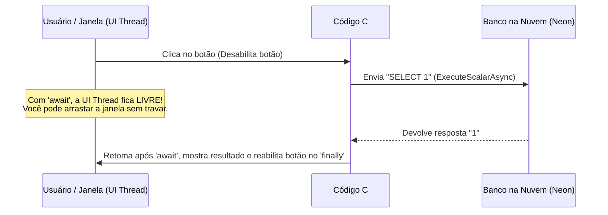

# Aula 13 — Conexão Assíncrona (`async`/`await`), Pool de Conexões e Descarte Seguro

> [!NOTE]
> **Opção MySQL/MariaDB (XAMPP):** se você escolheu banco local, utilize as Etapas 3 a 5 da [trilha alternativa XAMPP](INTEGRACAO-MYSQL-XAMPP.md) no lugar de `Npgsql` e `NpgsqlDataSource`. Todos os conceitos de `async`/`await`, `await using`, `try/catch/finally` e segurança permanecem idênticos.

**Duração:** 3h30. **Pré-requisito:** [Aula 12](12-Criando-Banco-Dados-Neon.md) e `FormLogin` da [Aula 11](11-Criando-Interface-Login.md). **Entrega:** `Infrastructure/Banco.cs` lendo variável de ambiente `SUPERMERCADO_DB`, mais botão temporário de diagnóstico em `FormLogin` executando `SELECT 1` assincronamente sem congelar a janela (`A13.01`–`A13.05`).

| Bloco | Minutos | Atividade |
| --- | ---: | --- |
| Retomada | 15 | Conferir branch/tabela da Aula 12 e projeto `SupermercadoApp` no VS 2022 |
| Explicação | 30 | NuGet, variáveis de ambiente, Pool (`NpgsqlDataSource`), `async`/`await` e `finally` |
| Construção | 60 | Instalar `Npgsql`, configurar `SUPERMERCADO_DB` e construir `Infrastructure/Banco.cs` |
| Intervalo | 15 | Pausa |
| Prática | 60 | Injetar `NpgsqlDataSource` no `FormLogin` e programar `SELECT 1` assíncrono |
| Entrega | 30 | Demonstrar sucesso, espera responsiva (`Task.Delay`), falta de config e falha de rede |

---

## 1. Conceitos Fundamentais (O Quê, Como e Por Quê)

### 1.1 NuGet e Variável de Ambiente (`A13.01` e `A13.02`)
- **NuGet:** gerenciador oficial de pacotes do .NET. Instalar `Npgsql` adiciona a referência no arquivo `SupermercadoApp.csproj` (é dependência do *projeto*, não extensão da IDE).
- **Variável de Ambiente (`SUPERMERCADO_DB`):** mantém senhas fora do código-fonte. Ao criá-la no Windows, **feche e reabra o Visual Studio 2022**, pois cada processo captura o ambiente apenas no momento em que é iniciado.

### 1.2 Pool de Conexões (`NpgsqlDataSource`) e Descarte (`using` / `await using`) (`A13.03`)
- Criamos **um único `NpgsqlDataSource`** no `Program.cs` (dentro de `using var banco = Banco.Criar();`), que mantém um **Pool (piscina)** de conexões TCP/TLS reutilizáveis.
- Em cada consulta, usamos **`await using var cmd = banco.CreateCommand(...)`**: ao terminar o bloco (mesmo com exceção!), a conexão volta automaticamente para o Pool sem vazar recursos!

### 1.3 Programação Assíncrona (`async`, `await`, `Task` e `async void`) (`A13.04`)

No Windows Forms, existe uma única **Thread de Interface (UI Thread)** desenhando janelas e atendendo cliques:



- **Nunca use `.Result` ou `.Wait()` em WinForms:** bloqueiam a UI Thread, congelam a janela e podem causar *deadlock*.
- **Métodos assíncronos normais** retornam `Task` ou `Task<T>`.
- **Exceção única — `async void`:** manipuladores de evento do WinForms (`private async void btnTestarConexao_Click(...)`) exigem retorno `void`. **Nunca** use `async void` em serviços ou repositórios!

---

## 2. Preparação no Visual Studio 2022 e no Windows

### Passo 1 — Instalar o pacote `Npgsql` (`A13.01`)
1. No **Gerenciador de Soluções**, clique direito em **`SupermercadoApp`** → **Gerenciar Pacotes do NuGet...** → aba **Procurar**.
2. Pesquise **`Npgsql`** (autor *Npgsql*), escolha a versão compatível com o SDK da turma (veja [REFERENCIAS.md](REFERENCIAS.md)) e clique em **Instalar**.
3. Pressione `Ctrl+Shift+B` para confirmar a compilação.

### Passo 2 — Criar a variável `SUPERMERCADO_DB` no Windows (`A13.02`)
1. Menu Iniciar → **Editar as variáveis de ambiente da sua conta** → **Variáveis de usuário** → **Novo...**.
2. Nome: **`SUPERMERCADO_DB`** | Valor: sua string de conexão Npgsql da Aula 12 (com `SSL Mode=VerifyFull;`).
3. Clique em **OK** e **feche e reabra o Visual Studio 2022**.

---

## 3. Código Completo e Compilável desta Etapa (3 Arquivos)

> [!TIP]
> **Ordem importante no Designer:** antes de adicionar o parâmetro `NpgsqlDataSource banco` no construtor de `FormLogin`, abra `FormLogin.cs` no Designer (`Shift+F7`), arraste um `Button`, configure `(Name)` = **`btnTestarConexao`** e `Text` = **`Testar conexão`**, dê duplo clique para gerar o evento e salve (`Ctrl+S`). *(Este botão temporário será removido na Aula 14.)*

### Arquivo 1: `Infrastructure/Banco.cs` (`Shift+Alt+C` na pasta `Infrastructure`)

```csharp
using Npgsql;

namespace SupermercadoApp.Infrastructure;

// Classe estática: atua como fábrica de configuração, sem necessidade de 'new Banco()'.
public static class Banco
{
    public static NpgsqlDataSource Criar()
    {
        string? texto = Environment.GetEnvironmentVariable("SUPERMERCADO_DB");
        if (string.IsNullOrWhiteSpace(texto))
        {
            throw new InvalidOperationException(
                "Configure a variável SUPERMERCADO_DB e reabra o Visual Studio.");
        }

        var builder = new NpgsqlConnectionStringBuilder(texto);

        // Força segurança TLS e limites de tempo no código (não depende só do texto da variável!):
        builder.SslMode = SslMode.VerifyFull;
        builder.Timeout = 15;        // Máximo 15s para conectar
        builder.CommandTimeout = 30; // Máximo 30s por consulta

        return NpgsqlDataSource.Create(builder.ConnectionString);
    }
}
```

### Arquivo 2: `Program.cs` (Criando e Descartando o Pool com `using`)

```csharp
using SupermercadoApp.Infrastructure;
using SupermercadoApp.Views;

namespace SupermercadoApp;

internal static class Program
{
    [STAThread]
    private static void Main()
    {
        ApplicationConfiguration.Initialize();

        try
        {
            // 'using' garante que o Pool de conexões será encerrado com segurança ao sair do app:
            using var banco = Banco.Criar();
            Application.Run(new FormLogin(banco));
        }
        catch (InvalidOperationException erro)
        {
            // Trata ausência de SUPERMERCADO_DB com mensagem clara (sem travar com tela técnica!):
            MessageBox.Show(erro.Message, "Configuração do ambiente",
                MessageBoxButtons.OK, MessageBoxIcon.Warning);
        }
    }
}
```

### Arquivo 3: `Views/FormLogin.cs` (Injeção do Pool + Evento `SELECT 1` Assíncrono)

```csharp
using Npgsql;

namespace SupermercadoApp.Views;

public partial class FormLogin : Form
{
    private readonly NpgsqlDataSource banco;

    public FormLogin(NpgsqlDataSource banco)
    {
        InitializeComponent(); // SEMPRE na 1ª linha do construtor!
        this.banco = banco;
    }

    private void btnLogin_Click(object sender, EventArgs e)
    {
        if (string.IsNullOrWhiteSpace(txtUsuario.Text) || txtSenha.Text.Length == 0)
        {
            MessageBox.Show("Preencha usuário e senha.");
            return;
        }
        MessageBox.Show("Campos validados. A autenticação real entra na Aula 14.");
    }

    // Botão temporário de diagnóstico (será removido na Aula 14):
    private async void btnTestarConexao_Click(object sender, EventArgs e)
    {
        // 1. Impede que o usuário clique 5 vezes seguidas enquanto a rede responde:
        btnTestarConexao.Enabled = false;

        try
        {
            // Descomente temporariamente para o teste A13.04 (arrastar a janela durante a espera!):
            // await Task.Delay(2000);

            // 2. 'await using' devolve a conexão ao Pool automaticamente ao fim do bloco:
            await using var comando = banco.CreateCommand("SELECT 1");

            // 3. ExecuteScalarAsync devolve o único valor da 1ª linha e 1ª coluna (1):
            object? resultado = await comando.ExecuteScalarAsync();

            MessageBox.Show($"Conexão confirmada! Resultado do SELECT 1: {resultado}",
                "Diagnóstico OK", MessageBoxButtons.OK, MessageBoxIcon.Information);
        }
        catch (Exception)
        {
            // NUNCA exiba erro.ToString() nem a string de conexão na tela!
            MessageBox.Show("Não foi possível conectar ao banco. Verifique rede e configuração.",
                "Falha de comunicação", MessageBoxButtons.OK, MessageBoxIcon.Error);
        }
        finally
        {
            // 4. SEMPRE executa (no sucesso OU na falha), impedindo botão travado para sempre!
            btnTestarConexao.Enabled = true;
        }
    }
}
```

---

## 4. Roteiro de Testes e Evidências (`A13.01`–`A13.05`)

1. **Rastreamento de fluxo (`A13.03`):** desenhe o ciclo de vida de `Banco` → `NpgsqlDataSource` → `comando` nos caminhos de sucesso (`try` → `finally`) e falha (`try` → `catch` → `finally`).
2. **Teste de responsividade (`A13.04`):** descomente `await Task.Delay(2000);`, rode com `F5`, clique em **Testar conexão** e **arraste a janela pela tela durante os 2 segundos** — ela se move livremente e o botão permanece desabilitado até terminar. **Remova o `Task.Delay` após testar!**
3. **Teste real `SELECT 1`:** clique em **Testar conexão** → exibe `1` e reabilita o botão.
4. **Teste sem configuração (`A13.02`):** renomeie temporariamente `SUPERMERCADO_DB`, reabra o VS 2022, rode e confirme o aviso amigável; depois restaure e reabra o VS 2022.
5. **Teste de rede indisponível (`A13.05`):** com orientação do professor, teste sem rede confirmando que nenhuma senha/host aparece e que o botão volta a habilitar.

---

## 5. Erros Comuns no Visual Studio 2022 (❌ Errado vs ✅ Certo)

| Erro / Sintoma | Causa provável | Como resolver |
| --- | --- | --- |
| **`CS4033`: `await` só pode ser usado em método assíncrono** | Faltou `async` em `private async void btnTestarConexao_Click`. | Adicione `async` antes de `void`. |
| **Aviso de `SUPERMERCADO_DB` ausente mesmo após criar** | Variável criada com o Visual Studio 2022 já aberto. | Feche todas as janelas do VS 2022 e abra de novo. |
| **Botão fica cinza para sempre após erro de internet** | Colocou `Enabled = true;` dentro do `try` em vez do `finally`. | Mova `btnTestarConexao.Enabled = true;` para o bloco **`finally`**. |

[Anterior: Aula 12](12-Criando-Banco-Dados-Neon.md) · [Próxima: Aula 14 — Autenticação segura](14-Autenticacao-Segura.md) · [Índice](README.md)

## Atividades por conceito

Realize as atividades da [aula 13 no caderno complementar](ATIVIDADES-POR-CONCEITO.md#aula-13). Cada conceito tem enunciado e critério de aceite. Reúna as evidências em uma entrega por aula, usando os IDs no [caderno de evidências](CADERNO-DE-EVIDENCIAS.md). Essas tarefas integram a prática e a verificação já previstas no encontro.
