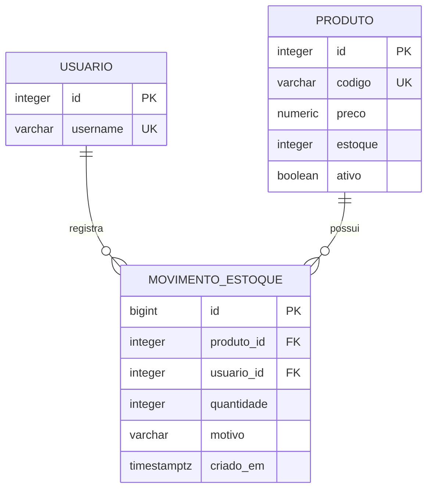

# Aula 15 — Modelagem de Produtos, Regras de Validação e Dublê em Memória (Fake)

**Duração:** 3h30. **Pré-requisito:** [Aula 14](14-Sessao-e-Perfis.md). **Entrega:** tabelas `produto` e `movimento_estoque` criadas no banco, modelo `Produto`, contrato inicial `IProdutoRepository`, validação completa em `ProdutoService.SalvarAsync` e testes executáveis de fronteira usando um repositório Fake em memória (sem tela de cadastro ainda).

| Bloco | Minutos | Atividade |
| --- | ---: | --- |
| Retomada | 15 | Revisar autorização de administrador e responsabilidades das camadas |
| Explicação | 30 | Relacionamentos (PK/FK), saldo vs histórico, `numeric(10,2)` e testes com Fake |
| Construção | 60 | Aplicar script `002-produtos.sql`, construir `Produto`, contrato e `ProdutoService` |
| Intervalo | 15 | Pausa |
| Prática | 60 | Construir `ProdutoEmMemoriaRepository` (Fake) e validar todas as fronteiras |
| Entrega | 30 | Demonstrar contador de chamadas do Fake, exceções e explicar o modelo ER |

---

## 1. Modelando Antes de Codificar: Por Que Duas Tabelas (`produto` e `movimento_estoque`)? (`A15.01`)

Antes de escrever C#, observe o modelo relacional do script [database/002-produtos.sql](database/002-produtos.sql):



Entenda **os 4 motivos de engenharia** dessa modelagem:

1. **Por que separar `produto.estoque` (saldo) de `movimento_estoque` (histórico)?**
   - `produto.estoque` responde rapidamente *"quantas unidades temos na prateleira agora?"*.
   - `movimento_estoque` responde *"quem mudou, quando mudou, quanto entrou (`+`) ou saiu (`-`) e por qual motivo (`Reposicao` ou `Venda`)?"*.
   - As Chaves Estrangeiras (**FK** — `REFERENCES produto(id)` e `REFERENCES usuario(id)`) garantem que nunca exista um movimento apontando para um produto ou funcionário inexistente — mas **não** somam o estoque sozinhas (faremos a atualização conjunta em transação nas Aulas 18 e 20).
2. **Por que todo produto nasce com `estoque = 0` e não deixamos digitar saldo no cadastro?**
   - Se alguém digitasse "50" no cadastro inicial sem registrar um movimento de entrada, o saldo (`50`) nunca bateria com a soma do histórico (`0`). Toda entrada física de mercadoria passa por **Reposição** (Aula 18).
3. **Por que existe a coluna `ativo` (`boolean`) em vez de apagar produtos com `DELETE`?**
   - Se apagássemos fisicamente um produto que já foi vendido no mês passado, quebraríamos o histórico de vendas e relatórios! Por isso usamos **exclusão lógica** (`ativo = false`).
4. **Por que `codigo` é `varchar(30)` e `preco` é `numeric(10,2)`? (`A15.02`)**
   - Código `"000123"` precisa ser texto para preservar zeros à esquerda.
   - `numeric(10,2)` aceita **10 dígitos totais**, sendo **2 casas decimais** (ou seja, 8 dígitos antes da vírgula: máximo exato **`99.999.999,99`**).

---

## 2. Técnicas de Validação em C# Que Você Vai Construir (`A15.02` e `A15.03`)

Entenda os dois recursos do C# que tornam as validações de `ProdutoService` curtas, legíveis e exatas:

### 2.1 Padrão Relacional (`is < ... or > ...`)
Em vez de repetir o nome da variável (`if (nome.Length < 2 || nome.Length > 120)`), o C# moderno permite escrever:
```csharp
if (nome.Length is < 2 or > 120)
```
Lê-se naturalmente em inglês/português: *"se o tamanho de `nome` é menor que 2 ou maior que 120"*.

### 2.2 Recusando 3 Casas Decimais Sem Arredondar Silenciosamente
Se o usuário tentar enviar `1.999m`, o PostgreSQL (`numeric(10,2)`) poderia arredondar silenciosamente para `2.00`. **Por que não queremos arredondamento silencioso?** Em preços comerciais, o operador precisa ver o erro e corrigir!
Como detectar em C# se um `decimal` tem mais de duas casas decimais?
```csharp
if (decimal.Round(preco, 2) != preco)
```
- **Entenda o truque matemático:** se `preco` for `25.90m`, `decimal.Round(25.90m, 2)` dá `25.90m` (igual → válido!). Se `preco` for `1.999m`, `decimal.Round(1.999m, 2)` dá `2.00m` (`2.00m != 1.999m` → diferente → **recusado!**).

### 2.3 Por que Testar com um Repositório Fake em Memória (`Task.CompletedTask`)? (`A15.04`)
Ainda não escrevemos o SQL de produtos nem a tela de cadastro, mas graças à interface `IProdutoRepository`, podemos criar uma classe **Fake** (dublê em memória) que apenas conta quantas vezes `SalvarAsync` foi chamado (`Chamadas++`) e retorna **`Task.CompletedTask`** (uma tarefa assíncrona já concluída sem precisar de `await`).
- **O que isso comprova?** Se passarmos preço `0`, `1.999m`, nome vazio ou uma sessão de `Caixa`, o serviço deve lançar exceção **antes** de chamar o repositório — logo, `fake.Chamadas` **não pode aumentar**!

---

## 3. Roteiro de Construção Guiada (Sua Vez no Visual Studio 2022!)

### Passo 1 — Executar o Script `002-produtos.sql` no Banco
1. No SQL Editor do Neon (ou phpMyAdmin usando [database/mysql/002-produtos.sql](database/mysql/002-produtos.sql)), confira a branch/banco e execute [database/002-produtos.sql](database/002-produtos.sql) **uma única vez** (após o script 001).
2. Confirme executando `SELECT codigo, nome, preco, estoque, ativo FROM produto;` (retornará zero linhas).
3. Desenhe no seu caderno as relações entre `usuario`, `produto` e `movimento_estoque` com PK, FK, cardinalidades e dicionário de dados (`A15.01`).

### Passo 2 — Construir o Modelo `Models/Produto.cs`
Crie **`Models/Produto.cs`** em `namespace SupermercadoApp.Models;` declarando um `public sealed record Produto` com os 6 parâmetros posicionais exatamente nesta ordem:
`int Id, string Codigo, string Nome, decimal Preco, int Estoque, bool Ativo`.

### Passo 3 — Construir o Contrato Mínimo `Repositories/IProdutoRepository.cs`
Crie **`Repositories/IProdutoRepository.cs`** em `namespace SupermercadoApp.Repositories;` com **apenas** o método desta aula (não declare métodos de aulas futuras ainda!):
- `Task SalvarAsync(int id, string codigo, string nome, decimal preco);`

### Passo 4 — Construir o Serviço `Services/ProdutoService.cs`
Crie **`Services/ProdutoService.cs`** em `namespace SupermercadoApp.Services;`:
1. Declare `public sealed class ProdutoService(IProdutoRepository produtos)` (construtor primário recebendo o contrato).
2. Implemente o método **`public Task SalvarAsync(Sessao sessao, int id, string codigo, string nome, decimal preco)`** seguindo esta ordem rigorosa:
   - **Autorização:** chame `Permissoes.ExigirAdministrador(sessao);` primeiro de tudo!
   - **Normalização:** aplique `.Trim()` em `codigo` e em `nome`.
   - **Validação de ID e tamanhos:** se `id < 0` ou `codigo.Length is < 1 or > 30` ou `nome.Length is < 2 or > 120`, lance `ArgumentException` informando os limites (`id == 0` indica inclusão de novo produto; negativo é inválido).
   - **Validação monetária:** se `preco <= 0` ou `preco > 99999999.99m` ou `decimal.Round(preco, 2) != preco`, lance `ArgumentException`.
   - **Delegação:** só após passar por **todas** as barreiras acima, retorne `produtos.SalvarAsync(id, codigo, nome, preco);`.

### Passo 5 — Construir o Dublê `ProdutoEmMemoriaRepository` e Provar as Fronteiras (`A15.02`–`A15.05`)
1. Crie uma classe temporária `ProdutoEmMemoriaRepository : IProdutoRepository` com:
   - `public int Chamadas { get; private set; }`
   - Propriedades opcionais `UltimoCodigo`, `UltimoNome`, `UltimoPreco` para inspecionar o que chegou após `.Trim()`.
   - Dentro de `SalvarAsync`: incremente `Chamadas++`, salve os valores recebidos e retorne `Task.CompletedTask;`.
2. Conecte temporariamente o serviço com esse Fake em `Program.cs` / `FormAdministrador` (ou em um botão temporário de verificação que será removido após o teste) e execute **todos os casos de fronteira da tabela abaixo**:

| Entrada testada | Resultado esperado | Efeito em `fake.Chamadas` |
| --- | --- | --- |
| Válido: admin, ID `0`, `" 000123 "`, `" Arroz "`, `25.90m` | Aceita; salva `"000123"` e `"Arroz"` | Aumenta (+1) |
| Preço `0` / `0.01m` / `1.999m` | Recusa / Aceita / Recusa | Só `0.01m` aumenta |
| Preço `99999999.99m` / `100000000m` | Aceita / Recusa | Só o máximo aumenta |
| Nome com `1` / `2` / `120` / `121` caracteres | Recusa / Aceita / Aceita / Recusa | Só `2` e `120` aumentam |
| Código (após Trim) com `0` / `1` / `30` / `31` caracteres | Recusa / Aceita / Aceita / Recusa | Só `1` e `30` aumentam |
| ID `-1` / `0` | Recusa / Aceita | Só `0` aumenta |
| Sessão de `Caixa` com dados válidos | Lança `UnauthorizedAccessException` | **Não aumenta!** |

3. **Primeira asserção executável (reaproveitada na Aula 24):** após rodar 1 caso válido seguido de vários inválidos, escreva uma verificação automática:
   ```csharp
   if (fake.Chamadas != 1)
       throw new Exception("Validação falhou e chegou indevidamente ao repositório!");
   ```
4. **Limpeza importante antes da Aula 16:** após registrar as evidências, remova o botão temporário e **remova `ProdutoEmMemoriaRepository.cs` de dentro do projeto `SupermercadoApp`** (guarde uma cópia do arquivo fora da pasta do projeto para reutilizar no projeto de verificações da Aula 24). **Por quê?** Na Aula 16 adicionaremos `ListarAsync` ao contrato `IProdutoRepository` — deixar um Fake antigo incompleto dentro de `SupermercadoApp` causaria erro de compilação `CS0535`!

[Anterior: Aula 14](14-Sessao-e-Perfis.md) · [Próxima: Aula 16 — Consulta de produtos](16-Consulta-de-Produtos.md) · [Índice](README.md)

## Atividades por conceito

Realize as atividades da [aula 15 no caderno complementar](ATIVIDADES-POR-CONCEITO.md#aula-15). Cada conceito tem enunciado e critério de aceite. Reúna as evidências em uma entrega por aula, usando os IDs no [caderno de evidências](CADERNO-DE-EVIDENCIAS.md). Essas tarefas integram a prática e a verificação já previstas no encontro.
