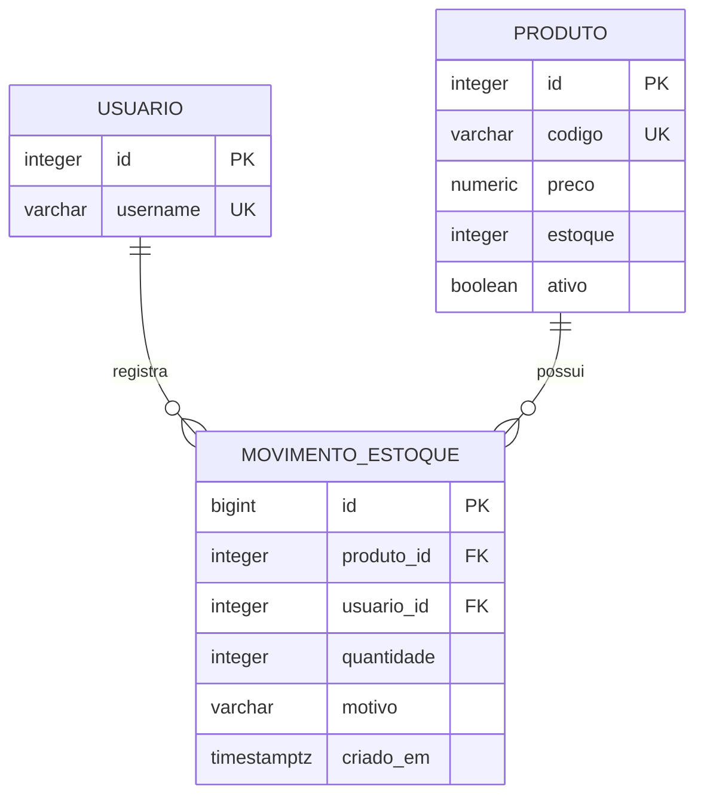

# Aula 16 — Modelagem de Produtos, Regras de Validação e Testes com Fake em Memória

**Duração:** 3h30. **Pré-requisito:** [Aula 15](15-Sessao-e-Perfis.md). **Entrega:** tabelas `produto` e `movimento_estoque` criadas no banco, modelo `Produto`, contrato `IProdutoRepository`, serviço `ProdutoService.SalvarAsync` e suíte executável de fronteiras usando um repositório **Fake** em memória (`A16.01`–`A16.05`).

| Bloco | Minutos | Atividade |
| --- | ---: | --- |
| Retomada | 15 | Revisar autorização de administrador e as 5 camadas da Aula 08 |
| Explicação | 30 | PK/FK, saldo vs histórico, `numeric(10,2)`, padrão `is < ... or > ...` e dublê Fake |
| Construção | 60 | Aplicar `002-produtos.sql` e construir `Produto`, `IProdutoRepository` e `ProdutoService` |
| Intervalo | 15 | Pausa |
| Prática | 60 | Construir `ProdutoEmMemoriaRepository` (Fake) e executar todos os testes de fronteira |
| Entrega | 30 | Demonstrar contador de chamadas do Fake, asserção executável e modelo ER |

---

## 1. Modelagem Relacional (`database/002-produtos.sql`) Dissecada (`A16.01`)

Antes de escrever C#, observe o diagrama e o script completo [database/002-produtos.sql](database/002-produtos.sql):



```sql
BEGIN;

CREATE TABLE produto (
    id      integer       GENERATED ALWAYS AS IDENTITY PRIMARY KEY,
    codigo  varchar(30)   NOT NULL UNIQUE CHECK (length(trim(codigo)) > 0),
    nome    varchar(120)  NOT NULL CHECK (length(trim(nome)) >= 2),
    preco   numeric(10,2) NOT NULL CHECK (preco > 0),
    estoque integer       NOT NULL DEFAULT 0 CHECK (estoque >= 0),
    ativo   boolean       NOT NULL DEFAULT true
);

CREATE TABLE movimento_estoque (
    id         bigint      GENERATED ALWAYS AS IDENTITY PRIMARY KEY,
    produto_id integer     NOT NULL REFERENCES produto(id),
    usuario_id integer     NOT NULL REFERENCES usuario(id),
    quantidade integer     NOT NULL CHECK (quantidade <> 0),
    motivo     varchar(20) NOT NULL CHECK (motivo IN ('Reposicao', 'Venda')),
    criado_em  timestamptz NOT NULL DEFAULT now()
);

COMMIT;
```

### Os 4 Motivos de Engenharia Dessa Modelagem
1. **Saldo (`produto.estoque`) vs Histórico (`movimento_estoque`):** o saldo responde rápido *"quantos temos agora?"*; o histórico registra *quem*, *quando*, *quanto* (`+` entrada ou `-` saída) e *por quê* (`Reposicao` ou `Venda`).
2. **Todo produto nasce com `estoque = 0` (`DEFAULT 0`):** nunca deixamos digitar estoque inicial solto no cadastro, para que toda entrada física gere um movimento de auditoria (Aula 19).
3. **Exclusão lógica (`ativo boolean DEFAULT true`):** nunca apagamos produtos com `DELETE`, preservando chaves estrangeiras (`FK`) das vendas históricas.
4. **Código textual e `numeric(10,2)` (`A16.02`):** `"000123"` preserva zeros à esquerda; `numeric(10,2)` permite exatamente 8 dígitos inteiros + 2 decimais (máximo exato **`99.999.999,99`**).

---

## 2. Técnicas de Validação em C# Que Vamos Aplicar

- **Padrão relacional (`is < 2 or > 120`):** forma legível de escrever `nome.Length < 2 || nome.Length > 120`.
- **Recusar 3 casas decimais sem arredondar silenciosamente:**
  ```csharp
  if (decimal.Round(preco, 2) != preco) // 25.90m == 25.90m (OK) | 1.999m != 2.00m (RECUSA!)
  ```
- **Repositório Fake em memória (`Task.CompletedTask`):** graças à interface `IProdutoRepository`, testamos todas as regras de `ProdutoService` **sem internet e sem SQL**, contando em `fake.Chamadas` quantas vezes o serviço deixou a chamada chegar ao repositório!

---

## 3. Código Completo e Compilável desta Etapa (4 Arquivos + Testes)

### Passo 1 — Aplicar o Script `002-produtos.sql`
No SQL Editor do Neon (ou phpMyAdmin usando [database/mysql/002-produtos.sql](database/mysql/002-produtos.sql)), execute `002-produtos.sql` **uma única vez** e confira com `SELECT codigo, nome, preco, estoque, ativo FROM produto;` (deve retornar 0 linhas).

### Arquivo 1: `Models/Produto.cs`

```csharp
namespace SupermercadoApp.Models;

public sealed record Produto(
    int Id,
    string Codigo,
    string Nome,
    decimal Preco,
    int Estoque,
    bool Ativo);
```

### Arquivo 2: `Repositories/IProdutoRepository.cs` (Contrato Inicial)

```csharp
namespace SupermercadoApp.Repositories;

public interface IProdutoRepository
{
    Task SalvarAsync(int id, string codigo, string nome, decimal preco);
}
```

### Arquivo 3: `Services/ProdutoService.cs` (Regras de Negócio e Autorização)

```csharp
using SupermercadoApp.Models;
using SupermercadoApp.Repositories;

namespace SupermercadoApp.Services;

public sealed class ProdutoService(IProdutoRepository produtos)
{
    public Task SalvarAsync(Sessao sessao, int id, string codigo, string nome, decimal preco)
    {
        // 1. Autorização SEMPRE primeiro!
        Permissoes.ExigirAdministrador(sessao);

        // 2. Normalização de espaços nas bordas:
        codigo = codigo.Trim();
        nome = nome.Trim();

        // 3. Validação de ID e tamanhos (id == 0 significa inclusão de novo produto):
        if (id < 0 || codigo.Length is < 1 or > 30 || nome.Length is < 2 or > 120)
            throw new ArgumentException("Informe código (1 a 30) e nome (2 a 120 caracteres).");

        // 4. Validação monetária exata (sem arredondar 1,999m silenciosamente!):
        if (preco <= 0 || preco > 99999999.99m || decimal.Round(preco, 2) != preco)
            throw new ArgumentException("Preço deve ser positivo, com até duas casas decimais.");

        // 5. Só chega ao repositório se passou por TODAS as barreiras acima!
        return produtos.SalvarAsync(id, codigo, nome, preco);
    }
}
```

### Arquivo 4 (Temporário para Teste — `A16.04`): `ProdutoEmMemoriaRepository.cs`

```csharp
using SupermercadoApp.Repositories;

namespace SupermercadoApp.Repositories;

public sealed class ProdutoEmMemoriaRepository : IProdutoRepository
{
    public int Chamadas { get; private set; }
    public string UltimoCodigo { get; private set; } = "";
    public string UltimoNome { get; private set; } = "";
    public decimal UltimoPreco { get; private set; }

    public Task SalvarAsync(int id, string codigo, string nome, decimal preco)
    {
        Chamadas++;
        UltimoCodigo = codigo;
        UltimoNome = nome;
        UltimoPreco = preco;
        return Task.CompletedTask; // Tarefa assíncrona já concluída em memória!
    }
}
```

### Exemplo Prático Completo — Executando Todas as Fronteiras + Primeira Asserção (`A16.02`–`A16.04`)

Você pode rodar este método de verificação em um botão temporário no `FormAdministrador` (ou em um projeto console de teste) para comprovar **todas** as fronteiras sem tocar no banco:

```csharp
async Task VerificarRegrasProdutosAsync()
{
    var fake = new ProdutoEmMemoriaRepository();
    var servico = new ProdutoService(fake);
    var admin = new Sessao(1, "admin", Perfil.Administrador);
    var caixa = new Sessao(2, "caixa", Perfil.Caixa);

    // 1. Caso VÁLIDO com espaços externos -> deve chamar fake (Chamadas vai para 1):
    await servico.SalvarAsync(admin, 0, " 000123 ", " Arroz ", 25.90m);
    if (fake.Chamadas != 1 || fake.UltimoCodigo != "000123" || fake.UltimoNome != "Arroz")
        throw new Exception("Falha no caso válido / Trim!");

    // 2. Casos de FRONTEIRA INVÁLIDOS -> nenhum pode incrementar fake.Chamadas!
    async Task ExigirErro<TEx>(Func<Task> acao, string caso) where TEx : Exception
    {
        try { await acao(); throw new Exception($"Deveria recusar: {caso}"); }
        catch (TEx) { /* Recusado corretamente! */ }
    }

    await ExigirErro<ArgumentException>(() => servico.SalvarAsync(admin, 0, "000123", "Arroz", 0m), "preço 0");
    await ExigirErro<ArgumentException>(() => servico.SalvarAsync(admin, 0, "000123", "Arroz", 1.999m), "3 casas decimais");
    await ExigirErro<ArgumentException>(() => servico.SalvarAsync(admin, 0, "000123", "Arroz", 100000000m), "acima do máximo");
    await ExigirErro<ArgumentException>(() => servico.SalvarAsync(admin, -1, "000123", "Arroz", 10m), "ID negativo");
    await ExigirErro<ArgumentException>(() => servico.SalvarAsync(admin, 0, "", "Arroz", 10m), "código vazio");
    await ExigirErro<ArgumentException>(() => servico.SalvarAsync(admin, 0, "000123", "A", 10m), "nome com 1 letra");
    await ExigirErro<UnauthorizedAccessException>(() => servico.SalvarAsync(caixa, 0, "000123", "Arroz", 10m), "sessão de Caixa");

    // 3. Caso limite máximo válido (0,01 e 99.999.999,99):
    await servico.SalvarAsync(admin, 0, new string('1', 30), new string('A', 120), 99999999.99m);
    await servico.SalvarAsync(admin, 0, "1", "AB", 0.01m);

    if (fake.Chamadas != 3)
        throw new Exception($"Esperava exatamente 3 chamadas válidas, mas ocorreram {fake.Chamadas}!");

    MessageBox.Show("Todas as verificações de fronteira passaram! Chamadas válidas no Fake: 3.");
}
```

> [!WARNING]
> **Limpeza antes da Aula 17:** após registrar as evidências, **remova `ProdutoEmMemoriaRepository.cs`** do projeto `SupermercadoApp` (guarde fora da pasta para reutilizar na Aula 25), pois na Aula 17 adicionaremos `ListarAsync` em `IProdutoRepository` — deixar o Fake antigo dentro do projeto causaria erro `CS0535`!

[Anterior: Aula 15](15-Sessao-e-Perfis.md) · [Próxima: Aula 17 — Consulta de produtos](17-Consulta-de-Produtos.md) · [Índice](README.md)

## Atividades por conceito

Realize as atividades da [aula 16 no caderno complementar](ATIVIDADES-POR-CONCEITO.md#aula-16). Cada conceito tem enunciado e critério de aceite. Reúna as evidências em uma entrega por aula, usando os IDs no [caderno de evidências](CADERNO-DE-EVIDENCIAS.md). Essas tarefas integram a prática e a verificação já previstas no encontro.
