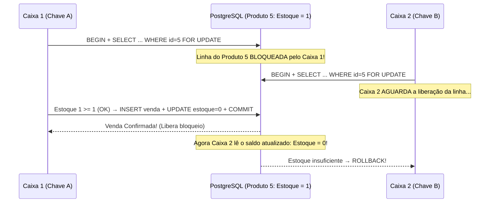

# Aula 21 — Persistência da Venda: Transação Atômica, Bloqueios e Idempotência

**Duração:** 3h30. **Pré-requisito:** [Aula 20](20-Carrinho-do-Caixa.md). **Entrega:** tabelas `venda` e `venda_item` criadas, serviço e repositório transacional de venda construídos por você, com provas reais de atomicidade (rollback após escrita), disputa concorrente pelo último item e idempotência por `Guid` (o fluxo visual definitivo de pagamento/troco entra na Aula 22).

| Bloco | Minutos | Atividade |
| --- | ---: | --- |
| Retomada | 15 | Relembrar que o carrinho da Aula 20 não reserva estoque no banco |
| Explicação | 30 | Snapshot histórico, idempotência (`Guid`), `advisory lock`, `FOR UPDATE` e deadlock |
| Construção | 60 | Paradas 1 e 2: aplicar script 003, construir modelos, contrato, serviço e bloqueios |
| Intervalo | 15 | Pausa |
| Prática | 60 | Paradas 3 e 4: concluir `VendaRepository` e executar ensaios de concorrência/rollback |
| Entrega | 30 | Conferir contagens SQL antes/depois e explicar cada etapa da transação |

---

## 1. Os 5 Desafios Reais de Uma Venda de Supermercado (Entenda o "Por Quê" Antes do Código)

Esta é a aula tecnicamente mais rica do curso. Antes de abrir o Visual Studio 2022, entenda **por que** uma venda profissional precisa de cada uma dessas 5 defesas:

### 1.1 Snapshot Histórico em `venda_item` (`A21.01`)
Abra [database/003-vendas.sql](database/003-vendas.sql). Note que `venda_item` grava `nome` e `preco_unitario` além de `produto_id`.
**Por quê?** Se hoje você vende Arroz a `R$ 25,90` e amanhã o administrador sobe o preço do Arroz para `R$ 30,00`, o comprovante da venda de ontem **não pode mudar para R$ 30,00**! Copiar nome e preço no item congela o retrato histórico daquele momento.

### 1.2 Autoridade do Preço no Banco (`PedidoItem`) (`A21.02`)
`VendaService` converte o carrinho em um array de `PedidoItem(ProdutoId, Quantidade)` — **sem enviar o preço da tela** para o `VendaRepository`!
**Por quê?** Entre o momento em que o caixa bipou o item e clicou em Finalizar, o administrador pode ter atualizado o preço (ou alguém pode ter alterado a memória do cliente). O repositório lê o preço oficial direto da tabela `produto` dentro da transação.

### 1.3 Idempotência com `Guid` + `pg_advisory_xact_lock` (`A21.03` e `A21.08`)
Imagine que o caixa clique em Finalizar, a internet oscile e o caixa tente enviar a mesma venda de novo.
- Cada intenção de compra recebe um identificador único universal (**`Guid` / `uuid`**) chamado `operacao`.
- No início da transação, chamamos **`SELECT pg_advisory_xact_lock(hashtextextended(@op, 0))`**: se duas requisições chegarem no **mesmo milissegundo** com o **mesmo `Guid`**, a segunda fica esperando em fila até a primeira terminar.
- Logo depois, consultamos `SELECT id, total, recebido FROM venda WHERE operacao=@op AND usuario_id=@usuario`. Se a venda já foi gravada, devolvemos imediatamente o resultado existente **sem gravar de novo nem baixar estoque duas vezes**! Isso é **Idempotência**.

### 1.4 Concorrência pelo Último Item (`FOR UPDATE`) e Prevenção de Deadlock (`A21.04` e `A21.06`)

- **Por que ordenar os itens por `ProdutoId` crescente (`itens.OrderBy(i => i.ProdutoId)`) antes do `FOR UPDATE`?**
  Se o Caixa 1 travasse o Produto `10` e pedisse o Produto `2`, enquanto o Caixa 2 travasse o Produto `2` e pedisse o Produto `10`, os dois ficariam esperando um pelo outro para sempre (**Deadlock**!). Quando todos os caixas sempre bloqueiam os produtos em ordem crescente (`2` primeiro, depois `10`), o bloqueio circular fica eliminado!

### 1.5 Por Que `INSERT ... RETURNING id` e NUNCA `SELECT MAX(id)`? (`A21.07`)
Se dois caixas inserem vendas quase juntos, `SELECT MAX(id)` pode devolver ao Caixa 1 o ID da venda que o Caixa 2 acabou de criar! Já `INSERT INTO venda(...) VALUES (...) RETURNING id` devolve atomicamente o ID exato da linha que **este** comando inseriu.

---

## 2. Roteiro de Construção Guiada em 4 Paradas (Sua Vez no VS 2022!)

Trabalhe nas 4 paradas abaixo, compilando (`Ctrl+Shift+B`) ao final de cada uma:

### Parada 1 — Esquema SQL, Modelos e Contrato (`Models/` e `Repositories/`)
1. No SQL Editor (após conferir branch/banco), execute [database/003-vendas.sql](database/003-vendas.sql) **uma vez** (após 001 e 002).
2. Crie os 3 records em **`Models/`** (`namespace SupermercadoApp.Models;`):
   - **`PedidoItem.cs`:** `public sealed record PedidoItem(int ProdutoId, int Quantidade);`
   - **`VendaConfirmada.cs`:** `public sealed record VendaConfirmada(int Id, decimal Total, decimal Recebido)` com a propriedade calculada `public decimal Troco => Recebido - Total;`.
   - **`ResumoVenda.cs`:** `public sealed record ResumoVenda(int Id, DateTime DataUtc, string Operador, decimal Total);` *(será usado no relatório da Aula 23)*.
3. Crie **`Repositories/IVendaRepository.cs`** com os 2 métodos desta aula (deixe `RelatorioAsync` para a Aula 23):
   - `Task<VendaConfirmada?> BuscarAsync(Guid operacao);`
   - `Task<VendaConfirmada> FinalizarAsync(Guid operacao, int usuarioId, IReadOnlyList<PedidoItem> itens, decimal recebido);`

### Parada 2 — Evoluir `Services/VendaService.cs`
Atualize o construtor primário para `public sealed class VendaService(IVendaRepository vendas, IProdutoRepository produtos)` *(aguarde até o fim da Parada 3 para atualizar `Program.cs`, depois que `VendaRepository` existir)*:
1. Mantenha `BuscarProdutoAsync`.
2. Adicione **`ConsultarAsync(Sessao sessao, Guid operacao)`:** exija `Permissoes.ExigirCaixa(sessao)` e retorne `vendas.BuscarAsync(operacao)`.
3. Adicione **`FinalizarAsync(Sessao sessao, Guid operacao, IReadOnlyList<ItemCarrinho> itens, decimal recebido)`:**
   - Exija `Permissoes.ExigirCaixa(sessao);`.
   - Valide que `operacao != Guid.Empty`, `itens.Count > 0` e nenhum item tem `Quantidade <= 0` (`!itens.Any(i => i.Quantidade <= 0)`).
   - Valide que não há `ProdutoId` repetido (`itens.Select(i => i.ProdutoId).Distinct().Count() != itens.Count`).
   - Valide `recebido`: não negativo, `<= 9999999999.99m` e no máximo 2 casas decimais (`decimal.Round(recebido, 2) == recebido`).
   - Projete apenas os IDs e quantidades com `itens.Select(i => new PedidoItem(i.ProdutoId, i.Quantidade)).ToArray()` e retorne `vendas.FinalizarAsync(operacao, sessao.Id, ..., recebido)`.

### Parada 3 — Construir `Repositories/VendaRepository.cs` e Atualizar `Program.cs`
Crie **`Repositories/VendaRepository.cs`** (`public sealed class VendaRepository(NpgsqlDataSource banco) : IVendaRepository`):
1. **`BuscarAsync(Guid operacao)`:** execute `SELECT id, total, recebido FROM venda WHERE operacao=@op`, devolvendo `new VendaConfirmada(...)` se `ReadAsync()` for `true`, ou `null`.
2. **`FinalizarAsync(Guid operacao, int usuarioId, IReadOnlyList<PedidoItem> itens, decimal recebido)`** — construa exatamente nesta ordem:
   1. Abra conexão e transação (`await using var conexao = ...`, `await using var transacao = ...`).
   2. Execute o advisory lock: `SELECT pg_advisory_xact_lock(hashtextextended(@op, 0))` passando `operacao.ToString()`.
   3. Consulte se já existe venda para `operacao=@op AND usuario_id=@usuario`; se encontrar, retorne `new VendaConfirmada(...)` imediatamente (idempotência!).
   4. Percorra `foreach (var item in itens.OrderBy(i => i.ProdutoId))`:
      - Execute `SELECT nome, preco, estoque, ativo FROM produto WHERE id=@id FOR UPDATE` (passando `conexao, transacao`).
      - Se não encontrar, ou `!ativo`, ou `estoque < item.Quantidade`, lance `InvalidOperationException`.
      - Guarde os dados oficiais do banco em uma lista `confirmados` (`List<ItemCarrinho>`).
   5. Calcule `decimal total = confirmados.Sum(i => i.Subtotal);`. Se `total <= 0 || total > 9999999999.99m || recebido < total`, lance `InvalidOperationException` informando o total atualizado.
   6. Insira o cabeçalho: `INSERT INTO venda(operacao, usuario_id, total, recebido) VALUES (@op, @usuario, @total, @recebido) RETURNING id`, capturando `int vendaId = (int)(await cmd.ExecuteScalarAsync())!;`.
   7. Percorra `confirmados` e, para cada item (na mesma `conexao` e `transacao`), execute:
      - `INSERT INTO venda_item(venda_id, produto_id, nome, quantidade, preco_unitario) VALUES (...)`
      - `UPDATE produto SET estoque = estoque - @q WHERE id = @produto`
      - `INSERT INTO movimento_estoque(produto_id, usuario_id, quantidade, motivo) VALUES (@produto, @usuario, -@q, 'Venda')`
   8. Execute **`await transacao.CommitAsync();`** uma única vez ao final e retorne `new VendaConfirmada(vendaId, total, recebido)`.
3. **Conectar em `Program.cs`:** agora que `VendaRepository` existe, atualize a composição para `var vendaService = new VendaService(new VendaRepository(banco), produtos);` e pressione `Ctrl+Shift+B` para confirmar compilação limpa!

### Parada 4 — Chamada Controlada e Ensaios de Laboratório (`A21.01`–`A21.08`)
Adicione temporariamente em `FormCaixa` um campo `private Guid operacao = Guid.NewGuid();` e um botão de teste que chama `vendas.FinalizarAsync(sessao, operacao, carrinho.Itens, 100m)` exibindo `resultado.Id`, `resultado.Total` e `operacao` *(esse botão será substituído pelo pagamento completo na Aula 22)*.

Execute e registre evidências reais (contagens e saldos antes/depois no SQL Editor):
1. **Repetição com o mesmo `Guid` (`A21.03`):** clique duas vezes no botão de teste com o mesmo carrinho → deve devolver o **mesmo ID** e apenas **uma** baixa de estoque!
2. **Snapshot histórico (`A21.01`):** após confirmar uma venda, altere o preço do produto como Administrador e consulte `venda_item` → o preço histórico da venda permanece o antigo!
3. **Concorrência no último item (`A21.06`):** com um produto de estoque `1` e duas instâncias abertas com contas de `Caixa` diferentes (chaves distintas), finalize ambos → exatamente 1 confirma, 1 recusa, saldo final `0`, sem cabeçalho órfão!
4. **Rollback real após escrita (`A21.05`):** siga com o professor o procedimento [Rollback após alteração real](VALIDACAO-MANUAL.md#rollback-após-alteração-real) (gatilho que falha **depois** de inserir cabeçalho, item e atualizar estoque). Comprove que todas as tabelas voltaram às contagens iniciais, remova o gatilho e confirme a venda.

Consulte também a documentação oficial de [Bloqueios no PostgreSQL](https://www.postgresql.org/docs/current/explicit-locking.html).

[Anterior: Aula 20](20-Carrinho-do-Caixa.md) · [Próxima: Aula 22 — Finalização e troco](22-Finalizacao-e-Troco.md) · [Índice](README.md)

## Atividades por conceito

Realize as atividades da [aula 21 no caderno complementar](ATIVIDADES-POR-CONCEITO.md#aula-21). Cada conceito tem enunciado e critério de aceite. Reúna as evidências em uma entrega por aula, usando os IDs no [caderno de evidências](CADERNO-DE-EVIDENCIAS.md). Essas tarefas integram a prática e a verificação já previstas no encontro.
