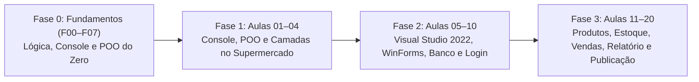

# C# na Prática com Visual Studio 2022: Do Zero ao Sistema de Supermercado (MarketFlow)

Guia progressivo e autoexplicativo para estudantes que estão **começando do absoluto zero** na linguagem **C#** utilizando o **Visual Studio 2022**. Ao longo do percurso, você aprenderá cada conceito de programação, o funcionamento da ferramenta e os **motivos técnicos** por trás de cada escolha, até construir por conta própria o **MarketFlow** — um aplicativo desktop Windows Forms com áreas separadas para **Administrador** e **Caixa**, conectado ao **Neon PostgreSQL** ou **MySQL/MariaDB pelo XAMPP**.

---

## Como este guia funciona (Filosofia de Aprendizagem)

Este material foi desenhado com duas regras fundamentais:

1. **Explicação detalhada do "O quê", "Como" e "Por quê":** Nenhum comando, palavra-chave ou símbolo da linguagem C# aparece "por mágica". Cada capítulo explica detalhadamente o conceito, disseca a sintaxe usando pequenos modelos didáticos independentes e mostra **por que** fazemos daquela forma (e qual problema ocorreria se fizéssemos diferente).
2. **O guia orienta; você constrói:** Você não vai encontrar blocos prontos do sistema para "copiar e colar". Em vez disso, cada aula traz **orientações passo a passo no Visual Studio 2022** e uma **ficha estruturada de construção** (quais classes, métodos, validações e regras criar), para que você escreva o código com autonomia e entenda cada linha que produziu.

> [!TIP]
> **Onde está o código pronto?** A pasta `src/` deste repositório é de uso exclusivo do professor para conferência e execução das verificações automatizadas. Durante seus estudos, construa tudo pelas orientações dos capítulos — errar, ler o diagnóstico do Visual Studio 2022 e depurar faz parte do aprendizado.

---

## Mapa da Jornada (Do Zero ao Projeto Completo)

### Por onde começar

- **Se você nunca programou ou ainda não domina Orientação a Objetos:** comece obrigatoriamente pelo [**Guia Preparatório de Fundamentos (F00–F07)**](fundamentos/README.md). São oito encontros progressivos em Console no Visual Studio 2022, começando do zero absoluto até interfaces e polimorfismo.
- **Para reforçar Orientação a Objetos:** após a etapa F03, utilize o [**Laboratório de POO na Prática**](fundamentos/POO-na-Pratica.md) como exercício complementar no console.
- **Planejamento total sugerido:** **28 horas de fundamentos (8 encontros) + 70 horas do projeto (20 encontros) = 98 horas**. As aulas 01–03 do projeto aplicam e consolidam os fundamentos no domínio do supermercado; não substituem o percurso preparatório para turmas iniciantes.

### Documentos de apoio

1. Consulte o [**Plano de Aulas**](PLANO-DE-AULAS.md) para ver objetivos, distribuição dos 210 minutos por encontro, entregas e rubrica de avaliação.
2. Acompanhe as entregas de cada aula pelo [**Caderno de Atividades por Conceito**](ATIVIDADES-POR-CONCEITO.md) e registre seus testes no [**Caderno de Evidências**](CADERNO-DE-EVIDENCIAS.md).
3. Se você iniciou em uma versão antiga deste roteiro, leia primeiro o [**Guia de Transição**](TRANSICAO.md).
4. **Para professores:** consulte o [**Apoio ao Professor**](ensino/README.md), a [**Análise Pedagógica**](ANALISE-PEDAGOGICA.md), as [**Referências Técnicas**](REFERENCIAS.md), o [**Código de Referência Docente**](src/README.md) e os registros de validação ([VALIDACAO-MELHORIAS.md](VALIDACAO-MELHORIAS.md) e [VALIDACAO.md](VALIDACAO.md)). Para validar documentação e compilação da referência, utilize `tools/Validar-Material.ps1`.

---

## Escolha do Banco de Dados (A partir da Aula 07)

- **Trilha principal (Nuvem):** **Neon / PostgreSQL** com a biblioteca `Npgsql`.
- **Trilha alternativa (Local):** **MySQL / MariaDB pelo XAMPP** com a biblioteca `MySqlConnector`. Siga o guia [**Integração MySQL/MariaDB com XAMPP**](INTEGRACAO-MYSQL-XAMPP.md) para os scripts SQL e orientações de adaptação a partir da Aula 07.

---

## Sequência das 20 Aulas do Projeto MarketFlow (Após os Fundamentos)

| Aula | Tema e Guia de Construção | O que você vai construir ao final de 3h30 |
| --- | --- | --- |
| 01 | [Lógica e tipos no supermercado](01-Introducao-CSharp.md) | Programa de console com cálculos financeiros, decisões e laços |
| 02 | [Console, validação e depuração](02-Pratica-Console.md) | Caixa de console blindado contra entradas inválidas e depuração com Breakpoint |
| 03 | [Orientação a objetos aplicada](03-Orientacao-a-Objetos.md) | Classes de domínio, encapsulamento, composição, herança e polimorfismo |
| 04 | [Arquitetura em camadas e contratos](04-Arquitetura-e-Padroes.md) | Separação em responsabilidades, interface e injeção de dependência manual |
| 05 | [Ambiente e solução no Visual Studio 2022](05-Configuracao-Ambiente.md) | Solução Windows Forms estruturada em pastas e compilando |
| 06 | [Interface de login no Designer](06-Criando-Interface-Login.md) | Tela de login acessível pelo teclado com validação visual de campos |
| 07 | [Modelagem e banco de dados (Neon ou XAMPP)](07-Criando-Banco-Dados-Neon.md) | Tabela `usuario` com restrições de integridade e sem senha em texto puro |
| 08 | [Conexão assíncrona com o banco](08-Conectando-Banco-Dados.md) | Infraestrutura segura de pool de conexões e consulta sem congelar a tela |
| 09 | [Autenticação segura com hash](09-Autenticacao-Segura.md) | Primeiro administrador e fluxo de login verificando hash com salt |
| 10 | [Sessão, perfis e autorização](10-Sessao-e-Perfis.md) | Menus separados para Administrador e Caixa, com troca limpa de usuário |
| 11 | [Modelo e regras de produtos](11-Modelo-de-Produtos.md) | Tabelas de produto/movimento e serviço validado em memória com dublê (Fake) |
| 12 | [Consulta de produtos na grade](12-Consulta-de-Produtos.md) | Busca parametrizada exibida em `DataGridView` com carregamento assíncrono |
| 13 | [Cadastro, edição e inativação](13-Cadastro-de-Produtos.md) | Inclusão, atualização, tratamento de duplicidade e exclusão lógica |
| 14 | [Reposição de estoque com transação](14-Reposicao-de-Estoque.md) | Atualização atômica de saldo e histórico na mesma transação |
| 15 | [Carrinho do operador de caixa](15-Carrinho-do-Caixa.md) | Agrupamento de itens, cálculo de subtotal/total e remoção em memória |
| 16 | [Persistência de venda com transação](16-Venda-com-Transacao.md) | Venda atômica, bloqueio contra concorrência e proteção por idempotência |
| 17 | [Finalização, troco e falhas de rede](17-Finalizacao-e-Troco.md) | Máquina de estados do caixa, cálculo de troco e reconciliação de tentativa pendente |
| 18 | [Relatório de vendas por período](18-Relatorio-de-Vendas.md) | Consulta por intervalo semiaberto em UTC com totalização e contagem |
| 19 | [Cadastro de usuários pelo administrador](19-Cadastro-de-Usuarios.md) | Formulário de criação de contas reutilizando o serviço de autenticação |
| 20 | [Verificação e publicação local](20-Testes-e-Publicacao.md) | Testes automatizados com Fakes, roteiro manual e publicação executável |

---

## Decisões Arquiteturais e Escopo Didático

- **Um único projeto organizado em pastas por responsabilidade** (`Models`, `Services`, `Repositories`, `Infrastructure`, `Views`), **injeção de dependência manual** e **SQL parametrizado** diretamente com `Npgsql` (ou `MySqlConnector`). Por quê? Contêineres automáticos de injeção, múltiplos projetos e ORMs escondem o que acontece por baixo dos panos. Dominar os fundamentos explícitos primeiro torna qualquer framework futuro muito mais fácil de entender.
- **Escopo realista e concluível:** produtos em unidades inteiras e pagamento em dinheiro simulado com comprovante didático (*sem valor fiscal*). Integrações fiscais, balança, TEF/Pix e modo offline ficam como projetos de continuação.
- **Fronteira de segurança explicada com honestidade:** a ligação direta do aplicativo desktop ao banco de dados é um recorte de laboratório. Em sistemas comerciais, uma API no servidor protege a string de conexão e aplica autenticação/autorização fora da máquina do cliente. Isso é discutido explicitamente desde a [Aula 04](04-Arquitetura-e-Padroes.md).

---

## Ambiente Recomendado (Visual Studio 2022)

- **IDE:** **Visual Studio 2022 Community** (gratuito) com a carga de trabalho **Desenvolvimento para desktop com .NET** instalada.
- **SDK / .NET:** utilize a versão moderna do .NET suportada pelo laboratório da sua turma (**.NET 8 LTS** nativo no Visual Studio 2022; os arquivos de referência do repositório estão configurados em `global.json` para a faixa de validação do ambiente do professor). Sempre mantenha o mesmo SDK em todos os computadores da turma.
- **Pacotes NuGet utilizados no projeto:** `Npgsql` (ou `MySqlConnector`) e `Microsoft.Extensions.Identity.Core` (instalados nas Aulas 08 e 09). Consulte as [Referências Técnicas](REFERENCIAS.md) para detalhes de compatibilidade e documentação oficial da Microsoft.
